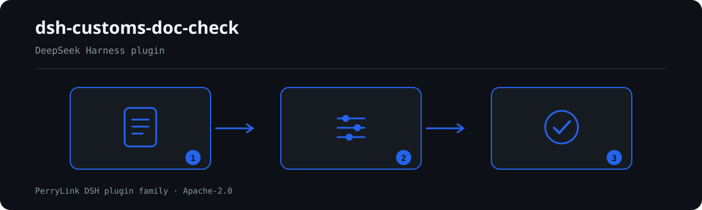

# dsh-customs-doc-check — Verificación de coherencia del registro de documentos de declaración aduanera

[English](README.md) · [简体中文](README-zh.md) · [Español](README-es.md) · [Português](README-pt.md) · [हिन्दी](README-hi.md)

[](https://dsh.market/)
[](https://dshfind.com/en/plugins/PerryLink/dsh-customs-doc-check?ref=badge)

`dsh-customs-doc-check` lee un registro de documentos de declaración (报关单证台账) —cuyos nombres de columna pueden estar en chino o en inglés— y comprueba ese registro en sí mismo, no la declaración que hay detrás: que cada fila traiga al menos uno de los dos, el nombre de la mercancía o el importe total; que el código de mercancía tenga diez dígitos y la moneda sea un código de tres letras; que no se repita ningún número de documento; que el peso bruto no sea inferior al peso neto; que la fecha de declaración, cuando consta, se pueda analizar y no sea posterior a la fecha de comprobación; y que no quede ningún marcador de plantilla sin sustituir en la columna del nombre de la mercancía.

## Install

```sh
dsh plugin --profile <name> add dsh-customs-doc-check
dsh --profile <name> --dump-config | grep 'dsh-customs-doc-check'
```

## Cómo se ve la salida



*Resumen del flujo: documento → reglas → hallazgos. Los ejemplos siguientes usan la superficie de comandos real.*


Salida real de este plugin sobre su propio fixture de prueba `CD-001` — no es un montaje. El paquete de reglas no inventa citas, así que cada hallazgo nombra la cláusula aplicada y advierte que su texto no se obtuvo.

## Qué responde

### Ejemplos

La tabla siguiente es el conjunto de ejemplos: la primera fila es el caso detallado y las demás son casos breves.


#### Salida detallada

**Herramienta** `customs_doc_check`

**Entrada**

~~~json
{"rows":[{"单证种类":"发票","商品名称":"","总价":"", ...}]}
~~~
 
**Salida**

~~~json
{
  "id": "dsh-customs-doc-check.CD-001.de09b5a6",
  "ruleId": "CD-001",
  "severity": "warn",
  "locator": {
    "row": 1,
    "field": "goodsName"
  },
  "found": "第 1 行 goodsName、amount 都为空",
  "expected": "goodsName、amount 至少应填写一项",
  "fix": "补填品名与总价；本条只核对是否填写，不判断申报内容是否真实"
}
~~~

*Observado en `dsh-customs-doc-check/tests/fixtures/CD-001/CD-001-unsafe.json; dsh-customs-doc-check/tests/fixtures/CD-001/cases.json; dsh-customs-doc-check/rules/customs-doc-check.yaml; dsh-customs-doc-check/tests/index.test.ts`*

| Usted pregunta | Qué responde |
|---|---|
| En una fila el nombre de la mercancía todavía dice `待填` y la casilla del importe está vacía, ¿se informa de algo? | `CD-001` no: solo exige que se rellene al menos uno de los dos, el nombre de la mercancía o el importe total, y `待填` no está en blanco. La regla que informa de esa fila es `CD-007`, que busca en la columna del nombre de la mercancía los marcadores de plantilla que el paquete enumera (`【`, `{{`, `XXX`, `待填`, `TBD` y similares). `CD-001` no juzga si el contenido declarado es veraz; `CD-007` solo busca esos términos en esa columna, y su lista de términos puede ajustarse a la plantilla propia. |
| El código de mercancía figura como `84713000`, ocho dígitos, ¿se informa? | Sí. `CD-002` contrasta la casilla con diez dígitos e informa de cualquier otro caso. Comprueba solo el número de dígitos y la legalidad de los caracteres, nunca si el código es el correcto: una misma mercancía puede llevar códigos distintos bajo decisiones de clasificación distintas. El número de dígitos es el parámetro `pattern` de la regla, modificable cuando el arancel cambie su número de dígitos. |
| La columna de moneda dice `RMB` en una fila y `usd` en otra, ¿qué fila se informa? | `usd`: `CD-003` solo acepta tres letras mayúsculas. `RMB` encaja en esa forma y pasa, porque la regla es una comprobación de forma y no el texto del artículo — la tabla de códigos a la que remite el artículo no se obtuvo, y la regla no toma partido entre las grafías `CNY` y `RMB` que la práctica aduanera también usa; estreche el `pattern` si su casa fija una sola. No juzga si la moneda elegida es la correcta para la liquidación. |
| El mismo número de documento aparece en dos filas, ¿qué dice la comprobación? | `CD-004` informa del número repetido; al comparar se ignoran los espacios. La unicidad es todo lo que establece la regla: un hallazgo suele significar que el mismo documento se registró dos veces o que se copió un número de otro documento, y cuál de los dos es erróneo debe confirmarlo una persona. No decide qué registro es el válido. |
| El peso bruto figura como `1,180` y el neto como `1,250`, ¿se detecta? ¿Y si una fila no tiene peso neto? | Lo primero se informa: `CD-005` compara los dos valores e informa de la fila en que el peso bruto es inferior al neto. Solo se comparan los números y se admiten unidades (`12.5KGS`), y la regla no juzga si el peso declarado es veraz. Una fila a la que le falta uno de los dos campos no se compara en absoluto; si eso deja sin nada que comparar, la regla pasa a `skipped` con su motivo en lugar de informarse como diferencia. |
| El registro no trae ninguna fecha de declaración y una fila tiene `2026-13-40`, ¿qué se informa? | La fecha imposible se informa: `CD-006` exige que la fecha se pueda analizar y que no sea posterior a la fecha de comprobación. Que falte la fecha de declaración no se informa como defecto — en el momento de declarar esa columna está 免予填报, la registra el sistema informático de aduanas y no el declarante, así que la regla solo comprueba la fecha cuando consta. Una fecha que no se puede analizar se informa por separado y nunca se omite en silencio, y la regla no juzga si la declaración se hizo dentro de un plazo legal. |

## Normas que sigue

| Documento | Número | Reglas que lo citan |
|---|---|---|
| 《中华人民共和国海关进出口货物报关单填制规范》 | 海关总署公告 2019 年第 18 号（本次未取得条文） | CD-001, CD-002, CD-005, CD-007 |
| 《表示货币的代码》 | GB/T 12406—2022（表示货币的代码；2022-12-30 发布并实施；全部代替 GB/T 12406—2008（该版名称为「表示货币和资金的代码」）——注意旧版名称含"资金"；修改采用 ISO 4217:2015，非等同采用；条号本次未取得） | CD-003 |
| 《中华人民共和国海关进出口货物申报管理规定》 | 海关总署令（现行令号本次未核实） | CD-004, CD-006 |

**Boundary:** this plugin checks a **报关单证台账** for what a register can be held to mechanically — that
the key columns are filled, that the commodity code and currency follow their formats, that document
numbers are unique, that gross weight is not below net weight, that dates parse, and that no template
placeholder survives. It does **not** decide whether a declaration is truthful, whether it amounts to
misdeclaration, whether it affects duty, or whether goods should be inspected or penalised. **Those calls
belong to Customs**, and the same goods may legitimately carry different codes under different
classification decisions. **This plugin never judges classification.**

> ### ⚠️ What the citations rest on
>
> **《中华人民共和国海关进出口货物报关单填制规范》was obtained in full and read article by article** (49 articles
> plus the closing definitions), and `rules/evidence/clause-verification.md` records what was quoted: article 34
> (the commodity code is **10 digits**), articles 5 and 6 (dates are **8 digits**, year-month-day, and — worth
> knowing — the declaration date is 「**在申报时免予填报**」, so a register lacking it is normal), article 39
> (currency is taken from the 《货币代码表》), articles 24–26 (packages, gross and net weight) and article 38.
> The **issuing facts were confirmed against the official announcement**: 《海关总署公告 2019 年第 18 号》,
> dated 2019-01-22, **in force from 2019-02-01, and it repealed 海关总署 2018 年第 60 号公告**, so citing that one
> is simply wrong. 《进（出）境货物备案清单》 is filled **比照** this specification.
>
> **Two claims were corrected as a result.** `CD-003` said currency "should be three letters" — the article says
> only 「按海关规定的《货币代码表》选择相应的货币名称及代码填报」, and that code table **was not obtained**, so
> three letters is an inference about the table's shape, not the article's wording. And `CD-006` now states the
> exemption above rather than implying a missing declaration date is a defect.
>
> **Every `excerpt` still says "本次未取得" and every rule stays `warn` or `info`** — deliberately. The
> specification governs **how the declaration form's columns are filled in**, while this plugin checks an
> enterprise's **supporting-document register**. A register is not a declaration form, so raising a rule to
> `direct` would dress a register gap up as a customs obligation. **《申报管理规定》and the various code tables
> (关区、运输方式、监管方式、货币、国别、港口 etc.) were all unobtained**, which is exactly why no code table is
> built in. The specification text itself was read from a **local trade-promotion council's reprint**, because the
> official attachment is a `.doc` and this tool cannot decode binary Office files.
>
> Two checks deserve a note of their own. The commodity-code check verifies **ten digits and nothing
> else** — the digit count comes from the current tariff, and the check never says whether a code is the
> *right* code. The currency check verifies **three upper-case letters**, and deliberately takes no
> position on `CNY` versus the `RMB` spelling that Customs practice also uses; narrow the pattern if your
> house style is one of them.

## Compatibility

| Superficie | Estado |
|---|---|
| Harness | Rango de peers `>=0.1.2-rc.1 <0.2.0 \|\| >=0.2.0-0 <0.3.0` — verificado para aceptar tanto `0.2.0-rc.2` como `0.2.1-rc.2`. **`engines.dsh` se declara como `>=0.2.1-0 <0.3.0`** y el host lo aplica desde 0.2.1 |
| Node | `^22.19.0 || >=24.0.0` |
| Plataformas | Todas (ESM puro; sin código nativo, sin red, sin llamada al modelo) |
| Modo de herramienta | Funciona en `native` y `ptc`; para un directorio completo use `ptc` |

## What it does

La tabla de reglas, los campos y el comportamiento detallado están en [README.md](README.md#what-it-does) (versión principal en inglés). El plugin sólo enumera divergencias literales frente a las cláusulas citadas e indica en `skipped` cada comprobación que no pudo ejecutarse.

## Configuration

Todos los parámetros ajustables viven en el esquema Schemastery de `src/config.ts`, por lo que se cambian desde `cordis.yml` sin tocar el código; los umbrales por regla están en el paquete de reglas bajo `rules/`.

| Clave | Tipo | Predeterminado | Descripción |
|---|---|---|---|
| `rulesFile` | string | `rules/customs-doc-check.yaml` | Ruta del paquete de reglas, relativa a la raíz del paquete |
| `disabledRules` | string[] | `[]` | Ids de reglas que se dejan de ejecutar; cada una aparece en `skipped` |
| `onlyRules` | string[] | `[]` | Ejecutar solo estas reglas; vacío ejecuta todas |
| `skipNotes` | string | `""` | Nota añadida a cada motivo de `skipped` |
| `timeoutMs` | number | `120000` | Presupuesto de tiempo de espera cooperativo de la herramienta |

## Material format

Acepta JSON o YAML. El ejemplo completo de campos está en [README.md](README.md#material-format) (versión principal en inglés). Los campos son opcionales en la capa de lectura y los valida el motor, de modo que una exportación parcial produce hallazgos sobre lo que falta en lugar de un fallo.

## Rule sources

Los datos de las reglas están separados del código: cada regla lleva documento, número, cláusula en la numeración propia de la fuente, extracto literal y URL de origen. El cargador impone que el extracto sea una cita real de al menos ocho caracteres y que una comprobación basada sólo en un principio general (`kind: derived-from-principle`, tope `warn`) o en una política local (`kind: institutional-configuration`, tope `info`) nunca se declare `error`.

Los límites verificados y las conclusiones deliberadamente **no** afirmadas están en [README.md](README.md#rule-sources) (versión principal en inglés) y en `rules/evidence/`.

## Troubleshooting

- **El plugin se instala pero la herramienta no aparece**: compruebe que `main` resuelve a `lib/index.mjs` y que `pnpm run build` lo generó.
- **`dsh plugin add` rechaza el paquete**: la faixa de peers cubre `0.1.x` y `0.2.x`; fuera de ella, conceda una exención explícita con `dsh plugin --profile <name> allow-version <pkg@ver> --dsh-version <runtime> --accept-risk`.
- **Una regla no se ejecutó**: lea el arreglo `skipped`.
- **`check` informa `manifest-peers` como fallo**: es un problema conocido de `dsh-plugin-dev`; el runtime aplica la compatibilidad al instalar.
- **Los horarios parecen desplazados**: toda la aritmética es de hora local sobre las cadenas entregadas.

## Development

```sh
pnpm install
pnpm run typecheck
pnpm test
pnpm run build
node ../scripts/sync-shared.mjs dsh-customs-doc-check
```

El último comando copia el kit compartido de `../_shared` a `src/shared/`; vuelva a ejecutarlo tras cada cambio compartido.

## PerryLink DSH Plugin Family

Este proyecto forma parte de la familia de plugins de DeepSeek Harness de [PerryLink](https://github.com/PerryLink). El registro permanece plegado abajo para que cada README conserve una primera pantalla corta; expándelo para ver cada fila y su estado.

<details>
<summary>Expandir todos los plugins</summary>

| Plugin | Estado |
|---|---|
| **[dsh-aqua-input-check](https://github.com/PerryLink/dsh-aqua-input-check)** |  |
| **[dsh-archive-check](https://github.com/PerryLink/dsh-archive-check)** |  |
| **[dsh-auto-review](https://github.com/PerryLink/dsh-auto-review)** |  |
| **[dsh-autotier](https://github.com/PerryLink/dsh-autotier)** |  |
| **[dsh-bid-ca-precheck](https://github.com/PerryLink/dsh-bid-ca-precheck)** |  |
| **[dsh-bid-qual-check](https://github.com/PerryLink/dsh-bid-qual-check)** |  |
| **[dsh-cert-mcp](https://github.com/PerryLink/dsh-cert-mcp)** |  |
| **[dsh-checkpoint-rewind](https://github.com/PerryLink/dsh-checkpoint-rewind)** |  |
| **[dsh-click](https://github.com/PerryLink/dsh-click)** |  |
| **[dsh-composer-history](https://github.com/PerryLink/dsh-composer-history)** |  |
| **[dsh-contract-stance](https://github.com/PerryLink/dsh-contract-stance)** |  |
| **[dsh-customs-doc-check](https://github.com/PerryLink/dsh-customs-doc-check)** |  |
| **[dsh-data-quality](https://github.com/PerryLink/dsh-data-quality)** |  |
| **[dsh-demurrage-ledger](https://github.com/PerryLink/dsh-demurrage-ledger)** |  |
| **[dsh-doublecheck](https://github.com/PerryLink/dsh-doublecheck)** |  |
| **[dsh-drill-script-check](https://github.com/PerryLink/dsh-drill-script-check)** |  |
| **[dsh-eia-guide-check](https://github.com/PerryLink/dsh-eia-guide-check)** |  |
| **[dsh-emergency-plan](https://github.com/PerryLink/dsh-emergency-plan)** |  |
| **[dsh-essay-rubric-check](https://github.com/PerryLink/dsh-essay-rubric-check)** |  |
| **[dsh-evidence-check](https://github.com/PerryLink/dsh-evidence-check)** |  |
| **[dsh-export-ctl-check](https://github.com/PerryLink/dsh-export-ctl-check)** |  |
| **[dsh-fast](https://github.com/PerryLink/dsh-fast)** |  |
| **[dsh-fmea-table-check](https://github.com/PerryLink/dsh-fmea-table-check)** |  |
| **[dsh-forecast-penalty](https://github.com/PerryLink/dsh-forecast-penalty)** |  |
| **[dsh-fund-research](https://github.com/PerryLink/dsh-fund-research)** |  |
| **[dsh-github](https://github.com/PerryLink/dsh-github)** |  |
| **[dsh-gongwen-flow-check](https://github.com/PerryLink/dsh-gongwen-flow-check)** |  |
| **[dsh-gongwen-word-check](https://github.com/PerryLink/dsh-gongwen-word-check)** |  |
| **[dsh-guard-plan-qc](https://github.com/PerryLink/dsh-guard-plan-qc)** |  |
| **[dsh-hazchem-check](https://github.com/PerryLink/dsh-hazchem-check)** |  |
| **[dsh-hazplan-check](https://github.com/PerryLink/dsh-hazplan-check)** |  |
| **[dsh-hidden-risk-map](https://github.com/PerryLink/dsh-hidden-risk-map)** |  |
| **[dsh-hs-classify](https://github.com/PerryLink/dsh-hs-classify)** |  |
| **[dsh-icd-rule-check](https://github.com/PerryLink/dsh-icd-rule-check)** |  |
| **[dsh-industry-research](https://github.com/PerryLink/dsh-industry-research)** |  |
| **[dsh-lawcite-adapter](https://github.com/PerryLink/dsh-lawcite-adapter)** |  |
| **[dsh-laya](https://github.com/PerryLink/dsh-laya)** |  |
| **[dsh-lc-doc-check](https://github.com/PerryLink/dsh-lc-doc-check)** |  |
| **[dsh-learning-gap-check](https://github.com/PerryLink/dsh-learning-gap-check)** |  |
| **[dsh-library](https://github.com/PerryLink/dsh-library)** |  |
| **[dsh-local-ai](https://github.com/PerryLink/dsh-local-ai)** |  |
| **[dsh-lsp-actions](https://github.com/PerryLink/dsh-lsp-actions)** |  |
| **[dsh-mask](https://github.com/PerryLink/dsh-mask)** |  |
| **[dsh-mcp-panel](https://github.com/PerryLink/dsh-mcp-panel)** |  |
| **[dsh-medrec-qc](https://github.com/PerryLink/dsh-medrec-qc)** |  |
| **[dsh-memento](https://github.com/PerryLink/dsh-memento)** |  |
| **[dsh-nsfc-form-check](https://github.com/PerryLink/dsh-nsfc-form-check)** |  |
| **[dsh-nurse-record-check](https://github.com/PerryLink/dsh-nurse-record-check)** |  |
| **[dsh-observe](https://github.com/PerryLink/dsh-observe)** |  |
| **[dsh-origin-rvc-check](https://github.com/PerryLink/dsh-origin-rvc-check)** |  |
| **[dsh-ota-review-check](https://github.com/PerryLink/dsh-ota-review-check)** |  |
| **[dsh-output-styles](https://github.com/PerryLink/dsh-output-styles)** |  |
| **[dsh-paper-doc-adapter](https://github.com/PerryLink/dsh-paper-doc-adapter)** |  |
| **[dsh-permission-rules](https://github.com/PerryLink/dsh-permission-rules)** |  |
| **[dsh-permit-report-check](https://github.com/PerryLink/dsh-permit-report-check)** |  |
| **[dsh-pipeline-check](https://github.com/PerryLink/dsh-pipeline-check)** |  |
| **[dsh-pleading-draft](https://github.com/PerryLink/dsh-pleading-draft)** |  |
| **[dsh-plugin-doctor](https://github.com/PerryLink/dsh-plugin-doctor)** |  |
| **[dsh-plugin-guide](https://github.com/PerryLink/dsh-plugin-guide)** |  |
| **[dsh-plugin-kit](https://github.com/PerryLink/dsh-plugin-kit)** |  |
| **[dsh-plugin-upgrade](https://github.com/PerryLink/dsh-plugin-upgrade)** |  |
| **[dsh-policy-brief-draft](https://github.com/PerryLink/dsh-policy-brief-draft)** |  |
| **[dsh-power-loss-split](https://github.com/PerryLink/dsh-power-loss-split)** |  |
| **[dsh-power-ticket-check](https://github.com/PerryLink/dsh-power-ticket-check)** |  |
| **[dsh-ppap-check](https://github.com/PerryLink/dsh-ppap-check)** |  |
| **[dsh-protest-deadline](https://github.com/PerryLink/dsh-protest-deadline)** |  |
| **[dsh-railway-window](https://github.com/PerryLink/dsh-railway-window)** |  |
| **[dsh-repair-order-qc](https://github.com/PerryLink/dsh-repair-order-qc)** |  |
| **[dsh-research-report](https://github.com/PerryLink/dsh-research-report)** |  |
| **[dsh-review-reply-check](https://github.com/PerryLink/dsh-review-reply-check)** |  |
| **[dsh-rulefile-check](https://github.com/PerryLink/dsh-rulefile-check)** |  |
| **[dsh-safety-brief-check](https://github.com/PerryLink/dsh-safety-brief-check)** |  |
| **[dsh-score](https://github.com/PerryLink/dsh-score)** |  |
| **[dsh-session-sync](https://github.com/PerryLink/dsh-session-sync)** |  |
| **[dsh-site-log-check](https://github.com/PerryLink/dsh-site-log-check)** |  |
| **[dsh-skill-pack-security](https://github.com/PerryLink/dsh-skill-pack-security)** |  |
| **[dsh-soe-decision-check](https://github.com/PerryLink/dsh-soe-decision-check)** |  |
| **[dsh-soilwater-check](https://github.com/PerryLink/dsh-soilwater-check)** |  |
| **[dsh-sop-sync-check](https://github.com/PerryLink/dsh-sop-sync-check)** |  |
| **[dsh-spc-gbt-adapter](https://github.com/PerryLink/dsh-spc-gbt-adapter)** |  |
| **[dsh-talk](https://github.com/PerryLink/dsh-talk)** |  |
| **[dsh-tender-extract](https://github.com/PerryLink/dsh-tender-extract)** |  |
| **[dsh-tender-matrix](https://github.com/PerryLink/dsh-tender-matrix)** |  |
| **[dsh-test-drive](https://github.com/PerryLink/dsh-test-drive)** |  |
| **[dsh-ticktick](https://github.com/PerryLink/dsh-ticktick)** |  |
| **[dsh-translate](https://github.com/PerryLink/dsh-translate)** |  |
| **[dsh-warranty-calc](https://github.com/PerryLink/dsh-warranty-calc)** |  |
| **[dsh-budget](https://github.com/PerryLink/dsh-budget)** | 🧊 CONGELADO — ver el README del repositorio |
| **[dsh-claude-move](https://github.com/PerryLink/dsh-claude-move)** | 🧊 CONGELADO — ver el README del repositorio |
| **[dsh-defend](https://github.com/PerryLink/dsh-defend)** | 🧊 CONGELADO — ver el README del repositorio |
| **[dsh-draw](https://github.com/PerryLink/dsh-draw)** | 🧊 CONGELADO — ver el README del repositorio |
| **[dsh-reach](https://github.com/PerryLink/dsh-reach)** | 🧊 CONGELADO — ver el README del repositorio |
| **[dsh-background-agents](https://github.com/PerryLink/dsh-background-agents)** | 🚫 RETIRADO — ver el README del repositorio |
| **[dsh-session-pin](https://github.com/PerryLink/dsh-session-pin)** | 🚫 RETIRADO — ver el README del repositorio |
| **[dsh-team-rooms](https://github.com/PerryLink/dsh-team-rooms)** | 🚫 RETIRADO — ver el README del repositorio |

</details>

## License

[Apache License 2.0](LICENSE) © 2026 dsh-customs-doc-check contributors.
