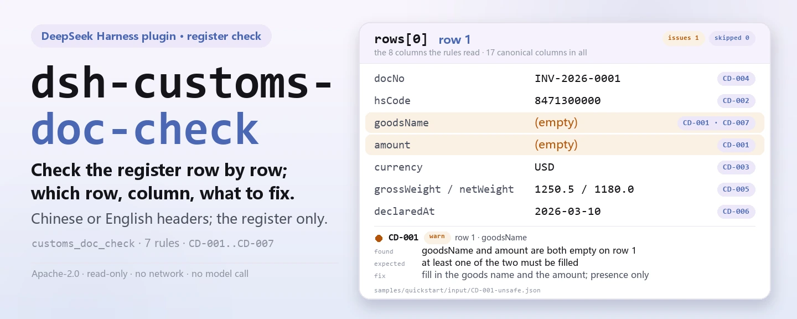

<div align="center">

<picture>
  <source media="(prefers-color-scheme: dark)" srcset="docs/assets/dsh-customs-doc-check-hero-en-dark.webp">
  
</picture>

# dsh-customs-doc-check

**Check a customs declaration register row by row — you get a list of which row, which column, and what to fix; the verdict stays with the reviewer.**

A data-only checker plugin for DeepSeek Harness: it reads one customs declaration document register (column names may be Chinese or English), applies the versioned rule pack it ships (CD-001..CD-007), and lists only the differences it can point to inside the material — never a compliance verdict, never a liability finding.

[Install](#three-step-setup) · [Configuration](#configuration) · [FAQ](#faq) · [简体中文](README.md) · [English](README.en.md) · [Español](README.es.md) · [Português](README.pt.md) · [हिन्दी](README.hi.md)

[](LICENSE)
[](#compatibility)
[](https://www.npmjs.com/package/dsh-customs-doc-check)
[](https://github.com/PerryLink/dsh-customs-doc-check/actions/workflows/ci.yml)
[](#compatibility)

[](https://github.com/PerryLink/dsh-customs-doc-check/stargazers)
[](https://www.npmjs.com/package/dsh-customs-doc-check)
[](https://dshfind.com/plugins/PerryLink/dsh-customs-doc-check?ref=badge)
[](https://securityscorecards.dev/viewer/?uri=github.com/PerryLink/dsh-customs-doc-check)
[](https://dsh.market/)
[](https://gitee.com/perrylink/dsh-customs-doc-check)

```sh
dsh plugin --profile <name> add dsh-customs-doc-check
```

</div>

<sub>Community plugin, not affiliated with DeepSeek. Canonical repository: <https://github.com/PerryLink/dsh-customs-doc-check> (Gitee is a mirror).</sub>

## What it is

`dsh-customs-doc-check` reads one declaration supporting-document register — a customs declaration register whose own column names may be Chinese or English — and checks that register itself rather than the declaration behind it: that each row carries at least one of the goods name and the amount, that the commodity code is ten digits and the currency a three-letter code, that no document number is repeated, that gross weight is not below net weight, that a declaration date, where one is recorded, parses and is not later than the check date, and that no unreplaced template placeholder survives in the goods-name column.

It does not decide whether a declaration is truthful, whether it amounts to misdeclaration, whether it affects duty, or whether goods should be inspected or penalised.

- **Who it is for**: customs declarants and trade document clerks; no command line required — hand the material over in chat.
- **What you give it**: the source material the check works on (a table, register, or document); the original is never modified. Excel can be converted to JSON/YAML first, in chat if the platform supports it.
- **What you get back**: a list of "which row, which column, what is missing, how to fix it"; every check that could not run is listed in `skipped` with its reason.

<picture>
  <source media="(prefers-color-scheme: dark)" srcset="docs/assets/dsh-customs-doc-check-flow-v5-dark.svg">
  
</picture>

## Three-step setup

1. **Install** (pick one channel):

   ```sh
   # git channel (latest main; equivalent to git+https://github.com/PerryLink/dsh-customs-doc-check.git)
   dsh plugin --profile <name> add github:PerryLink/dsh-customs-doc-check
   # npm channel (published releases)
   dsh plugin --profile <name> add dsh-customs-doc-check
   # tarball channel: pnpm pack in this repo, then
   dsh plugin --profile <name> add ./dsh-customs-doc-check-<version>.tgz
   ```

2. **Minimal config** (sane defaults; a bundle row without `config` uses every default, with the rule-pack path pointing at the bundled `rules/customs-doc-check.yaml`):

   ```yaml
   - insert:
       - id: dsh-customs-doc-check
         name: dsh-customs-doc-check
   ```

3. **Verify it mounts**:

   ```sh
   dsh --profile <name> --dump-config | grep 'dsh-customs-doc-check'
   ```

   Then run the bundled sample (needs `pnpm run build` first to produce `lib/`):

   ```sh
   node samples/quickstart/run.mjs --check
   ```

   Output (expected in `samples/quickstart/expected/result.json`):

   ```text
   customs_doc_check: 1 issue(s) — error 0, warn 1, info 0
   skipped: 0
   ```

   A screenshot is in `docs/assets/quickstart.png`.

**Uninstall**: `dsh plugin --profile <name> remove dsh-customs-doc-check` (or remove the row from the profile patch).

<details>
<summary>Use it in WorkBuddy / Coze</summary>

Search "Customs Compliance Suite" in WorkBuddy / Coze (this check is one part of it; availability as listed) to call the same checking capability without a command line.

</details>

<details>
<summary>Install from the DSH Desktop market</summary>

Every PerryLink plugin is listed in the built-in DSH Desktop market: **Market → Sources → Add source → paste** `https://perrylink-dsh-catalog.perrylink.workers.dev/catalog-source.json` **→ select**. Installation still requires the market's npm identity check and your confirmation.

</details>

## Core capabilities

`dsh-customs-doc-check` registers the `customs_doc_check` tool: it reads one declaration register — the register's own column names, Chinese or English — applies a versioned rule pack, and returns a report.

- **Seven rules in one data pack** — the rule pack is data, not code (`rules/customs-doc-check.yaml`); replacing it switches the whole rule set without touching a line of TypeScript.
- **Read-only on the material** — accepts JSON or YAML and never modifies the original; pure ESM, no network requests, no model calls.
- **No fabricated citations** — every rule carries `document` / `number` / `clause` / `excerpt` / `kind` / `source`; `excerpt` must be a verbatim quotation, and rules whose clause text could not be obtained this pass say so in the `excerpt` itself and stay marked `derived-from-principle`.
- **Severity follows the evidence** — `derived-from-principle` is capped at `warn`, institutional configuration (`institutional-configuration`) at `info`, and a test asserts it.
- **An empty issue list is never "nothing is wrong"** — every check that could not run is reported in `skipped` with its reason; a rule whose required list is unset reports itself in `skipped` rather than passing silently.
- **No adjudicating wording** — the report lists differences and never pronounces on compliance, liability, or correctness; a wording guard enforces this and every report carries the disclaimer.

| Rule | Check | Severity | Basis kind |
|---|---|---|---|
| `CD-001` | the register records a goods name and an amount | warn | principle |
| `CD-002` | the commodity code is ten digits | warn | principle |
| `CD-003` | the currency is a three-letter code | warn | principle |
| `CD-004` | document numbers are unique in the register | warn | principle |
| `CD-005` | gross weight is not below net weight | warn | principle |
| `CD-006` | the declaration date parses and is not in the future | warn | principle |
| `CD-007` | the goods name holds no unreplaced placeholder | warn | principle |

### Examples

These are the plugin's real entry points; install once, then call one. The first row of the table below is the detailed walkthrough, the remaining rows are short cases.

**Detailed example** — tool `customs_doc_check`, input:

```json
{"rows":[{"单证种类":"发票","商品名称":"","总价":"", ...}]}
```

Output:

```json
{
  "id": "dsh-customs-doc-check.CD-001.de09b5a6",
  "ruleId": "CD-001",
  "severity": "warn",
  "locator": {
    "row": 1,
    "field": "goodsName"
  },
  "found": "第 1 行 goodsName、amount 都为空",
  "expected": "goodsName、amount 至少应填写一项",
  "fix": "补填品名与总价；本条只核对是否填写，不判断申报内容是否真实"
}
```

*Observed from `dsh-customs-doc-check/tests/fixtures/CD-001/CD-001-unsafe.json; dsh-customs-doc-check/tests/fixtures/CD-001/cases.json; dsh-customs-doc-check/rules/customs-doc-check.yaml; dsh-customs-doc-check/tests/index.test.ts`*

This is the plugin's real output on its own `CD-001` test fixture, not a mock-up. The rule pack does not invent citations, so every finding names the clause it applies and says that the clause text was not obtained this pass.

| You ask | What it answers |
|---|---|
| One row's goods name still carries the template word for "to be filled" and its amount cell is empty — is anything reported? | Not by `CD-001`: it only asks that at least one of the goods name and the amount be filled, and the template word is not blank. What reports the row is `CD-007`, which looks in the goods-name column for the placeholder terms the pack lists (`【`, `{{`, `XXX`, `TBD` and the like). `CD-001` never judges whether the declared content is truthful; `CD-007` only looks for those terms in that one column, and its term list can be adjusted to your own template. |
| The commodity code is written `84713000` — eight digits. Is that reported? | Yes. `CD-002` matches the cell against ten digits and reports anything else. It checks the digit count and the legality of the characters only, never whether the code is the right one: the same goods may legitimately carry different codes under different classification decisions. The digit count is the rule's `pattern` parameter, so it can be changed when the tariff changes its digit count. |
| The currency column reads `RMB` in one row and `usd` in another — which row is reported? | `usd`: `CD-003` accepts three upper-case letters. `RMB` fits that shape and passes, because the rule is a shape check and not the wording of the clause — the code table the clause points to was not obtained, and the rule deliberately takes no position on the `CNY` versus `RMB` spelling that customs practice also uses; tighten the `pattern` if your house style fixes one. It does not judge whether the currency chosen is the right one for the settlement. |
| The same document number appears in two rows — what does the check say? | `CD-004` reports the repeated number; whitespace is ignored when comparing. Uniqueness is all the rule establishes: a hit usually means the same document was registered twice or a number was copied from another document, and which of the two is wrong is for a person to confirm. It does not decide which registration is the valid one. |
| Gross weight reads `1,180` and net weight `1,250` — is that caught? And what if a row has no net weight? | The first is reported: `CD-005` compares the two values and reports a row where gross weight is below net weight. Only the numbers are compared and units are allowed (`12.5KGS`), and the rule never judges whether the declared weight is truthful. A row missing either field is not compared at all; where that leaves nothing to compare, the rule lands in `skipped` with its reason instead of reporting a difference. |
| The register carries no declaration date at all, and one row's date is `2026-13-40`. What is reported? | The impossible date is reported: `CD-006` requires the date to parse and not to be later than the check date. A missing declaration date is not reported as a defect — at declaration time that column is exempt from completion, being recorded by the customs computer system rather than by the declarant, so the rule only checks a date that is there. A date that cannot be parsed is reported on its own and never silently skipped, and the rule does not judge whether the declaration was made within a statutory time limit. |

## Standards it follows

| Document | Number | Cited by rules |
|---|---|---|
| Specification for Completing the Customs Declaration Form for Import and Export Goods of the People's Republic of China (canonical Chinese title recorded in `rules/evidence/`) | General Administration of Customs Announcement No. 18 of 2019 (clause text not obtained this pass) | CD-001, CD-002, CD-005, CD-007 |
| Codes for the Representation of Currencies | GB/T 12406—2022 (issued and effective 2022-12-30; fully replaces GB/T 12406—2008, whose title was "Codes for the representation of currencies and funds" — note the older title includes "funds"; a modified adoption of ISO 4217:2015, not identical; clause numbers not obtained this pass) | CD-003 |
| Provisions of the Customs of the People's Republic of China on the Administration of Import and Export Goods Declaration | General Administration of Customs decree (current decree number not verified this pass) | CD-004, CD-006 |

**Boundary:** this plugin checks a **customs declaration document register** for what a register can be held to mechanically — that the key columns are filled, that the commodity code and currency follow their formats, that document numbers are unique, that gross weight is not below net weight, that dates parse, and that no template placeholder survives. It does **not** decide whether a declaration is truthful, whether it amounts to misdeclaration, whether it affects duty, or whether goods should be inspected or penalised. **Those calls belong to Customs**, and the same goods may legitimately carry different codes under different classification decisions. **This plugin never judges classification.**

> ### ⚠️ Read this before trusting a citation in the report
>
> **The Specification for Completing the Customs Declaration Form was obtained in full and read article by article** (49 articles
> plus the closing definitions), and `rules/evidence/clause-verification.md` records what was quoted: article 34
> (the commodity code is **10 digits**), articles 5 and 6 (dates are **8 digits**, year-month-day, and — worth
> knowing — the declaration date is "**exempt from completion at declaration time**", so a register lacking it is normal), article 39
> (currency is taken from the Customs Code Table), articles 24–26 (packages, gross and net weight) and article 38.
> The **issuing facts were confirmed against the official announcement**: GACC Announcement No. 18 of 2019,
> dated 2019-01-22, **in force from 2019-02-01, and it repealed GACC Announcement No. 60 of 2018**, so citing that one
> is simply wrong. The Record List for Inward/Outward Cargo is completed by reference to this specification.
>
> **Two claims were corrected as a result.** `CD-003` said currency "should be three letters" — the article says
> only "select the corresponding currency name and code in accordance with the Customs Code Table", and that code table **was not obtained**, so
> three letters is an inference about the table's shape, not the article's wording. And `CD-006` now states the
> exemption above rather than implying a missing declaration date is a defect.
>
> **Every `excerpt` still admits the gap and every rule stays `warn` or `info`** — deliberately. The
> specification governs **how the declaration form's columns are filled in**, while this plugin checks an
> enterprise's **supporting-document register**. A register is not a declaration form, so raising a rule to
> `direct` would dress a register gap up as a customs obligation. **The Declaration Administration Provisions and the various code tables
> (customs districts, transport modes, supervision modes, currencies, countries, ports and so on) were all unobtained**, which is exactly why no code table is
> built in. The specification text itself was read from a **local trade-promotion council's reprint**, because the
> official attachment is a `.doc` and this tool cannot decode binary Office files.
>
> Two checks deserve a note of their own. The commodity-code check verifies **ten digits and nothing
> else** — the digit count comes from the current tariff, and the check never says whether a code is the
> *right* code. The currency check verifies **three upper-case letters**, and deliberately takes no
> position on `CNY` versus the `RMB` spelling that Customs practice also uses; narrow the pattern if your
> house style is one of them.

## Configuration

All tunables are Schemastery `Config` fields in `src/config.ts` (changeable from cordis.yml); the per-rule thresholds live in the rule pack under `rules/`. An id-targeted override replaces the whole row — restate every key you need.

| Key | Type | Default | Description |
|---|---|---|---|
| `rulesFile` | string | `rules/customs-doc-check.yaml` | Rule-pack path, relative to the package root |
| `disabledRules` | string[] | `[]` | Rule ids to stop running; each appears in `skipped` |
| `onlyRules` | string[] | `[]` | Run only these rule ids; empty runs every rule |
| `skipNotes` | string | `""` | Note appended to every `skipped` reason |
| `timeoutMs` | number | `120000` | Cooperative tool timeout budget |

Rule-level parameters worth knowing:

- `CD-002` `pattern` — the commodity-code shape; the default demands ten digits. Change it when the tariff changes its digit count.
- `CD-003` `pattern` — the currency shape; the default demands three upper-case letters. Tighten it to one spelling of the local currency if your house style fixes one.
- `CD-005` `relation` — the comparison between gross and net weight, `gte` by default.
- `CD-007` `terms` — the placeholders to look for.

Example override in your profile patch:

```yaml
- insert:
    - id: dsh-customs-doc-check
      name: dsh-customs-doc-check
      config:
        disabledRules: [CD-007]
        timeoutMs: 180000
```

## Material format

The tool accepts JSON or YAML:

```yaml
declarationNo: '530120260310000001'
consignee: 某某进出口有限公司
contractNo: SC-2026-018
rows:
  - { 单证种类: 发票, 单证编号: INV-2026-0001, 商品编号: '8471300000',
      商品名称: 便携式自动数据处理设备, 数量: '100', 总价: '45000.00', 币制: USD,
      毛重: '1250.5', 净重: '1180.0', 申报日期: 2026-03-10 }
```

Column names are matched case-insensitively and ignoring spaces, underscores and hyphens, so a Chinese column name and its `hsCode` alias resolve to the same field; the register's own column names are kept, so a finding names the column it read. Numeric cells may carry units and thousands separators (`12.5KGS`, `1,250.5`). Fields are optional at the reader layer and validated by the check engine, so a partially exported register produces "missing item" findings instead of a crash.

## Rule sources

Rule data lives in `rules/customs-doc-check.yaml`, separated from the code: every rule carries document, number, clause in the source's own numbering, a verbatim excerpt, and a source URL. The pack's header states the citation gap in full, and each rule's `note` repeats the part that matters for that rule. The load-time guard that normally enforces "an excerpt must be a real quotation of at least eight characters" cannot tell a quotation from a description — so this pack leans on the header, the per-rule notes, and a test that asserts every `excerpt` admits the gap. A pack that overstates its basis fails at load time instead of producing a confident-looking report. The boundaries confirmed during verification and the conclusions deliberately **not** drawn ship in the bundled `rules/evidence/` directory.

## FAQ

<details>
<summary>Does it decide compliance for us?</summary>

No. It lists only the differences it can point to inside the material (which row, which column, what is missing, how to fix it) and decides neither facts nor compliance — the conclusion always stays with the reviewer. A wording guard enforces the report's wording, and every report carries the disclaimer.

</details>

<details>
<summary>My register is an Excel file. Can I use it directly?</summary>

Yes — convert it to JSON or YAML first; in chat the platform can do the conversion for you if supported. The tool only reads the material and never modifies the original.

</details>

<details>
<summary>Why is every rule capped at `warn` — where is `error`?</summary>

Because the evidence level decides the severity: a rule whose verbatim clause text was not obtained this pass is marked `derived-from-principle` and capped at `warn`, while a check whose threshold comes from your institution (`institutional-configuration`) is capped at `info`. The pack refuses an overstated `error` at load time, and a test asserts the cap.

</details>

<details>
<summary>Can an empty `issues` list be read as "nothing is wrong"?</summary>

No. Every check that could not run is listed in `skipped` with its reason (a missing date, a missing net weight, a disabled rule). Read `issues` and `skipped` together before drawing any conclusion from a report.

</details>

<details>
<summary>Will it cope with a whole quarter of declarations at once?</summary>

The tool works in both `native` and `ptc` modes; for batch work (a quarter of registers or a whole directory) use `ptc`, where the schema cost is paid once. The checks themselves are local column matching plus numeric and date arithmetic — no network requests, no model calls; `timeoutMs` (default 120 s) is the cooperative timeout budget.

</details>

## Troubleshooting

- **`CD-002` fires on a code I know is valid.** The cell is not exactly ten digits — it may carry a trailing space, a dot, or a sub-item suffix. Normalise the export, or change `pattern`.
- **`CD-003` fires on `RMB`.** The default pattern accepts any three letters, so this means the cell is not three letters — a symbol suffix, the local-language name, or a lower-case code would all fail. Normalise, or narrow the pattern.
- **`CD-006` fires on a date in the future.** That is the check: a declaration dated after the review date means either the date or the review basis is wrong.
- **The reader refuses a register it used to accept.** It found none of the known column names; the error names the columns it saw.
- **The plugin installs but the tool never appears.** Check that `main` resolves to `lib/index.mjs` and that `pnpm run build` produced it; a wrong `main` makes the loader skip the entry silently.
- **`dsh plugin add` refuses the package as incompatible.** The peer range covers `0.1.x` and `0.2.x`; if your runtime sits outside it, grant an explicit exemption: `dsh plugin --profile <name> allow-version dsh-customs-doc-check@0.1.0 --dsh-version <runtime> --accept-risk`
- **`check` reports `manifest-peers` as failed.** The static checker compares against a hard-coded peer range that predates the 0.2 line. The runtime enforces peer compatibility at install time, so the declared range is the correct one; this is a known upstream issue in `dsh-plugin-dev`.
- **Times look shifted.** All arithmetic is wall-clock on the input strings, with no timezone conversion.

## Compatibility

| Surface | Status |
|---|---|
| Harness | Peer range `>=0.1.2-rc.1 <0.2.0 \|\| >=0.2.0-0 <0.3.0` — verified to accept both `0.2.0-rc.2` and `0.2.1-rc.2`. `engines.dsh` is declared as `>=0.2.1-0 <0.3.0` and is enforced by the host since 0.2.1 |
| Node | `^22.19.0 \|\| >=24.0.0` |
| Platforms | All (plain ESM; no native code, no network, no model call) |
| Tool mode | Works in `native` and `ptc`; for a batch of declarations use `ptc` |

## Ecosystem & quality

- [Gitee mirror](https://gitee.com/perrylink/dsh-customs-doc-check) (sync mirror; GitHub is canonical)
- [dshfind plugin page](https://dshfind.com/plugins/PerryLink/dsh-customs-doc-check) (installs and ranking)
- [OpenSSF Scorecard report](https://securityscorecards.dev/viewer/?uri=github.com/PerryLink/dsh-customs-doc-check) (driven by [.github/workflows/scorecard.yml](.github/workflows/scorecard.yml))
- [DSH Market](https://dsh.market/) (listed)
- **1024 store channel**: `npm i -g dsh1024` once, then `dsh1024 plugin --profile <name> add dsh-customs-doc-check` (counts toward the [deepseek1024.com](https://deepseek1024.com) install ranking)
- [Ecosystem knowledge base](https://perrylink.github.io/dsh-plugin-guide/) — plugin development guide · measured selection data · maintenance criteria

## Development

```sh
pnpm install                                        # node ^22.19 || >=24
pnpm run typecheck                                  # tsc --noEmit
pnpm test                                           # vitest: shared table-plugin suite + paired fixtures
pnpm run build                                      # tsdown -> lib/index.mjs + lib/index.d.mts
pnpm run verify:self-contained                      # dependency specs resolve from the registry
pnpm run check:lockfile                             # lockfile drift check
pnpm run check:readmes                              # five-language README consistency
pnpm run check:citations                            # rule-pack citation baseline
node ../scripts/sync-shared.mjs dsh-customs-doc-check   # refresh src/shared from ../_shared
pnpm pack                                           # the published tarball
```

The plugin is **data-only**: `src/model.ts` declares the table shape, the shared kit supplies the reader and the check engine, and the rule pack declares every check; a check that fits an existing kind needs a rule pack edit and nothing else. Local sample run (needs `pnpm run build` first to produce `lib/`):

```sh
node samples/quickstart/run.mjs --json
# => {"tool":"customs_doc_check","issueCount":1,"summary":{"error":0,"warn":1,"info":0},"skippedCount":0}
```

The sample input lives in `samples/quickstart/input/`, the expected output in `samples/quickstart/expected/result.json`, and a screenshot in `docs/assets/quickstart.png`. The README images are generated programmatically by [`scripts/gen-readme-assets.py`](scripts/gen-readme-assets.py): the hero banners with Pillow (zh / en × light / dark, four files) and the structure diagram as hand-written SVG (light and dark); safe to re-run: `python scripts/gen-readme-assets.py`. The older single-skin flow diagram, hero and demo images stay in `docs/assets/` for external deep links, while the READMEs reference only the new hero set and the flow-v5 pair.

Topics: `deepseek-harness`, `dsh`, `dsh-plugin`, `cordis`, `customs`, `doc`

## Family & thanks

This project is part of the DeepSeek Harness plugin family from [PerryLink](https://github.com/PerryLink) (all Apache-2.0). Full family index: [choose a checker by material](https://perrylink.github.io/zh/checkers/choose/) and [all plugins](https://github.com/PerryLink). If it is useful, **a star helps the next person find it** — nothing is gated behind it.

- [@PerryLink](https://github.com/PerryLink) — creator and maintainer: the data-only rule pack (CD-001..CD-007), the `customs_doc_check` tool, the citation-verification record, and the five-language docs.

<details>
<summary>Expand all plugins</summary>

| Plugin | Status |
|---|---|
| **[dsh-aqua-input-check](https://github.com/PerryLink/dsh-aqua-input-check)** |  |
| **[dsh-archive-check](https://github.com/PerryLink/dsh-archive-check)** |  |
| **[dsh-auto-review](https://github.com/PerryLink/dsh-auto-review)** |  |
| **[dsh-autotier](https://github.com/PerryLink/dsh-autotier)** | 🧊 FROZEN — see the repo README |
| **[dsh-bid-ca-precheck](https://github.com/PerryLink/dsh-bid-ca-precheck)** |  |
| **[dsh-bid-qual-check](https://github.com/PerryLink/dsh-bid-qual-check)** |  |
| **[dsh-cert-mcp](https://github.com/PerryLink/dsh-cert-mcp)** | 🧊 FROZEN — see the repo README |
| **[dsh-checkpoint-rewind](https://github.com/PerryLink/dsh-checkpoint-rewind)** |  |
| **[dsh-click](https://github.com/PerryLink/dsh-click)** |  |
| **[dsh-composer-history](https://github.com/PerryLink/dsh-composer-history)** |  |
| **[dsh-contract-stance](https://github.com/PerryLink/dsh-contract-stance)** |  |
| **[dsh-customs-doc-check](https://github.com/PerryLink/dsh-customs-doc-check)** |  |
| **[dsh-data-quality](https://github.com/PerryLink/dsh-data-quality)** | 🧊 FROZEN — see the repo README |
| **[dsh-demurrage-ledger](https://github.com/PerryLink/dsh-demurrage-ledger)** |  |
| **[dsh-doublecheck](https://github.com/PerryLink/dsh-doublecheck)** |  |
| **[dsh-drill-script-check](https://github.com/PerryLink/dsh-drill-script-check)** |  |
| **[dsh-eia-guide-check](https://github.com/PerryLink/dsh-eia-guide-check)** |  |
| **[dsh-emergency-plan](https://github.com/PerryLink/dsh-emergency-plan)** |  |
| **[dsh-essay-rubric-check](https://github.com/PerryLink/dsh-essay-rubric-check)** |  |
| **[dsh-evidence-check](https://github.com/PerryLink/dsh-evidence-check)** |  |
| **[dsh-export-ctl-check](https://github.com/PerryLink/dsh-export-ctl-check)** |  |
| **[dsh-fast](https://github.com/PerryLink/dsh-fast)** |  |
| **[dsh-fmea-table-check](https://github.com/PerryLink/dsh-fmea-table-check)** |  |
| **[dsh-forecast-penalty](https://github.com/PerryLink/dsh-forecast-penalty)** |  |
| **[dsh-fund-research](https://github.com/PerryLink/dsh-fund-research)** |  |
| **[dsh-github](https://github.com/PerryLink/dsh-github)** |  |
| **[dsh-gongwen-flow-check](https://github.com/PerryLink/dsh-gongwen-flow-check)** |  |
| **[dsh-gongwen-word-check](https://github.com/PerryLink/dsh-gongwen-word-check)** |  |
| **[dsh-guard-plan-qc](https://github.com/PerryLink/dsh-guard-plan-qc)** |  |
| **[dsh-hazchem-check](https://github.com/PerryLink/dsh-hazchem-check)** |  |
| **[dsh-hazplan-check](https://github.com/PerryLink/dsh-hazplan-check)** |  |
| **[dsh-hidden-risk-map](https://github.com/PerryLink/dsh-hidden-risk-map)** |  |
| **[dsh-hs-classify](https://github.com/PerryLink/dsh-hs-classify)** |  |
| **[dsh-icd-rule-check](https://github.com/PerryLink/dsh-icd-rule-check)** |  |
| **[dsh-industry-research](https://github.com/PerryLink/dsh-industry-research)** |  |
| **[dsh-lawcite-adapter](https://github.com/PerryLink/dsh-lawcite-adapter)** |  |
| **[dsh-laya](https://github.com/PerryLink/dsh-laya)** |  |
| **[dsh-lc-doc-check](https://github.com/PerryLink/dsh-lc-doc-check)** |  |
| **[dsh-learning-gap-check](https://github.com/PerryLink/dsh-learning-gap-check)** |  |
| **[dsh-library](https://github.com/PerryLink/dsh-library)** |  |
| **[dsh-local-ai](https://github.com/PerryLink/dsh-local-ai)** |  |
| **[dsh-lsp-actions](https://github.com/PerryLink/dsh-lsp-actions)** |  |
| **[dsh-mask](https://github.com/PerryLink/dsh-mask)** |  |
| **[dsh-mcp-panel](https://github.com/PerryLink/dsh-mcp-panel)** |  |
| **[dsh-medrec-qc](https://github.com/PerryLink/dsh-medrec-qc)** |  |
| **[dsh-memento](https://github.com/PerryLink/dsh-memento)** | 🧊 FROZEN — see the repo README |
| **[dsh-nsfc-form-check](https://github.com/PerryLink/dsh-nsfc-form-check)** |  |
| **[dsh-nurse-record-check](https://github.com/PerryLink/dsh-nurse-record-check)** |  |
| **[dsh-observe](https://github.com/PerryLink/dsh-observe)** |  |
| **[dsh-origin-rvc-check](https://github.com/PerryLink/dsh-origin-rvc-check)** |  |
| **[dsh-ota-review-check](https://github.com/PerryLink/dsh-ota-review-check)** |  |
| **[dsh-output-styles](https://github.com/PerryLink/dsh-output-styles)** |  |
| **[dsh-paper-doc-adapter](https://github.com/PerryLink/dsh-paper-doc-adapter)** |  |
| **[dsh-permission-rules](https://github.com/PerryLink/dsh-permission-rules)** |  |
| **[dsh-permit-report-check](https://github.com/PerryLink/dsh-permit-report-check)** |  |
| **[dsh-pipeline-check](https://github.com/PerryLink/dsh-pipeline-check)** |  |
| **[dsh-pleading-draft](https://github.com/PerryLink/dsh-pleading-draft)** |  |
| **[dsh-plugin-doctor](https://github.com/PerryLink/dsh-plugin-doctor)** | 🚫 RETIRED (repo archived) |
| **[dsh-plugin-guide](https://github.com/PerryLink/dsh-plugin-guide)** |  |
| **[dsh-plugin-kit](https://github.com/PerryLink/dsh-plugin-kit)** | 🚫 RETIRED (repo archived) |
| **[dsh-plugin-upgrade](https://github.com/PerryLink/dsh-plugin-upgrade)** | 🚫 RETIRED (repo archived) |
| **[dsh-policy-brief-draft](https://github.com/PerryLink/dsh-policy-brief-draft)** |  |
| **[dsh-power-loss-split](https://github.com/PerryLink/dsh-power-loss-split)** |  |
| **[dsh-power-ticket-check](https://github.com/PerryLink/dsh-power-ticket-check)** |  |
| **[dsh-ppap-check](https://github.com/PerryLink/dsh-ppap-check)** |  |
| **[dsh-protest-deadline](https://github.com/PerryLink/dsh-protest-deadline)** |  |
| **[dsh-railway-window](https://github.com/PerryLink/dsh-railway-window)** |  |
| **[dsh-repair-order-qc](https://github.com/PerryLink/dsh-repair-order-qc)** |  |
| **[dsh-research-report](https://github.com/PerryLink/dsh-research-report)** |  |
| **[dsh-review-reply-check](https://github.com/PerryLink/dsh-review-reply-check)** |  |
| **[dsh-rulefile-check](https://github.com/PerryLink/dsh-rulefile-check)** |  |
| **[dsh-safety-brief-check](https://github.com/PerryLink/dsh-safety-brief-check)** |  |
| **[dsh-score](https://github.com/PerryLink/dsh-score)** | 🧊 FROZEN — see the repo README |
| **[dsh-session-sync](https://github.com/PerryLink/dsh-session-sync)** |  |
| **[dsh-site-log-check](https://github.com/PerryLink/dsh-site-log-check)** |  |
| **[dsh-skill-pack-security](https://github.com/PerryLink/dsh-skill-pack-security)** |  |
| **[dsh-soe-decision-check](https://github.com/PerryLink/dsh-soe-decision-check)** |  |
| **[dsh-soilwater-check](https://github.com/PerryLink/dsh-soilwater-check)** |  |
| **[dsh-sop-sync-check](https://github.com/PerryLink/dsh-sop-sync-check)** |  |
| **[dsh-spc-gbt-adapter](https://github.com/PerryLink/dsh-spc-gbt-adapter)** |  |
| **[dsh-talk](https://github.com/PerryLink/dsh-talk)** |  |
| **[dsh-tender-extract](https://github.com/PerryLink/dsh-tender-extract)** |  |
| **[dsh-tender-matrix](https://github.com/PerryLink/dsh-tender-matrix)** |  |
| **[dsh-test-drive](https://github.com/PerryLink/dsh-test-drive)** |  |
| **[dsh-ticktick](https://github.com/PerryLink/dsh-ticktick)** | 🚫 RETIRED (repo archived) |
| **[dsh-translate](https://github.com/PerryLink/dsh-translate)** |  |
| **[dsh-warranty-calc](https://github.com/PerryLink/dsh-warranty-calc)** |  |
| **[dsh-budget](https://github.com/PerryLink/dsh-budget)** | 🧊 FROZEN — see the repo README |
| **[dsh-claude-move](https://github.com/PerryLink/dsh-claude-move)** | 🧊 FROZEN — see the repo README |
| **[dsh-defend](https://github.com/PerryLink/dsh-defend)** | 🧊 FROZEN — see the repo README |
| **[dsh-draw](https://github.com/PerryLink/dsh-draw)** | 🧊 FROZEN — see the repo README |
| **[dsh-reach](https://github.com/PerryLink/dsh-reach)** | 🧊 FROZEN — see the repo README |
| **[dsh-background-agents](https://github.com/PerryLink/dsh-background-agents)** | 🚫 RETIRED (repo archived) |
| **[dsh-session-pin](https://github.com/PerryLink/dsh-session-pin)** | 🚫 RETIRED (repo archived) |
| **[dsh-team-rooms](https://github.com/PerryLink/dsh-team-rooms)** | 🚫 RETIRED (repo archived) |

</details>

## License

[LICENSE](LICENSE) (Apache License 2.0) © 2026 dsh-customs-doc-check contributors

<p align="center"><sub>Apache-2.0 · Community plugin, not affiliated with DeepSeek.</sub></p>
