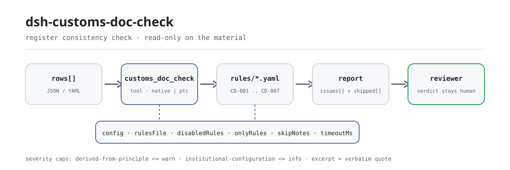

<div align="center">

<picture>
  <source media="(prefers-color-scheme: dark)" srcset="docs/assets/dsh-customs-doc-check-flow-dark.svg">
  
</picture>

# dsh-customs-doc-check

**Comprueba fila por fila un registro de documentos de declaración aduanera: obtienes una lista de qué fila, qué columna y qué corregir; el veredicto queda en manos del revisor.**

Un plugin verificador de datos para DeepSeek Harness: lee un registro de documentos de declaración (los nombres de columna pueden estar en chino o en inglés), aplica el paquete de reglas versionado que incluye (CD-001..CD-007) y solo enumera las diferencias que puede señalar dentro del material; nunca dicta cumplimiento ni responsabilidad.

[Instalar](#instalación-en-tres-pasos) · [Configuración](#configuración) · [FAQ](#faq) · [简体中文](README.md) · [English](README.en.md) · [Español](README.es.md) · [Português](README.pt.md) · [हिन्दी](README.hi.md)

[](LICENSE)
[](#compatibilidad)
[](https://www.npmjs.com/package/dsh-customs-doc-check)
[](https://github.com/PerryLink/dsh-customs-doc-check/actions/workflows/ci.yml)
[](#compatibilidad)

[](https://github.com/PerryLink/dsh-customs-doc-check/stargazers)
[](https://www.npmjs.com/package/dsh-customs-doc-check)
[](https://dshfind.com/plugins/PerryLink/dsh-customs-doc-check?ref=badge)
[](https://securityscorecards.dev/viewer/?uri=github.com/PerryLink/dsh-customs-doc-check)
[](https://dsh.market/)
[](https://gitee.com/perrylink/dsh-customs-doc-check)

```sh
dsh plugin --profile <name> add dsh-customs-doc-check
```

</div>

<sub>Plugin de la comunidad, no afiliado a DeepSeek. Repositorio canónico: <https://github.com/PerryLink/dsh-customs-doc-check> (Gitee es un espejo).</sub>

## Qué es

`dsh-customs-doc-check` lee un registro de documentos de declaración (报关单证台账) —cuyos nombres de columna pueden estar en chino o en inglés— y comprueba ese registro en sí mismo, no la declaración que hay detrás: que cada fila traiga al menos uno de los dos, el nombre de la mercancía o el importe total; que el código de mercancía tenga diez dígitos y la moneda sea un código de tres letras; que no se repita ningún número de documento; que el peso bruto no sea inferior al peso neto; que la fecha de declaración, cuando consta, se pueda analizar y no sea posterior a la fecha de comprobación; y que no quede ningún marcador de plantilla sin sustituir en la columna del nombre de la mercancía.

No decide si la declaración es veraz, si constituye una declaración inexacta, si afecta a los derechos arancelarios ni si la mercancía debe ser inspeccionada o sancionada.

- **Para quién es**: declarantes de aduanas, responsables de documentación comercial y agentes de comercio exterior; no hace falta línea de comandos, basta entregar el material en el chat.
- **Qué entrega usted**: el material fuente sobre el que trabaja la comprobación (una tabla, un registro o un documento); el original nunca se modifica. Excel puede convertirse antes a JSON/YAML, en el propio chat si la plataforma lo permite.
- **Qué recibe**: una lista de «qué fila, qué columna, qué falta, cómo corregirlo»; cada comprobación que no pudo ejecutarse aparece en `skipped` con su motivo.

## Instalación en tres pasos

1. **Instale** (elija un canal):

   ```sh
   # canal git (main más reciente; equivalente a git+https://github.com/PerryLink/dsh-customs-doc-check.git)
   dsh plugin --profile <name> add github:PerryLink/dsh-customs-doc-check
   # canal npm (versiones publicadas)
   dsh plugin --profile <name> add dsh-customs-doc-check
   # canal tarball: pnpm pack en este repo y después
   dsh plugin --profile <name> add ./dsh-customs-doc-check-<version>.tgz
   ```

2. **Configuración mínima** (valores por defecto listos para usar; una fila bundle sin `config` aplica todos los valores por defecto y la ruta del paquete de reglas apunta al `rules/customs-doc-check.yaml` incluido):

   ```yaml
   - insert:
       - id: dsh-customs-doc-check
         name: dsh-customs-doc-check
   ```

3. **Verifique que se monta**:

   ```sh
   dsh --profile <name> --dump-config | grep 'dsh-customs-doc-check'
   ```

   Después ejecute la muestra incluida en el repositorio (requiere `pnpm run build` antes para producir `lib/`):

   ```sh
   node samples/quickstart/run.mjs --check
   ```

   Salida (esperada en `samples/quickstart/expected/result.json`):

   ```text
   customs_doc_check: 1 issue(s) — error 0, warn 1, info 0
   skipped: 0
   ```

   Captura en `docs/assets/quickstart.png`.

**Desinstalar**: `dsh plugin --profile <name> remove dsh-customs-doc-check` (o elimine la fila del patch del perfil).

<details>
<summary>Usarlo en WorkBuddy / Coze</summary>

Busque «Customs Compliance Suite» en WorkBuddy / Coze (esta comprobación es una parte; disponibilidad según la tienda) para invocar la misma capacidad de verificación sin línea de comandos.

</details>

<details>
<summary>Instalar desde el mercado de DSH Desktop</summary>

Todos los plugins de PerryLink se pueden explorar en el mercado integrado de DSH Desktop: **Mercado → Fuentes → Añadir fuente → pegue** `https://perrylink-dsh-catalog.perrylink.workers.dev/catalog-source.json` **→ seleccione**. La instalación sigue requiriendo la verificación de identidad npm del mercado y su confirmación.

</details>

## Capacidades clave

`dsh-customs-doc-check` registra la herramienta `customs_doc_check`: lee un registro de documentos de declaración —con los nombres de columna del propio registro, en chino o en inglés—, aplica un paquete de reglas versionado y devuelve un informe.

- **Siete reglas en un paquete de datos** — el paquete de reglas es datos, no código (`rules/customs-doc-check.yaml`); sustituirlo cambia todo el conjunto de reglas sin tocar una línea de TypeScript.
- **Solo lectura sobre el material** — acepta JSON o YAML y nunca modifica el original; ESM puro, sin peticiones de red y sin llamadas al modelo.
- **Sin citas inventadas** — cada regla lleva `document` / `number` / `clause` / `excerpt` / `kind` / `source`; `excerpt` debe ser una cita literal, y las reglas cuyo texto de cláusula no se pudo obtener esta vez lo dicen en el propio `excerpt` y permanecen marcadas como `derived-from-principle`.
- **La severidad sigue a la evidencia** — `derived-from-principle` tiene como tope `warn`, la configuración institucional (`institutional-configuration`) tiene como tope `info`, y un test lo garantiza.
- **Una lista vacía nunca es «todo está bien»** — cada comprobación que no pudo ejecutarse se informa en `skipped` con su motivo; una regla cuya lista obligatoria no está configurada se autoinforma en `skipped` en lugar de pasar en silencio.
- **Sin redacción adjudicadora** — el informe enumera diferencias y nunca se pronuncia sobre cumplimiento, responsabilidad o corrección; un guardián de redacción (wording guard) lo impone y cada informe lleva el descargo.

| Regla | Comprobación | Severidad | Tipo de base |
|---|---|---|---|
| `CD-001` | el registro anota nombre de mercancía e importe | warn | principle |
| `CD-002` | el código de mercancía tiene diez dígitos | warn | principle |
| `CD-003` | la moneda es un código de tres letras | warn | principle |
| `CD-004` | los números de documento son únicos en el registro | warn | principle |
| `CD-005` | el peso bruto no es inferior al peso neto | warn | principle |
| `CD-006` | la fecha de declaración se analiza y no es futura | warn | principle |
| `CD-007` | el nombre de la mercancía no conserva marcadores sin sustituir | warn | principle |

### Ejemplos

Estos son los puntos de entrada reales del plugin; instálelo una vez e invoque uno. La primera fila de la tabla siguiente es el recorrido detallado y las demás son casos breves.

**Ejemplo detallado** — herramienta `customs_doc_check`, entrada:

```json
{"rows":[{"单证种类":"发票","商品名称":"","总价":"", ...}]}
```

Salida:

```json
{
  "id": "dsh-customs-doc-check.CD-001.de09b5a6",
  "ruleId": "CD-001",
  "severity": "warn",
  "locator": {
    "row": 1,
    "field": "goodsName"
  },
  "found": "第 1 行 goodsName、amount 都为空",
  "expected": "goodsName、amount 至少应填写一项",
  "fix": "补填品名与总价；本条只核对是否填写，不判断申报内容是否真实"
}
```

*Observado en `dsh-customs-doc-check/tests/fixtures/CD-001/CD-001-unsafe.json; dsh-customs-doc-check/tests/fixtures/CD-001/cases.json; dsh-customs-doc-check/rules/customs-doc-check.yaml; dsh-customs-doc-check/tests/index.test.ts`*

Salida real de este plugin sobre su propio fixture de prueba `CD-001` — no es un montaje. El paquete de reglas no inventa citas, así que cada hallazgo nombra la cláusula aplicada y advierte que su texto no se obtuvo en esta pasada.

| Usted pregunta | Qué responde |
|---|---|
| En una fila el nombre de la mercancía todavía dice `待填` y la casilla del importe está vacía, ¿se informa de algo? | `CD-001` no: solo exige que se rellene al menos uno de los dos, el nombre de la mercancía o el importe total, y `待填` no está en blanco. La regla que informa de esa fila es `CD-007`, que busca en la columna del nombre de la mercancía los marcadores de plantilla que el paquete enumera (`【`, `{{`, `XXX`, `待填`, `TBD` y similares). `CD-001` no juzga si el contenido declarado es veraz; `CD-007` solo busca esos términos en esa columna, y su lista de términos puede ajustarse a la plantilla propia. |
| El código de mercancía figura como `84713000`, ocho dígitos, ¿se informa? | Sí. `CD-002` contrasta la casilla con diez dígitos e informa de cualquier otro caso. Comprueba solo el número de dígitos y la legalidad de los caracteres, nunca si el código es el correcto: una misma mercancía puede llevar códigos distintos bajo decisiones de clasificación distintas. El número de dígitos es el parámetro `pattern` de la regla, modificable cuando el arancel cambie su número de dígitos. |
| La columna de moneda dice `RMB` en una fila y `usd` en otra, ¿qué fila se informa? | `usd`: `CD-003` solo acepta tres letras mayúsculas. `RMB` encaja en esa forma y pasa, porque la regla es una comprobación de forma y no el texto del artículo — la tabla de códigos a la que remite el artículo no se obtuvo, y la regla no toma partido entre las grafías `CNY` y `RMB` que la práctica aduanera también usa; estreche el `pattern` si su casa fija una sola. No juzga si la moneda elegida es la correcta para la liquidación. |
| El mismo número de documento aparece en dos filas, ¿qué dice la comprobación? | `CD-004` informa del número repetido; al comparar se ignoran los espacios. La unicidad es todo lo que establece la regla: un hallazgo suele significar que el mismo documento se registró dos veces o que se copió un número de otro documento, y cuál de los dos es erróneo debe confirmarlo una persona. No decide qué registro es el válido. |
| El peso bruto figura como `1,180` y el neto como `1,250`, ¿se detecta? ¿Y si una fila no tiene peso neto? | Lo primero se informa: `CD-005` compara los dos valores e informa de la fila en que el peso bruto es inferior al neto. Solo se comparan los números y se admiten unidades (`12.5KGS`), y la regla no juzga si el peso declarado es veraz. Una fila a la que le falta uno de los dos campos no se compara en absoluto; si eso deja sin nada que comparar, la regla pasa a `skipped` con su motivo en lugar de informarse como diferencia. |
| El registro no trae ninguna fecha de declaración y una fila tiene `2026-13-40`, ¿qué se informa? | La fecha imposible se informa: `CD-006` exige que la fecha se pueda analizar y que no sea posterior a la fecha de comprobación. Que falte la fecha de declaración no se informa como defecto — en el momento de declarar esa columna está 免予填报, la registra el sistema informático de aduanas y no el declarante, así que la regla solo comprueba la fecha cuando consta. Una fecha que no se puede analizar se informa por separado y nunca se omite en silencio, y la regla no juzga si la declaración se hizo dentro de un plazo legal. |

## Normas que sigue

| Documento | Número | Reglas que lo citan |
|---|---|---|
| 《中华人民共和国海关进出口货物报关单填制规范》 | 海关总署公告 2019 年第 18 号（本次未取得条文） | CD-001, CD-002, CD-005, CD-007 |
| 《表示货币的代码》 | GB/T 12406—2022（表示货币的代码；2022-12-30 发布并实施；全部代替 GB/T 12406—2008（该版名称为「表示货币和资金的代码」）——注意旧版名称含"资金"；修改采用 ISO 4217:2015，非等同采用；条号本次未取得） | CD-003 |
| 《中华人民共和国海关进出口货物申报管理规定》 | 海关总署令（现行令号本次未核实） | CD-004, CD-006 |

**Límite:** este plugin comprueba un **registro de documentos de declaración aduanera** en lo que un registro puede exigirse mecánicamente: que las columnas clave estén rellenas, que el código de mercancía y la moneda sigan sus formatos, que los números de documento sean únicos, que el peso bruto no sea inferior al neto, que las fechas se puedan analizar y que no sobreviva ningún marcador de plantilla. **No** decide si una declaración es veraz, si constituye una declaración inexacta, si afecta a los derechos arancelarios ni si la mercancía debe inspeccionarse o sancionarse. **Esas decisiones corresponden a la Aduana**, y una misma mercancía puede llevar legítimamente códigos distintos bajo decisiones de clasificación distintas. **Este plugin nunca juzga la clasificación.**

> ### ⚠️ Lea esto antes de fiarse de una cita del informe
>
> **La 《中华人民共和国海关进出口货物报关单填制规范》 se obtuvo completa y se leyó artículo por artículo** (49 artículos más las definiciones finales), y `rules/evidence/clause-verification.md` recoge lo citado: el artículo 34 (el código de mercancía son **10 dígitos**), los artículos 5 y 6 (las fechas son de **8 dígitos**, año-mes-día, y —conviene saberlo— la fecha de declaración queda «**免予填报**», exenta de rellenarse al declarar, así que un registro que carece de ella es normal), el artículo 39 (la moneda se toma de la 《货币代码表》), los artículos 24–26 (bultos, peso bruto y neto) y el artículo 38. Los **datos de publicación se confirmaron contra el anuncio oficial**: 《海关总署公告 2019 年第 18 号》, de fecha 2019-01-22, **en vigor desde 2019-02-01, y derogó el 《海关总署 2018 年第 60 号公告》**, de modo que citar este último es simplemente un error. La 《进（出）境货物备案清单》 se rellena **por referencia** a esta especificación.
>
> **Como consecuencia se corrigieron dos afirmaciones.** `CD-003` decía que la moneda «debe ser tres letras» — el artículo solo dice «seleccionar el nombre y el código de la moneda conforme a la 《货币代码表》 que fija la Aduana», y esa tabla de códigos **no se obtuvo**, así que «tres letras» es una inferencia sobre la forma de la tabla, no el texto del artículo. Y `CD-006` ahora declara la exención anterior en lugar de insinuar que falta la fecha es un defecto.
>
> **Cada `excerpt` sigue admitiendo la laguna y cada regla sigue en `warn` o `info`** — a propósito. La especificación regula **cómo se rellenan las columnas del formulario de declaración**, mientras que este plugin comprueba el **registro de documentos de soporte** de una empresa. Un registro no es un formulario de declaración, así que elevar una regla a `direct` vestiría una laguna del registro como una obligación aduanera. **La 《申报管理规定》 y las distintas tablas de códigos (distritos aduaneros, modos de transporte, regímenes de supervisión, monedas, países, puertos, etc.) no se obtuvieron**, y por eso no se incorpora ninguna tabla de códigos. El texto de la especificación se leyó de una **reproducción del consejo local de promoción del comercio**, porque el anexo oficial es un `.doc` y esta herramienta no puede decodificar archivos Office binarios.
>
> Dos comprobaciones merecen una nota aparte. La del código de mercancía verifica **diez dígitos y nada más** — el número de dígitos procede del arancel vigente, y la comprobación nunca dice si un código es el código *correcto*. La de la moneda verifica **tres letras mayúsculas** y deliberadamente no toma partido entre `CNY` y la grafía `RMB` que la práctica aduanera también usa; estreche el patrón si su casa se fija en una.

## Configuración

Todos los parámetros ajustables son campos `Config` de Schemastery en `src/config.ts` (modificables desde cordis.yml); los umbrales por regla viven en el paquete de reglas bajo `rules/`. Una sustitución por id reemplaza la fila entera: repita todas las claves que necesite.

| Clave | Tipo | Predeterminado | Descripción |
|---|---|---|---|
| `rulesFile` | string | `rules/customs-doc-check.yaml` | Ruta del paquete de reglas, relativa a la raíz del paquete |
| `disabledRules` | string[] | `[]` | Ids de reglas que se dejan de ejecutar; cada una aparece en `skipped` |
| `onlyRules` | string[] | `[]` | Ejecutar solo estas reglas; vacío ejecuta todas |
| `skipNotes` | string | `""` | Nota añadida a cada motivo de `skipped` |
| `timeoutMs` | number | `120000` | Presupuesto de tiempo de espera cooperativo de la herramienta |

Parámetros por regla que conviene conocer:

- `CD-002` `pattern` — la forma del código de mercancía; por defecto exige diez dígitos. Cámbielo cuando el arancel cambie su número de dígitos.
- `CD-003` `pattern` — la forma de la moneda; por defecto exige tres letras mayúsculas. Estreche a una sola grafía de la moneda local si su casa la fija.
- `CD-005` `relation` — la comparación entre peso bruto y neto, `gte` por defecto.
- `CD-007` `terms` — los marcadores que se buscan.

Ejemplo de sustitución en el patch de su perfil:

```yaml
- insert:
    - id: dsh-customs-doc-check
      name: dsh-customs-doc-check
      config:
        disabledRules: [CD-007]
        timeoutMs: 180000
```

## Formato del material

La herramienta acepta JSON o YAML:

```yaml
declarationNo: '530120260310000001'
consignee: 某某进出口有限公司
contractNo: SC-2026-018
rows:
  - { 单证种类: 发票, 单证编号: INV-2026-0001, 商品编号: '8471300000',
      商品名称: 便携式自动数据处理设备, 数量: '100', 总价: '45000.00', 币制: USD,
      毛重: '1250.5', 净重: '1180.0', 申报日期: 2026-03-10 }
```

Los nombres de columna se cotejan sin distinguir mayúsculas e ignorando espacios, guiones bajos y guiones; se conservan los nombres propios del registro, de modo que un hallazgo nombra la columna que leyó. Las celdas numéricas pueden llevar unidades y separadores de millar (`12.5KGS`, `1,250.5`). Los campos son opcionales en la capa de lectura y los valida el motor de comprobación, de modo que una exportación parcial produce hallazgos de «elemento ausente» en lugar de un fallo.

## Fuentes de las reglas

Los datos de las reglas viven en `rules/customs-doc-check.yaml`, separados del código: cada regla lleva documento, número, cláusula en la numeración propia de la fuente, extracto literal y URL de origen. La cabecera del paquete declara por completo la laguna de citas de esta pasada, y el `note` de cada regla repite la parte que le afecta. El guardián de carga que normalmente impone «un extracto debe ser una cita real de al menos ocho caracteres» no sabe distinguir una cita de una descripción, así que este paquete se apoya en la cabecera, en las notas por regla y en un test que garantiza que todo `excerpt` admite la laguna. Un paquete que exagere su base falla al cargar en lugar de producir un informe con aspecto seguro. Los límites confirmados durante la verificación y las conclusiones deliberadamente **no** afirmadas se incluyen en el directorio `rules/evidence/` del paquete.

## FAQ

<details>
<summary>¿Decide el cumplimiento por nosotros?</summary>

No. Solo enumera las diferencias que puede señalar dentro del material (qué fila, qué columna, qué falta, cómo corregirlo) y no decide hechos ni cumplimiento: la conclusión queda siempre en manos del revisor. Un guardián de redacción impone la redacción del informe y cada informe lleva el descargo.

</details>

<details>
<summary>Mi registro es un Excel. ¿Puedo usarlo directamente?</summary>

Sí: conviértalo antes a JSON o YAML; en el chat la plataforma puede hacer la conversión por usted si lo permite. La herramienta solo lee el material y nunca modifica el original.

</details>

<details>
<summary>¿Por qué ninguna regla supera `warn`? ¿Dónde está `error`?</summary>

Porque el nivel de evidencia decide la severidad: una regla cuyo texto literal no se obtuvo en esta pasada se marca `derived-from-principle` y tiene tope `warn`, mientras que una comprobación cuyo umbral proviene de su institución (`institutional-configuration`) tiene tope `info`. El paquete rechaza al cargar un `error` exagerado, y un test garantiza el tope.

</details>

<details>
<summary>¿Una lista `issues` vacía puede leerse como «nada va mal»?</summary>

No. Cada comprobación que no pudo ejecutarse aparece en `skipped` con su motivo (una fecha ausente, un peso neto ausente, una regla desactivada). Lea `issues` y `skipped` juntos antes de sacar cualquier conclusión de un informe.

</details>

<details>
<summary>¿Aguanta un trimestre entero de declaraciones de una vez?</summary>

La herramienta funciona en los modos `native` y `ptc`; para trabajo por lotes (un trimestre de registros o un directorio completo) use `ptc`, donde el coste del esquema se paga una sola vez. Las comprobaciones en sí son cotejo de columnas y aritmética numérica y de fechas locales: sin peticiones de red y sin llamadas al modelo; `timeoutMs` (120 s por defecto) es el presupuesto de tiempo de espera cooperativo.

</details>

## Solución de problemas

- **`CD-002` salta con un código que sé que es válido.** La casilla no tiene exactamente diez dígitos: puede llevar un espacio final, un punto o un sufijo de subpartida. Normalice la exportación o cambie `pattern`.
- **`CD-003` salta con `RMB`.** El patrón por defecto acepta tres letras cualesquiera, así que esto significa que la casilla no tiene tres letras: un sufijo de símbolo, el nombre en el idioma local o un código en minúsculas fallarían. Normalice o estreche el patrón.
- **`CD-006` salta con una fecha futura.** Esa es la comprobación: una declaración fechada después de la fecha de revisión significa que la fecha o la base de revisión están mal.
- **El lector rechaza un registro que antes aceptaba.** No encontró ninguno de los nombres de columna conocidos; el error enumera las columnas que vio.
- **El plugin se instala pero la herramienta no aparece.** Compruebe que `main` resuelve a `lib/index.mjs` y que `pnpm run build` lo generó; un `main` erróneo hace que el cargador omita la entrada en silencio.
- **`dsh plugin add` rechaza el paquete por incompatible.** El rango de peers cubre `0.1.x` y `0.2.x`; si su runtime queda fuera, conceda una exención explícita: `dsh plugin --profile <name> allow-version dsh-customs-doc-check@0.1.0 --dsh-version <runtime> --accept-risk`
- **`check` informa `manifest-peers` como fallo.** El verificador estático compara contra un rango de peers fijado en el código, anterior a la línea 0.2. El runtime impone la compatibilidad al instalar, así que el rango declarado es el correcto; es un problema conocido en origen de `dsh-plugin-dev`.
- **Los horarios parecen desplazados.** Toda la aritmética es de hora local sobre las cadenas entregadas, sin conversión de zona horaria.

## Compatibilidad

| Superficie | Estado |
|---|---|
| Harness | Rango de peers `>=0.1.2-rc.1 <0.2.0 \|\| >=0.2.0-0 <0.3.0` — verificado para aceptar tanto `0.2.0-rc.2` como `0.2.1-rc.2`. **`engines.dsh` se declara como `>=0.2.1-0 <0.3.0`** y el host lo aplica desde 0.2.1 |
| Node | `^22.19.0 \|\| >=24.0.0` |
| Plataformas | Todas (ESM puro; sin código nativo, sin red, sin llamada al modelo) |
| Modo de herramienta | Funciona en `native` y `ptc`; para un lote de declaraciones use `ptc` |

## Ecosistema y calidad

- [Espejo de Gitee](https://gitee.com/perrylink/dsh-customs-doc-check) (espejo sincronizado; GitHub es el canónico)
- [Página del plugin en dshfind](https://dshfind.com/plugins/PerryLink/dsh-customs-doc-check) (instalaciones y ranking)
- [Informe OpenSSF Scorecard](https://securityscorecards.dev/viewer/?uri=github.com/PerryLink/dsh-customs-doc-check) (impulsado por [.github/workflows/scorecard.yml](.github/workflows/scorecard.yml))
- [DSH Market](https://dsh.market/) (publicado)
- **Canal de la tienda 1024**: `npm i -g dsh1024` una vez y luego `dsh1024 plugin --profile <name> add dsh-customs-doc-check` (cuenta para el ranking de instalaciones de [deepseek1024.com](https://deepseek1024.com))
- [Base de conocimiento del ecosistema](https://perrylink.github.io/dsh-plugin-guide/): guía de desarrollo de plugins · datos medidos de selección · criterios de mantenimiento

## Desarrollo

```sh
pnpm install                                        # node ^22.19 || >=24
pnpm run typecheck                                  # tsc --noEmit
pnpm test                                           # vitest: suite compartida de plugins de tabla + fixtures emparejados
pnpm run build                                      # tsdown -> lib/index.mjs + lib/index.d.mts
pnpm run verify:self-contained                      # las dependencias resuelven desde el registry
pnpm run check:lockfile                             # comprobación de deriva del lockfile
pnpm run check:readmes                              # consistencia de los README en cinco idiomas
pnpm run check:citations                            # línea base de citas del paquete de reglas
node ../scripts/sync-shared.mjs dsh-customs-doc-check   # refresca src/shared desde ../_shared
pnpm pack                                           # tarball de publicación
```

El plugin es **solo datos**: `src/model.ts` declara la forma de la tabla, el kit compartido aporta el lector y el motor de comprobación, y el paquete de reglas declara cada comprobación; una comprobación que encaje en un tipo existente solo necesita un cambio en el paquete de reglas y nada más. Ejecución local de la muestra (requiere `pnpm run build` antes para producir `lib/`):

```sh
node samples/quickstart/run.mjs --json
# => {"tool":"customs_doc_check","issueCount":1,"summary":{"error":0,"warn":1,"info":0},"skippedCount":0}
```

La entrada de la muestra está en `samples/quickstart/input/`, la salida esperada en `samples/quickstart/expected/result.json` y una captura en `docs/assets/quickstart.png`. Las imágenes del README se generan programáticamente con [`scripts/gen-readme-assets.py`](scripts/gen-readme-assets.py) (Python + Pillow) y se pueden volver a ejecutar: `python scripts/gen-readme-assets.py`; el diagrama de flujo de una sola piel y las imágenes de demostración antiguas permanecen en `docs/assets/` para enlaces externos, mientras que los README solo referencian el nuevo par claro/oscuro.

Topics: `deepseek-harness`, `dsh`, `dsh-plugin`, `cordis`, `customs`, `doc`

## Familia y agradecimientos

Este proyecto forma parte de la familia de plugins de DeepSeek Harness de [PerryLink](https://github.com/PerryLink) (todos Apache-2.0). Índice completo: [elegir un verificador por material](https://perrylink.github.io/zh/checkers/choose/) y [todos los plugins](https://github.com/PerryLink). Si le resulta útil, **una estrella ayuda a que la siguiente persona lo encuentre**: nada queda bloqueado por ello.

- [@PerryLink](https://github.com/PerryLink) — creador y mantenedor: el paquete de reglas de datos (CD-001..CD-007), la herramienta `customs_doc_check`, el registro de verificación de citas y la documentación en cinco idiomas.

<details>
<summary>Desplegar todos los plugins</summary>

| Plugin | Estado |
|---|---|
| **[dsh-aqua-input-check](https://github.com/PerryLink/dsh-aqua-input-check)** |  |
| **[dsh-archive-check](https://github.com/PerryLink/dsh-archive-check)** |  |
| **[dsh-auto-review](https://github.com/PerryLink/dsh-auto-review)** |  |
| **[dsh-autotier](https://github.com/PerryLink/dsh-autotier)** | 🧊 CONGELADO — ver el README del repo |
| **[dsh-bid-ca-precheck](https://github.com/PerryLink/dsh-bid-ca-precheck)** |  |
| **[dsh-bid-qual-check](https://github.com/PerryLink/dsh-bid-qual-check)** |  |
| **[dsh-cert-mcp](https://github.com/PerryLink/dsh-cert-mcp)** | 🧊 CONGELADO — ver el README del repo |
| **[dsh-checkpoint-rewind](https://github.com/PerryLink/dsh-checkpoint-rewind)** |  |
| **[dsh-click](https://github.com/PerryLink/dsh-click)** |  |
| **[dsh-composer-history](https://github.com/PerryLink/dsh-composer-history)** |  |
| **[dsh-contract-stance](https://github.com/PerryLink/dsh-contract-stance)** |  |
| **[dsh-customs-doc-check](https://github.com/PerryLink/dsh-customs-doc-check)** |  |
| **[dsh-data-quality](https://github.com/PerryLink/dsh-data-quality)** | 🧊 CONGELADO — ver el README del repo |
| **[dsh-demurrage-ledger](https://github.com/PerryLink/dsh-demurrage-ledger)** |  |
| **[dsh-doublecheck](https://github.com/PerryLink/dsh-doublecheck)** |  |
| **[dsh-drill-script-check](https://github.com/PerryLink/dsh-drill-script-check)** |  |
| **[dsh-eia-guide-check](https://github.com/PerryLink/dsh-eia-guide-check)** |  |
| **[dsh-emergency-plan](https://github.com/PerryLink/dsh-emergency-plan)** |  |
| **[dsh-essay-rubric-check](https://github.com/PerryLink/dsh-essay-rubric-check)** |  |
| **[dsh-evidence-check](https://github.com/PerryLink/dsh-evidence-check)** |  |
| **[dsh-export-ctl-check](https://github.com/PerryLink/dsh-export-ctl-check)** |  |
| **[dsh-fast](https://github.com/PerryLink/dsh-fast)** |  |
| **[dsh-fmea-table-check](https://github.com/PerryLink/dsh-fmea-table-check)** |  |
| **[dsh-forecast-penalty](https://github.com/PerryLink/dsh-forecast-penalty)** |  |
| **[dsh-fund-research](https://github.com/PerryLink/dsh-fund-research)** |  |
| **[dsh-github](https://github.com/PerryLink/dsh-github)** |  |
| **[dsh-gongwen-flow-check](https://github.com/PerryLink/dsh-gongwen-flow-check)** |  |
| **[dsh-gongwen-word-check](https://github.com/PerryLink/dsh-gongwen-word-check)** |  |
| **[dsh-guard-plan-qc](https://github.com/PerryLink/dsh-guard-plan-qc)** |  |
| **[dsh-hazchem-check](https://github.com/PerryLink/dsh-hazchem-check)** |  |
| **[dsh-hazplan-check](https://github.com/PerryLink/dsh-hazplan-check)** |  |
| **[dsh-hidden-risk-map](https://github.com/PerryLink/dsh-hidden-risk-map)** |  |
| **[dsh-hs-classify](https://github.com/PerryLink/dsh-hs-classify)** |  |
| **[dsh-icd-rule-check](https://github.com/PerryLink/dsh-icd-rule-check)** |  |
| **[dsh-industry-research](https://github.com/PerryLink/dsh-industry-research)** |  |
| **[dsh-lawcite-adapter](https://github.com/PerryLink/dsh-lawcite-adapter)** |  |
| **[dsh-laya](https://github.com/PerryLink/dsh-laya)** |  |
| **[dsh-lc-doc-check](https://github.com/PerryLink/dsh-lc-doc-check)** |  |
| **[dsh-learning-gap-check](https://github.com/PerryLink/dsh-learning-gap-check)** |  |
| **[dsh-library](https://github.com/PerryLink/dsh-library)** |  |
| **[dsh-local-ai](https://github.com/PerryLink/dsh-local-ai)** |  |
| **[dsh-lsp-actions](https://github.com/PerryLink/dsh-lsp-actions)** |  |
| **[dsh-mask](https://github.com/PerryLink/dsh-mask)** |  |
| **[dsh-mcp-panel](https://github.com/PerryLink/dsh-mcp-panel)** |  |
| **[dsh-medrec-qc](https://github.com/PerryLink/dsh-medrec-qc)** |  |
| **[dsh-memento](https://github.com/PerryLink/dsh-memento)** | 🧊 CONGELADO — ver el README del repo |
| **[dsh-nsfc-form-check](https://github.com/PerryLink/dsh-nsfc-form-check)** |  |
| **[dsh-nurse-record-check](https://github.com/PerryLink/dsh-nurse-record-check)** |  |
| **[dsh-observe](https://github.com/PerryLink/dsh-observe)** |  |
| **[dsh-origin-rvc-check](https://github.com/PerryLink/dsh-origin-rvc-check)** |  |
| **[dsh-ota-review-check](https://github.com/PerryLink/dsh-ota-review-check)** |  |
| **[dsh-output-styles](https://github.com/PerryLink/dsh-output-styles)** |  |
| **[dsh-paper-doc-adapter](https://github.com/PerryLink/dsh-paper-doc-adapter)** |  |
| **[dsh-permission-rules](https://github.com/PerryLink/dsh-permission-rules)** |  |
| **[dsh-permit-report-check](https://github.com/PerryLink/dsh-permit-report-check)** |  |
| **[dsh-pipeline-check](https://github.com/PerryLink/dsh-pipeline-check)** |  |
| **[dsh-pleading-draft](https://github.com/PerryLink/dsh-pleading-draft)** |  |
| **[dsh-plugin-doctor](https://github.com/PerryLink/dsh-plugin-doctor)** | 🚫 RETIRADO (repo archivado) |
| **[dsh-plugin-guide](https://github.com/PerryLink/dsh-plugin-guide)** |  |
| **[dsh-plugin-kit](https://github.com/PerryLink/dsh-plugin-kit)** | 🚫 RETIRADO (repo archivado) |
| **[dsh-plugin-upgrade](https://github.com/PerryLink/dsh-plugin-upgrade)** | 🚫 RETIRADO (repo archivado) |
| **[dsh-policy-brief-draft](https://github.com/PerryLink/dsh-policy-brief-draft)** |  |
| **[dsh-power-loss-split](https://github.com/PerryLink/dsh-power-loss-split)** |  |
| **[dsh-power-ticket-check](https://github.com/PerryLink/dsh-power-ticket-check)** |  |
| **[dsh-ppap-check](https://github.com/PerryLink/dsh-ppap-check)** |  |
| **[dsh-protest-deadline](https://github.com/PerryLink/dsh-protest-deadline)** |  |
| **[dsh-railway-window](https://github.com/PerryLink/dsh-railway-window)** |  |
| **[dsh-repair-order-qc](https://github.com/PerryLink/dsh-repair-order-qc)** |  |
| **[dsh-research-report](https://github.com/PerryLink/dsh-research-report)** |  |
| **[dsh-review-reply-check](https://github.com/PerryLink/dsh-review-reply-check)** |  |
| **[dsh-rulefile-check](https://github.com/PerryLink/dsh-rulefile-check)** |  |
| **[dsh-safety-brief-check](https://github.com/PerryLink/dsh-safety-brief-check)** |  |
| **[dsh-score](https://github.com/PerryLink/dsh-score)** | 🧊 CONGELADO — ver el README del repo |
| **[dsh-session-sync](https://github.com/PerryLink/dsh-session-sync)** |  |
| **[dsh-site-log-check](https://github.com/PerryLink/dsh-site-log-check)** |  |
| **[dsh-skill-pack-security](https://github.com/PerryLink/dsh-skill-pack-security)** |  |
| **[dsh-soe-decision-check](https://github.com/PerryLink/dsh-soe-decision-check)** |  |
| **[dsh-soilwater-check](https://github.com/PerryLink/dsh-soilwater-check)** |  |
| **[dsh-sop-sync-check](https://github.com/PerryLink/dsh-sop-sync-check)** |  |
| **[dsh-spc-gbt-adapter](https://github.com/PerryLink/dsh-spc-gbt-adapter)** |  |
| **[dsh-talk](https://github.com/PerryLink/dsh-talk)** |  |
| **[dsh-tender-extract](https://github.com/PerryLink/dsh-tender-extract)** |  |
| **[dsh-tender-matrix](https://github.com/PerryLink/dsh-tender-matrix)** |  |
| **[dsh-test-drive](https://github.com/PerryLink/dsh-test-drive)** |  |
| **[dsh-ticktick](https://github.com/PerryLink/dsh-ticktick)** | 🚫 RETIRADO (repo archivado) |
| **[dsh-translate](https://github.com/PerryLink/dsh-translate)** |  |
| **[dsh-warranty-calc](https://github.com/PerryLink/dsh-warranty-calc)** |  |
| **[dsh-budget](https://github.com/PerryLink/dsh-budget)** | 🧊 CONGELADO — ver el README del repo |
| **[dsh-claude-move](https://github.com/PerryLink/dsh-claude-move)** | 🧊 CONGELADO — ver el README del repo |
| **[dsh-defend](https://github.com/PerryLink/dsh-defend)** | 🧊 CONGELADO — ver el README del repo |
| **[dsh-draw](https://github.com/PerryLink/dsh-draw)** | 🧊 CONGELADO — ver el README del repo |
| **[dsh-reach](https://github.com/PerryLink/dsh-reach)** | 🧊 CONGELADO — ver el README del repo |
| **[dsh-background-agents](https://github.com/PerryLink/dsh-background-agents)** | 🚫 RETIRADO (repo archivado) |
| **[dsh-session-pin](https://github.com/PerryLink/dsh-session-pin)** | 🚫 RETIRADO (repo archivado) |
| **[dsh-team-rooms](https://github.com/PerryLink/dsh-team-rooms)** | 🚫 RETIRADO (repo archivado) |

</details>

## Licencia

[LICENSE](LICENSE) (Apache License 2.0) © 2026 dsh-customs-doc-check contributors

<p align="center"><sub>Apache-2.0 · Plugin de la comunidad, no afiliado a DeepSeek.</sub></p>
