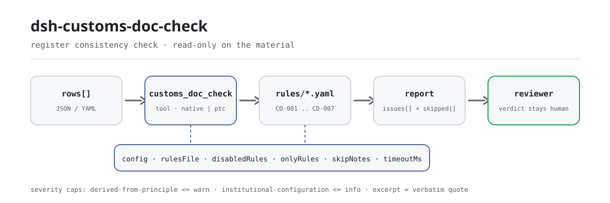

<div align="center">

<picture>
  <source media="(prefers-color-scheme: dark)" srcset="docs/assets/dsh-customs-doc-check-flow-dark.svg">
  
</picture>

# dsh-customs-doc-check

**सीमा-शुल्क घोषणा दस्तावेज़ पंजी को पंक्ति-दर-पंक्ति जाँचता है — आपको मिलती है «कौन-सी पंक्ति, कौन-सा कॉलम, क्या सुधारना है» की सूची; निर्णय समीक्षक के पास रहता है।**

DeepSeek Harness के लिए डेटा-आधारित जाँच प्लगइन: एक घोषणा दस्तावेज़ पंजी पढ़ता है (स्तंभ-नाम चीनी या अंग्रेज़ी हो सकते हैं), साथ आने वाले संस्करण-बद्ध नियम-पैक (CD-001..CD-007) को लागू करता है, और केवल वे अंतर सूचीबद्ध करता है जिन्हें सामग्री के भीतर शब्दशः इंगित किया जा सके — कभी अनुपालन का निर्णय नहीं, कभी दायित्व का निर्णय नहीं।

[इंस्टॉल](#तीन-चरणों-में-शुरुआत) · [कॉन्फ़िगरेशन](#कॉन्फ़िगरेशन) · [FAQ](#faq) · [简体中文](README.md) · [English](README.en.md) · [Español](README.es.md) · [Português](README.pt.md) · [हिन्दी](README.hi.md)

[](LICENSE)
[](#संगतता)
[](https://www.npmjs.com/package/dsh-customs-doc-check)
[](https://github.com/PerryLink/dsh-customs-doc-check/actions/workflows/ci.yml)
[](#संगतता)

[](https://github.com/PerryLink/dsh-customs-doc-check/stargazers)
[](https://www.npmjs.com/package/dsh-customs-doc-check)
[](https://dshfind.com/plugins/PerryLink/dsh-customs-doc-check?ref=badge)
[](https://securityscorecards.dev/viewer/?uri=github.com/PerryLink/dsh-customs-doc-check)
[](https://dsh.market/)
[](https://gitee.com/perrylink/dsh-customs-doc-check)

```sh
dsh plugin --profile <name> add dsh-customs-doc-check
```

</div>

<sub>सामुदायिक प्लगइन, DeepSeek से असंबद्ध। कैनोनिकल रिपॉज़िटरी: <https://github.com/PerryLink/dsh-customs-doc-check> (Gitee एक मिरर है)।</sub>

## यह क्या है

`dsh-customs-doc-check` एक घोषणा-संबंधी दस्तावेज़ पंजी (报关单证台账) पढ़ता है — जिसके स्तंभ-नाम चीनी या अंग्रेज़ी में हो सकते हैं — और उसी पंजी की जाँच करता है, उसके पीछे की घोषणा की नहीं: कि हर पंक्ति में माल का नाम या कुल राशि में से कम से कम एक भरा हो, कि माल-कोड दस अंकों का हो और मुद्रा तीन अक्षरों का कोड हो, कि कोई दस्तावेज़-क्रमांक दोहराया न गया हो, कि सकल भार निवल भार से कम न हो, कि दर्ज घोषणा-तिथि पढ़ी जा सके और जाँच-तिथि से बाद की न हो, और कि माल-नाम के स्तंभ में कोई अपरिवर्तित टेम्पलेट प्लेसहोल्डर शेष न रहे।

यह तय नहीं करता कि घोषणा सच है, कि वह गलत घोषणा है, कि उससे शुल्क प्रभावित होता है, या कि माल की जाँच या दंड होना चाहिए।

- **किसके लिए है**: सीमा-शुल्क घोषणाकर्ता, दस्तावेज़ लिपिक और विदेश-व्यापार अनुगामी; कमांड लाइन की ज़रूरत नहीं — सामग्री चैट में सौंप दें।
- **आप क्या सौंपते हैं**: जाँच की मूल सामग्री (तालिका, पंजी या दस्तावेज़); मूल कभी नहीं बदला जाता। Excel को पहले JSON/YAML में बदला जा सकता है, प्लेटफ़ॉर्म समर्थित हो तो चैट में भी।
- **आपको क्या मिलता है**: «कौन-सी पंक्ति, कौन-सा कॉलम, क्या कमी है, कैसे सुधारना है» की सूची; हर न चल पाई जाँच `skipped` में कारण के साथ दर्ज होती है।

## तीन चरणों में शुरुआत

1. **इंस्टॉल करें** (एक चैनल चुनें):

   ```sh
   # git चैनल (नवीनतम main; git+https://github.com/PerryLink/dsh-customs-doc-check.git के बराबर)
   dsh plugin --profile <name> add github:PerryLink/dsh-customs-doc-check
   # npm चैनल (प्रकाशित संस्करण)
   dsh plugin --profile <name> add dsh-customs-doc-check
   # tarball चैनल: इस रेपो में pnpm pack के बाद
   dsh plugin --profile <name> add ./dsh-customs-doc-check-<version>.tgz
   ```

2. **न्यूनतम कॉन्फ़िगरेशन** (डिफ़ॉल्ट तैयार है; `config` के बिना bundle पंक्ति सभी डिफ़ॉल्ट लागू करती है, नियम-पैक पथ साथ आए `rules/customs-doc-check.yaml` की ओर इशारा करता है):

   ```yaml
   - insert:
       - id: dsh-customs-doc-check
         name: dsh-customs-doc-check
   ```

3. **जाँचें कि माउंट हुआ**:

   ```sh
   dsh --profile <name> --dump-config | grep 'dsh-customs-doc-check'
   ```

   फिर रेपो में शामिल नमूना चलाएँ (`lib/` बनाने के लिए पहले `pnpm run build` आवश्यक):

   ```sh
   node samples/quickstart/run.mjs --check
   ```

   आउटपुट (`samples/quickstart/expected/result.json` में अपेक्षित):

   ```text
   customs_doc_check: 1 issue(s) — error 0, warn 1, info 0
   skipped: 0
   ```

   स्क्रीनशॉट: `docs/assets/quickstart.png`।

**अनइंस्टॉल**: `dsh plugin --profile <name> remove dsh-customs-doc-check` (या प्रोफ़ाइल पैच से वह पंक्ति हटा दें)।

<details>
<summary>WorkBuddy / Coze में उपयोग करें</summary>

WorkBuddy / Coze में «Customs Compliance Suite» खोजें (यह जाँच उसका एक भाग है; उपलब्धता स्टोर के अनुसार) और बिना कमांड लाइन वही जाँच क्षमता पाएँ।

</details>

<details>
<summary>DSH Desktop मार्केट से इंस्टॉल करें</summary>

सभी PerryLink प्लगइन DSH Desktop के अंतर्निहित मार्केट में देखे जा सकते हैं: **मार्केट → स्रोत → स्रोत जोड़ें → चिपकाएँ** `https://perrylink-dsh-catalog.perrylink.workers.dev/catalog-source.json` **→ चुनें**। इंस्टॉल के लिए मार्केट की npm पहचान जाँच और आपकी पुष्टि अब भी आवश्यक है।

</details>

## मुख्य क्षमताएँ

`dsh-customs-doc-check` `customs_doc_check` उपकरण पंजीकृत करता है: एक घोषणा दस्तावेज़ पंजी पढ़ता है — पंजी के अपने स्तंभ-नाम, चीनी या अंग्रेज़ी —, संस्करण-बद्ध नियम-पैक लागू करता है और रिपोर्ट लौटाता है।

- **एक डेटा-पैक में सात नियम** — नियम-पैक डेटा है, कोड नहीं (`rules/customs-doc-check.yaml`); उसे बदलने से पूरा नियम-समुच्चय बदल जाता है, TypeScript की एक पंक्ति भी नहीं छूती।
- **सामग्री पर केवल पढ़ाई** — JSON या YAML स्वीकारता है और मूल कभी नहीं बदलता; शुद्ध ESM, कोई नेटवर्क अनुरोध नहीं, कोई मॉडल कॉल नहीं।
- **कोई गढ़ा हुआ उद्धरण नहीं** — हर नियम में `document` / `number` / `clause` / `excerpt` / `kind` / `source` होता है; `excerpt` शब्दशः उद्धरण होना चाहिए, और जिन नियमों का धारा-पाठ इस बार प्राप्त नहीं हुआ वे स्वयं `excerpt` में यह बताते हैं और `derived-from-principle` चिह्नित रहते हैं।
- **गंभीरता साक्ष्य के अनुसार** — `derived-from-principle` का शीर्ष `warn` है, संस्था-कॉन्फ़िगरेशन (`institutional-configuration`) का शीर्ष `info`, और एक टेस्ट इसे सिद्ध करता है।
- **खाली सूची का अर्थ «सब ठीक» नहीं** — हर न चल पाई जाँच `skipped` में कारण के साथ दर्ज होती है; जिस नियम की आवश्यक सूची सेट नहीं है वह चुपचाप पास होने के बजाय स्वयं को `skipped` में दर्ज करता है।
- **कोई निर्णायक शब्दावली नहीं** — रिपोर्ट केवल अंतर गिनाती है, अनुपालन, दायित्व या सत्यता पर कभी निर्णय नहीं देती; wording guard इसे लागू करता है और हर रिपोर्ट अस्वीकरण के साथ आती है।

| नियम | जाँच | गंभीरता | आधार प्रकार |
|---|---|---|---|
| `CD-001` | पंजी में माल का नाम और राशि दर्ज है | warn | principle |
| `CD-002` | माल-कोड दस अंकों का है | warn | principle |
| `CD-003` | मुद्रा तीन अक्षरों का कोड है | warn | principle |
| `CD-004` | दस्तावेज़-क्रमांक पंजी में अद्वितीय हैं | warn | principle |
| `CD-005` | सकल भार निवल भार से कम नहीं है | warn | principle |
| `CD-006` | घोषणा-तिथि पढ़ी जा सकती है और भविष्य की नहीं है | warn | principle |
| `CD-007` | माल-नाम में कोई अपरिवर्तित प्लेसहोल्डर नहीं बचा | warn | principle |

### उदाहरण

ये प्लगइन के वास्तविक प्रवेश-बिंदु हैं; एक बार इंस्टॉल करें और कोई एक चलाएँ। नीचे दी तालिका की पहली पंक्ति विस्तृत केस है, बाकी संक्षिप्त केस हैं।

**विस्तृत उदाहरण** — उपकरण `customs_doc_check`, इनपुट:

```json
{"rows":[{"单证种类":"发票","商品名称":"","总价":"", ...}]}
```

आउटपुट:

```json
{
  "id": "dsh-customs-doc-check.CD-001.de09b5a6",
  "ruleId": "CD-001",
  "severity": "warn",
  "locator": {
    "row": 1,
    "field": "goodsName"
  },
  "found": "第 1 行 goodsName、amount 都为空",
  "expected": "goodsName、amount 至少应填写一项",
  "fix": "补填品名与总价；本条只核对是否填写，不判断申报内容是否真实"
}
```

*स्रोत `dsh-customs-doc-check/tests/fixtures/CD-001/CD-001-unsafe.json; dsh-customs-doc-check/tests/fixtures/CD-001/cases.json; dsh-customs-doc-check/rules/customs-doc-check.yaml; dsh-customs-doc-check/tests/index.test.ts`*

यह इस प्लगइन का अपने ही `CD-001` टेस्ट फ़िक्स्चर पर वास्तविक आउटपुट है, कोई नकली चित्र नहीं। नियम-पैक उद्धरण नहीं गढ़ता, इसलिए हर निष्कर्ष लागू किए गए खंड का नाम और यह भी बताता है कि उसका मूल पाठ इस बार प्राप्त नहीं हुआ।

| आपका सवाल | इसका जवाब |
|---|---|
| एक पंक्ति में माल का नाम अब भी `待填` लिखा है और राशि का खाना खाली है — क्या कुछ दर्ज होता है? | `CD-001` नहीं: वह केवल यह अपेक्षा करता है कि माल का नाम या कुल राशि — इनमें से कम से कम एक भरा हो, और `待填` खाली नहीं है। उस पंक्ति को `CD-007` दर्ज करता है, जो माल-नाम के स्तंभ में पैक में सूचीबद्ध टेम्पलेट प्लेसहोल्डर (`【`, `{{`, `XXX`, `待填`, `TBD` आदि) खोजता है। `CD-001` यह नहीं आँकता कि घोषित विवरण सच है या नहीं; `CD-007` केवल उसी एक स्तंभ में इन शब्दों को खोजता है, और शब्द-सूची अपने टेम्पलेट के अनुसार बदली जा सकती है। |
| माल-कोड `84713000` लिखा है — केवल आठ अंक। क्या यह दर्ज होता है? | हाँ। `CD-002` उस खाने को दस अंकों से मिलाता है और बाकी सब दर्ज करता है। यह केवल अंकों की संख्या और अक्षरों की वैधता देखता है, यह कभी नहीं कि कोड सही है या नहीं — एक ही माल के विभिन्न वर्गीकरण निर्णयों के अंतर्गत अलग-अलग कोड वैध हो सकते हैं। अंकों की संख्या इस नियम का `pattern` पैरामीटर है, जिसे तत्कालीन टैरिफ के अंक बदलने पर बदला जा सकता है। |
| मुद्रा स्तंभ में एक पंक्ति में `RMB` है और दूसरी में `usd` — कौन-सी पंक्ति दर्ज होती है? | `usd`: `CD-003` केवल तीन बड़े अक्षर स्वीकार करता है। `RMB` इस रूप में बैठता है, इसलिए पास हो जाता है — यह नियम रूप की जाँच है, अनुच्छेद की शब्दावली नहीं; जिस कोड तालिका की ओर अनुच्छेद संकेत करता है वह प्राप्त नहीं हुई, और यह नियम `CNY` तथा `RMB` लेखन में से किसी एक को तय नहीं करता; यदि आपकी संस्था एक ही लेखन तय करती है तो `pattern` को कस दें। यह नहीं आँकता कि चुनी गई मुद्रा भुगतान के लिए सही है या नहीं। |
| एक ही दस्तावेज़-क्रमांक दो पंक्तियों में आया है — जाँच क्या बताती है? | `CD-004` दोहराया गया क्रमांक दर्ज करता है; तुलना करते समय रिक्त स्थान छोड़ दिए जाते हैं। यह नियम केवल अद्वितीयता स्थापित करता है: ऐसा परिणाम सामान्यतः यह दर्शाता है कि वही दस्तावेज़ दो बार दर्ज हुआ है या क्रमांक कहीं और से कॉपी हुआ है, और इनमें कौन गलत है यह मनुष्य को देखना है। यह तय नहीं करता कि कौन-सा पंजीकरण मान्य है। |
| सकल भार `1,180` और निवल भार `1,250` है — क्या यह पकड़ा जाता है? और यदि किसी पंक्ति में निवल भार ही न हो? | पहला दर्ज होता है: `CD-005` दोनों मानों की तुलना करता है और जिस पंक्ति में सकल भार निवल भार से कम है उसे दर्ज करता है। केवल संख्याओं की तुलना होती है और इकाई चलती है (`12.5KGS`), और यह नियम कभी नहीं आँकता कि घोषित भार सच है या नहीं। जिस पंक्ति में इन दोनों में से कोई एक खाना न हो वह तुलना में ही नहीं आती; यदि इससे तुलना के लिए कुछ न बचे तो नियम अंतर के रूप में दर्ज होने के बजाय अपने कारण के साथ `skipped` में चला जाता है। |
| रजिस्टर में घोषणा-तिथि बिल्कुल नहीं है, और एक पंक्ति में `2026-13-40` है — क्या-क्या दर्ज होता है? | असंभव तिथि दर्ज होती है: `CD-006` अपेक्षा करता है कि तिथि पढ़ी जा सके और जाँच-तिथि से बाद की न हो। घोषणा-तिथि का न होना दोष के रूप में दर्ज नहीं होता — घोषणा के समय वह स्तंभ 免予填报 रहता है, उसे घोषणाकर्ता नहीं बल्कि सीमा-शुल्क का कंप्यूटर सिस्टम दर्ज करता है, इसलिए यह नियम केवल तभी जाँचता है जब तिथि लिखी हो। जो तिथि पढ़ी न जा सके वह अलग से दर्ज होती है, चुपचाप छोड़ी नहीं जाती, और यह नियम यह नहीं आँकता कि घोषणा किसी विधिक अवधि के भीतर हुई या नहीं। |

## यह किन मानकों पर आधारित है

| दस्तावेज़ | संख्यांक | इन्हें उद्धृत करने वाले नियम |
|---|---|---|
| 《中华人民共和国海关进出口货物报关单填制规范》 | 海关总署公告 2019 年第 18 号（本次未取得条文） | CD-001, CD-002, CD-005, CD-007 |
| 《表示货币的代码》 | GB/T 12406—2022（表示货币的代码；2022-12-30 发布并实施；全部代替 GB/T 12406—2008（该版名称为「表示货币和资金的代码」）——注意旧版名称含"资金"；修改采用 ISO 4217:2015，非等同采用；条号本次未取得） | CD-003 |
| 《中华人民共和国海关进出口货物申报管理规定》 | 海关总署令（现行令号本次未核实） | CD-004, CD-006 |

**सीमा:** यह प्लगइन एक **सीमा-शुल्क घोषणा दस्तावेज़ पंजी** की जाँच उन बातों पर करता है जो पंजी से यांत्रिक रूप से अपेक्षित हो सकती हैं — कि मुख्य स्तंभ भरे हैं, कि माल-कोड और मुद्रा अपने प्रारूपों में हैं, कि दस्तावेज़-क्रमांक अद्वितीय हैं, कि सकल भार निवल भार से कम नहीं है, कि तिथियाँ पढ़ी जा सकती हैं, और कि कोई टेम्पलेट प्लेसहोल्डर नहीं बचा। यह **नहीं** तय करता कि घोषणा सच है, कि वह गलत घोषणा है, कि उससे शुल्क प्रभावित होता है, या कि माल की जाँच या दंड होना चाहिए। **ये निर्णय सीमा-शुल्क विभाग के हैं**, और एक ही माल के विभिन्न वर्गीकरण निर्णयों के अंतर्गत अलग-अलग कोड वैध हो सकते हैं। **यह प्लगइन कभी वर्गीकरण का निर्णय नहीं करता।**

> ### ⚠️ रिपोर्ट के किसी उद्धरण पर भरोसा करने से पहले यह पढ़ें
>
> **《中华人民共和国海关进出口货物报关单填制规范》 पूरी प्राप्त की गई और अनुच्छेद-दर-अनुच्छेद पढ़ी गई** (49 अनुच्छेद और अंतिम परिभाषाएँ), और `rules/evidence/clause-verification.md` में दर्ज है कि क्या उद्धृत हुआ: अनुच्छेद 34 (माल-कोड **10 अंक**), अनुच्छेद 5 और 6 (तिथियाँ **8 अंक**, वर्ष-माह-दिन, और — जानने योग्य — घोषणा-तिथि «**在申报时免予填报**» है, अर्थात् घोषणा के समय भरने से छूट, इसलिए उसके बिना पंजी सामान्य है), अनुच्छेद 39 (मुद्रा 《货币代码表》 से ली जाती है), अनुच्छेद 24–26 (पैकेज, सकल और निवल भार) तथा अनुच्छेद 38। **प्रकाशन-तथ्य आधिकारिक घोषणा से पुष्ट किए गए**: 《海关总署公告 2019 年第 18 号》, दिनांक 2019-01-22, **2019-02-01 से प्रभावी, और इसने 《海关总署 2018 年第 60 号公告》 को निरस्त किया**, इसलिए उसका उद्धरण पूरी तरह गलत है। 《进（出）境货物备案清单》 इस विनिर्देश के **अनुसार** भरी जाती है।
>
> **इसके परिणामस्वरूप दो दावे सुधारे गए।** `CD-003` कहता था कि मुद्रा «तीन अक्षर» होनी चाहिए — अनुच्छेद केवल कहता है «सीमा-शुल्क द्वारा तय 《货币代码表》 के अनुसार मुद्रा का नाम और कोड भरें», और वह कोड तालिका **प्राप्त नहीं हुई**, इसलिए «तीन अक्षर» तालिका के रूप के बारे में एक अनुमान है, अनुच्छेद की शब्दावली नहीं। और `CD-006` अब उपरोक्त छूट लिखता है, बजाय यह संकेत देने के कि घोषणा-तिथि का न होना दोष है।
>
> **हर `excerpt` अब भी अंतराल स्वीकार करता है और हर नियम `warn` या `info` ही रहता है** — जानबूझकर। विनिर्देश तय करता है कि **घोषणा-फ़ॉर्म के स्तंभ कैसे भरे जाएँ**, जबकि यह प्लगइन किसी उद्यम की **सहायक-दस्तावेज़ पंजी** की जाँच करता है। पंजी घोषणा-फ़ॉर्म नहीं है, इसलिए किसी नियम को `direct` तक उठाना पंजी की कमी को सीमा-शुल्क दायित्व का रूप दे देगा। **《申报管理规定》 तथा विभिन्न कोड तालिकाएँ (सीमा-शुल्क क्षेत्र, परिवहन मोड, पर्यवेक्षण मोड, मुद्राएँ, देश, बंदरगाह आदि) सभी प्राप्त नहीं हुईं**, और इसीलिए कोई भी कोड तालिका अंतर्निहित नहीं है। विनिर्देश का पाठ **स्थानीय व्यापार-संवर्धन परिषद की पुनर्प्रकाशित प्रति** से पढ़ा गया, क्योंकि आधिकारिक अनुलग्नक `.doc` है और यह उपकरण बाइनरी Office फ़ाइलें डिकोड नहीं कर सकता।
>
> दो जाँचें अपनी अलग टिप्पणी की हक़दार हैं। माल-कोड की जाँच **दस अंक और कुछ नहीं** देखती — अंकों की संख्या वर्तमान टैरिफ से आती है, और जाँच कभी नहीं कहती कि कोड *सही* कोड है या नहीं। मुद्रा की जाँच **तीन बड़े अक्षर** देखती है, और जानबूझकर `CNY` तथा सीमा-शुल्क व्यवहार में भी प्रयुक्त `RMB` लेखन के बीच पक्ष नहीं लेती; यदि आपकी संस्था एक ही शैली अपनाती है तो पैटर्न कस दें।

## कॉन्फ़िगरेशन

सभी समायोज्य पैरामीटर `src/config.ts` की Schemastery `Config` फ़ील्ड हैं (cordis.yml से बदले जा सकते हैं); प्रति-नियम सीमाएँ `rules/` के नियम-पैक में हैं। id के अनुसार ओवरराइड पूरी पंक्ति बदल देता है — आवश्यक सभी कुंजियाँ दोबारा लिखें।

| कुंजी | प्रकार | डिफ़ॉल्ट | विवरण |
|---|---|---|---|
| `rulesFile` | string | `rules/customs-doc-check.yaml` | नियम-पैक का पथ, पैकेज रूट के सापेक्ष |
| `disabledRules` | string[] | `[]` | बंद करने वाले नियम id; प्रत्येक `skipped` में दिखता है |
| `onlyRules` | string[] | `[]` | केवल ये नियम चलाएँ; खाली होने पर सभी नियम चलते हैं |
| `skipNotes` | string | `""` | हर `skipped` कारण के आगे जोड़ी जाने वाली टिप्पणी |
| `timeoutMs` | number | `120000` | उपकरण का सहकारी समय-सीमा बजट |

जानने योग्य नियम-स्तरीय पैरामीटर:

- `CD-002` `pattern` — माल-कोड का रूप; डिफ़ॉल्ट दस अंक माँगता है। टैरिफ के अंक बदलने पर इसे बदलें।
- `CD-003` `pattern` — मुद्रा का रूप; डिफ़ॉल्ट तीन बड़े अक्षर माँगता है। यदि आपकी संस्था स्थानीय मुद्रा का एक ही लेखन तय करती है तो इसे कस दें।
- `CD-005` `relation` — सकल और निवल भार के बीच तुलना, डिफ़ॉल्ट `gte`।
- `CD-007` `terms` — खोजे जाने वाले टेम्पलेट प्लेसहोल्डर।

प्रोफ़ाइल पैच में ओवरराइड का उदाहरण:

```yaml
- insert:
    - id: dsh-customs-doc-check
      name: dsh-customs-doc-check
      config:
        disabledRules: [CD-007]
        timeoutMs: 180000
```

## सामग्री प्रारूप

उपकरण JSON या YAML स्वीकारता है:

```yaml
declarationNo: '530120260310000001'
consignee: 某某进出口有限公司
contractNo: SC-2026-018
rows:
  - { 单证种类: 发票, 单证编号: INV-2026-0001, 商品编号: '8471300000',
      商品名称: 便携式自动数据处理设备, 数量: '100', 总价: '45000.00', 币制: USD,
      毛重: '1250.5', 净重: '1180.0', 申报日期: 2026-03-10 }
```

स्तंभ-नाम केस-असंवेदी रूप से मिलाए जाते हैं और रिक्त स्थान, अंडरस्कोर व हाइफ़न छोड़ दिए जाते हैं; पंजी के अपने स्तंभ-नाम सुरक्षित रहते हैं, इसलिए निष्कर्ष उसी स्तंभ का नाम लेता है जिसे पढ़ा गया। संख्यात्मक खानों में इकाई और हज़ार-विभाजक हो सकते हैं (`12.5KGS`, `1,250.5`)। पढ़ने की परत में फ़ील्ड वैकल्पिक हैं और जाँच इंजन उन्हें सत्यापित करता है, इसलिए आंशिक निर्यात पर क्रैश के बजाय «अनुपस्थित» श्रेणी के निष्कर्ष मिलते हैं।

## नियमों के स्रोत

नियम-डेटा `rules/customs-doc-check.yaml` में कोड से अलग रहता है: प्रत्येक नियम में दस्तावेज़, संख्या, स्रोत की अपनी क्रमांकन-प्रणाली के अनुसार धारा, शब्दशः उद्धरण और स्रोत URL होता है। पैक का शीर्ष इस बार के उद्धरण-अंतराल को पूरी तरह घोषित करता है, और हर नियम का `note` उससे संबंधित भाग दोहराता है। लोड-समय का गार्ड जो सामान्यतः «उद्धरण कम से कम आठ अक्षरों का वास्तविक उद्धरण हो» लागू करता है, उद्धरण और विवरण में भेद नहीं कर सकता — इसलिए यह पैक शीर्ष-घोषणा, प्रति-नियम नोट और उस टेस्ट पर टिका है जो सिद्ध करता है कि हर `excerpt` अंतराल स्वीकार करता है। अपना आधार बढ़ा-चढ़ाकर बताने वाला पैक लोड पर विफल होता है, आत्मविश्वासी दिखने वाली रिपोर्ट नहीं बनाता। सत्यापन में पुष्ट सीमाएँ और जान-बूझकर **न** निकाले गए निष्कर्ष पैक के `rules/evidence/` निर्देशिका में शामिल हैं।

## FAQ

<details>
<summary>क्या यह हमारी ओर से अनुपालन का निर्णय देता है?</summary>

नहीं। यह केवल सामग्री के भीतर शब्दशः इंगित किए जा सकने वाले अंतर गिनाता है (कौन-सी पंक्ति, कौन-सा कॉलम, क्या कमी है, कैसे सुधारना है) और न तथ्यों का निर्णय देता है न अनुपालन का — निर्णय सदा समीक्षक के पास रहता है। wording guard रिपोर्ट की शब्दावली लागू करता है और हर रिपोर्ट अस्वीकरण के साथ आती है।

</details>

<details>
<summary>मेरी पंजी Excel फ़ाइल है। क्या सीधे उपयोग कर सकता हूँ?</summary>

हाँ — पहले उसे JSON या YAML में बदलें; चैट में प्लेटफ़ॉर्म समर्थित हो तो रूपांतरण कर देगा। उपकरण केवल सामग्री पढ़ता है और मूल कभी नहीं बदलता।

</details>

<details>
<summary>हर नियम अधिकतम `warn` तक ही क्यों है? `error` कहाँ है?</summary>

क्योंकि साक्ष्य-स्तर ही गंभीरता तय करता है: जिस नियम का शब्दशः धारा-पाठ इस बार प्राप्त नहीं हुआ वह `derived-from-principle` चिह्नित और `warn` तक सीमित रहता है, जबकि जिस जाँच की सीमा आपकी संस्था से आती है (`institutional-configuration`) वह `info` तक सीमित रहती है। पैक लोड पर बढ़ा-चढ़ाकर कहा गया `error` अस्वीकार करता है, और एक टेस्ट इस सीमा को सिद्ध करता है।

</details>

<details>
<summary>खाली `issues` सूची को «कुछ गड़बड़ नहीं» माना जा सकता है?</summary>

नहीं। हर न चल पाई जाँच `skipped` में कारण के साथ दर्ज होती है (तिथि अनुपस्थित, निवल भार अनुपस्थित, नियम बंद)। रिपोर्ट से कोई निष्कर्ष निकालने से पहले `issues` और `skipped` दोनों पढ़ें।

</details>

<details>
<summary>पूरी तिमाही की घोषणाएँ एक साथ जाँची जा सकती हैं?</summary>

उपकरण `native` और `ptc` दोनों मोड में चलता है; बैच कार्य (एक तिमाही की पंजियाँ या पूरी निर्देशिका) के लिए `ptc` चुनें, जहाँ schema लागत एक ही बार चुकाई जाती है। जाँचें स्वयं स्थानीय स्तंभ-मिलान तथा संख्या और तिथि-गणना हैं — कोई नेटवर्क अनुरोध नहीं, कोई मॉडल कॉल नहीं; `timeoutMs` (डिफ़ॉल्ट 120 सेकंड) सहकारी समय-सीमा बजट है।

</details>

## समस्या निवारण

- **`CD-002` उस कोड पर दर्ज होता है जिसे मैं वैध जानता हूँ।** खाना ठीक दस अंकों का नहीं है — उसमें अंत में रिक्त स्थान, बिंदु या उप-मद सफ़िक्स हो सकता है। निर्यात सामान्य करें, या `pattern` बदलें।
- **`CD-003` `RMB` पर दर्ज होता है।** डिफ़ॉल्ट पैटर्न कोई भी तीन अक्षर स्वीकार करता है, इसलिए इसका अर्थ है कि खाना तीन अक्षरों का नहीं है — प्रतीक-सफ़िक्स, स्थानीय-भाषा नाम या छोटे अक्षरों का कोड सभी विफल होंगे। सामान्य करें, या पैटर्न कसें।
- **`CD-006` भविष्य की तिथि पर दर्ज होता है।** यही जाँच है: समीक्षा-तिथि के बाद की घोषणा का अर्थ है कि तिथि या समीक्षा-आधार में से कोई एक गलत है।
- **पाठक उस पंजी को अस्वीकार करता है जिसे पहले स्वीकार करता था।** उसे कोई ज्ञात स्तंभ-नाम नहीं मिला; त्रुटि उन स्तंभों के नाम बताती है जो उसने देखे।
- **प्लगइन इंस्टॉल हो गया पर उपकरण दिखता नहीं।** जाँचें कि `main` `lib/index.mjs` पर जाता है और `pnpm run build` ने उसे बनाया है; गलत `main` लोडर को प्रविष्टि चुपचाप छोड़ने पर मजबूर करता है।
- **`dsh plugin add` असंगत बताकर पैकेज मना करता है।** peer range `0.1.x` और `0.2.x` दोनों को कवर करती है; बाहर होने पर स्पष्ट छूट दें: `dsh plugin --profile <name> allow-version dsh-customs-doc-check@0.1.0 --dsh-version <runtime> --accept-risk`
- **`check` में `manifest-peers` विफल दिखता है।** स्थिर जाँचकर्ता 0.2 पंक्ति से पहले के हार्डकोडित peer रेंज से तुलना करता है। रनटाइम इंस्टॉल के समय अनुकूलता लागू करता है, इसलिए घोषित रेंज सही है; यह `dsh-plugin-dev` की ज्ञात अपस्ट्रीम समस्या है।
- **समय खिसका हुआ लगता है।** सारी गणना दिए गए स्ट्रिंग पर वॉल-क्लॉक है, कोई समय-क्षेत्र रूपांतरण नहीं।

## संगतता

| सतह | स्थिति |
|---|---|
| Harness | peer रेंज `>=0.1.2-rc.1 <0.2.0 \|\| >=0.2.0-0 <0.3.0` — `0.2.0-rc.2` और `0.2.1-rc.2` दोनों को स्वीकार करने के लिए सत्यापित। **`engines.dsh` `>=0.2.1-0 <0.3.0` के रूप में घोषित है** और 0.2.1 से होस्ट इसे लागू करता है |
| Node | `^22.19.0 \|\| >=24.0.0` |
| प्लेटफ़ॉर्म | सभी (शुद्ध ESM; कोई नेटिव कोड नहीं, कोई नेटवर्क नहीं, कोई मॉडल कॉल नहीं) |
| टूल मोड | `native` और `ptc` में काम करता है; घोषणाओं के बैच के लिए `ptc` चुनें |

## इकोसिस्टम और गुणवत्ता

- [Gitee मिरर](https://gitee.com/perrylink/dsh-customs-doc-check) (समकालिक मिरर; कैनोनिकल GitHub है)
- [dshfind प्लगइन पेज](https://dshfind.com/plugins/PerryLink/dsh-customs-doc-check) (इंस्टॉल और रैंकिंग)
- [OpenSSF Scorecard रिपोर्ट](https://securityscorecards.dev/viewer/?uri=github.com/PerryLink/dsh-customs-doc-check) ([.github/workflows/scorecard.yml](.github/workflows/scorecard.yml) से संचालित)
- [DSH Market](https://dsh.market/) (सूचीबद्ध)
- **1024 स्टोर चैनल**: एक बार `npm i -g dsh1024`, फिर `dsh1024 plugin --profile <name> add dsh-customs-doc-check` ([deepseek1024.com](https://deepseek1024.com) की इंस्टॉल रैंकिंग में गिना जाता है)
- [इकोसिस्टम ज्ञान-कोष](https://perrylink.github.io/dsh-plugin-guide/): प्लगइन विकास गाइड · चयन के मापे गए आँकड़े · रखरखाव के मानदंड

## डेवलपमेंट

```sh
pnpm install                                        # node ^22.19 || >=24
pnpm run typecheck                                  # tsc --noEmit
pnpm test                                           # vitest: साझा टेबल-प्लगइन सूट + युग्मित फ़िक्स्चर
pnpm run build                                      # tsdown -> lib/index.mjs + lib/index.d.mts
pnpm run verify:self-contained                      # निर्भरताएँ registry से हल होती हैं
pnpm run check:lockfile                             # lockfile विचलन जाँच
pnpm run check:readmes                              # पाँच भाषाओं के README की संगति
pnpm run check:citations                            # नियम-पैक उद्धरण आधाररेखा
node ../scripts/sync-shared.mjs dsh-customs-doc-check   # ../_shared से src/shared ताज़ा करें
pnpm pack                                           # प्रकाशन tarball
```

प्लगइन **केवल-डेटा** है: `src/model.ts` तालिका का आकार घोषित करता है, साझा किट पाठक और जाँच इंजन देता है, और नियम-पैक हर जाँच घोषित करता है; मौजूदा प्रकार में फ़िट होने वाली जाँच के लिए केवल नियम-पैक में बदलाव चाहिए, और कुछ नहीं। स्थानीय नमूना (`lib/` बनाने के लिए पहले `pnpm run build` आवश्यक):

```sh
node samples/quickstart/run.mjs --json
# => {"tool":"customs_doc_check","issueCount":1,"summary":{"error":0,"warn":1,"info":0},"skippedCount":0}
```

नमूना इनपुट `samples/quickstart/input/` में, अपेक्षित आउटपुट `samples/quickstart/expected/result.json` में और स्क्रीनशॉट `docs/assets/quickstart.png` में है। README की छवियाँ [`scripts/gen-readme-assets.py`](scripts/gen-readme-assets.py) (Python + Pillow) से प्रोग्रामेटिक रूप से बनती हैं और दोबारा चलाई जा सकती हैं: `python scripts/gen-readme-assets.py`; पुराना एक-रूप फ़्लो डायग्राम और डेमो चित्र बाहरी लिंक के लिए `docs/assets/` में रहते हैं, जबकि README केवल नए हल्के/गहरे जोड़े का संदर्भ देते हैं।

Topics: `deepseek-harness`, `dsh`, `dsh-plugin`, `cordis`, `customs`, `doc`

## परिवार और आभार

यह परियोजना [PerryLink](https://github.com/PerryLink) द्वारा अनुरक्षित DeepSeek Harness प्लगइन परिवार का सदस्य है (सभी Apache-2.0)। पूरा सूचकांक: [सामग्री के अनुसार जाँचकर्ता चुनें](https://perrylink.github.io/zh/checkers/choose/) और [सभी प्लगइन](https://github.com/PerryLink)। अगर यह उपयोगी है, तो **एक स्टार अगले व्यक्ति को इसे खोजने में मदद करता है** — इसके पीछे कुछ भी बंद नहीं है।

- [@PerryLink](https://github.com/PerryLink) — निर्माता और अनुरक्षक: डेटा-आधारित नियम-पैक (CD-001..CD-007), `customs_doc_check` उपकरण, उद्धरण-सत्यापन रिकॉर्ड और पाँच-भाषा दस्तावेज़।

<details>
<summary>सभी प्लगइन खोलें</summary>

| प्लगइन | स्थिति |
|---|---|
| **[dsh-aqua-input-check](https://github.com/PerryLink/dsh-aqua-input-check)** |  |
| **[dsh-archive-check](https://github.com/PerryLink/dsh-archive-check)** |  |
| **[dsh-auto-review](https://github.com/PerryLink/dsh-auto-review)** |  |
| **[dsh-autotier](https://github.com/PerryLink/dsh-autotier)** | 🧊 फ़्रोज़न — रेपो README देखें |
| **[dsh-bid-ca-precheck](https://github.com/PerryLink/dsh-bid-ca-precheck)** |  |
| **[dsh-bid-qual-check](https://github.com/PerryLink/dsh-bid-qual-check)** |  |
| **[dsh-cert-mcp](https://github.com/PerryLink/dsh-cert-mcp)** | 🧊 फ़्रोज़न — रेपो README देखें |
| **[dsh-checkpoint-rewind](https://github.com/PerryLink/dsh-checkpoint-rewind)** |  |
| **[dsh-click](https://github.com/PerryLink/dsh-click)** |  |
| **[dsh-composer-history](https://github.com/PerryLink/dsh-composer-history)** |  |
| **[dsh-contract-stance](https://github.com/PerryLink/dsh-contract-stance)** |  |
| **[dsh-customs-doc-check](https://github.com/PerryLink/dsh-customs-doc-check)** |  |
| **[dsh-data-quality](https://github.com/PerryLink/dsh-data-quality)** | 🧊 फ़्रोज़न — रेपो README देखें |
| **[dsh-demurrage-ledger](https://github.com/PerryLink/dsh-demurrage-ledger)** |  |
| **[dsh-doublecheck](https://github.com/PerryLink/dsh-doublecheck)** |  |
| **[dsh-drill-script-check](https://github.com/PerryLink/dsh-drill-script-check)** |  |
| **[dsh-eia-guide-check](https://github.com/PerryLink/dsh-eia-guide-check)** |  |
| **[dsh-emergency-plan](https://github.com/PerryLink/dsh-emergency-plan)** |  |
| **[dsh-essay-rubric-check](https://github.com/PerryLink/dsh-essay-rubric-check)** |  |
| **[dsh-evidence-check](https://github.com/PerryLink/dsh-evidence-check)** |  |
| **[dsh-export-ctl-check](https://github.com/PerryLink/dsh-export-ctl-check)** |  |
| **[dsh-fast](https://github.com/PerryLink/dsh-fast)** |  |
| **[dsh-fmea-table-check](https://github.com/PerryLink/dsh-fmea-table-check)** |  |
| **[dsh-forecast-penalty](https://github.com/PerryLink/dsh-forecast-penalty)** |  |
| **[dsh-fund-research](https://github.com/PerryLink/dsh-fund-research)** |  |
| **[dsh-github](https://github.com/PerryLink/dsh-github)** |  |
| **[dsh-gongwen-flow-check](https://github.com/PerryLink/dsh-gongwen-flow-check)** |  |
| **[dsh-gongwen-word-check](https://github.com/PerryLink/dsh-gongwen-word-check)** |  |
| **[dsh-guard-plan-qc](https://github.com/PerryLink/dsh-guard-plan-qc)** |  |
| **[dsh-hazchem-check](https://github.com/PerryLink/dsh-hazchem-check)** |  |
| **[dsh-hazplan-check](https://github.com/PerryLink/dsh-hazplan-check)** |  |
| **[dsh-hidden-risk-map](https://github.com/PerryLink/dsh-hidden-risk-map)** |  |
| **[dsh-hs-classify](https://github.com/PerryLink/dsh-hs-classify)** |  |
| **[dsh-icd-rule-check](https://github.com/PerryLink/dsh-icd-rule-check)** |  |
| **[dsh-industry-research](https://github.com/PerryLink/dsh-industry-research)** |  |
| **[dsh-lawcite-adapter](https://github.com/PerryLink/dsh-lawcite-adapter)** |  |
| **[dsh-laya](https://github.com/PerryLink/dsh-laya)** |  |
| **[dsh-lc-doc-check](https://github.com/PerryLink/dsh-lc-doc-check)** |  |
| **[dsh-learning-gap-check](https://github.com/PerryLink/dsh-learning-gap-check)** |  |
| **[dsh-library](https://github.com/PerryLink/dsh-library)** |  |
| **[dsh-local-ai](https://github.com/PerryLink/dsh-local-ai)** |  |
| **[dsh-lsp-actions](https://github.com/PerryLink/dsh-lsp-actions)** |  |
| **[dsh-mask](https://github.com/PerryLink/dsh-mask)** |  |
| **[dsh-mcp-panel](https://github.com/PerryLink/dsh-mcp-panel)** |  |
| **[dsh-medrec-qc](https://github.com/PerryLink/dsh-medrec-qc)** |  |
| **[dsh-memento](https://github.com/PerryLink/dsh-memento)** | 🧊 फ़्रोज़न — रेपो README देखें |
| **[dsh-nsfc-form-check](https://github.com/PerryLink/dsh-nsfc-form-check)** |  |
| **[dsh-nurse-record-check](https://github.com/PerryLink/dsh-nurse-record-check)** |  |
| **[dsh-observe](https://github.com/PerryLink/dsh-observe)** |  |
| **[dsh-origin-rvc-check](https://github.com/PerryLink/dsh-origin-rvc-check)** |  |
| **[dsh-ota-review-check](https://github.com/PerryLink/dsh-ota-review-check)** |  |
| **[dsh-output-styles](https://github.com/PerryLink/dsh-output-styles)** |  |
| **[dsh-paper-doc-adapter](https://github.com/PerryLink/dsh-paper-doc-adapter)** |  |
| **[dsh-permission-rules](https://github.com/PerryLink/dsh-permission-rules)** |  |
| **[dsh-permit-report-check](https://github.com/PerryLink/dsh-permit-report-check)** |  |
| **[dsh-pipeline-check](https://github.com/PerryLink/dsh-pipeline-check)** |  |
| **[dsh-pleading-draft](https://github.com/PerryLink/dsh-pleading-draft)** |  |
| **[dsh-plugin-doctor](https://github.com/PerryLink/dsh-plugin-doctor)** | 🚫 रिटायर्ड (रेपो संग्रहीत) |
| **[dsh-plugin-guide](https://github.com/PerryLink/dsh-plugin-guide)** |  |
| **[dsh-plugin-kit](https://github.com/PerryLink/dsh-plugin-kit)** | 🚫 रिटायर्ड (रेपो संग्रहीत) |
| **[dsh-plugin-upgrade](https://github.com/PerryLink/dsh-plugin-upgrade)** | 🚫 रिटायर्ड (रेपो संग्रहीत) |
| **[dsh-policy-brief-draft](https://github.com/PerryLink/dsh-policy-brief-draft)** |  |
| **[dsh-power-loss-split](https://github.com/PerryLink/dsh-power-loss-split)** |  |
| **[dsh-power-ticket-check](https://github.com/PerryLink/dsh-power-ticket-check)** |  |
| **[dsh-ppap-check](https://github.com/PerryLink/dsh-ppap-check)** |  |
| **[dsh-protest-deadline](https://github.com/PerryLink/dsh-protest-deadline)** |  |
| **[dsh-railway-window](https://github.com/PerryLink/dsh-railway-window)** |  |
| **[dsh-repair-order-qc](https://github.com/PerryLink/dsh-repair-order-qc)** |  |
| **[dsh-research-report](https://github.com/PerryLink/dsh-research-report)** |  |
| **[dsh-review-reply-check](https://github.com/PerryLink/dsh-review-reply-check)** |  |
| **[dsh-rulefile-check](https://github.com/PerryLink/dsh-rulefile-check)** |  |
| **[dsh-safety-brief-check](https://github.com/PerryLink/dsh-safety-brief-check)** |  |
| **[dsh-score](https://github.com/PerryLink/dsh-score)** | 🧊 फ़्रोज़न — रेपो README देखें |
| **[dsh-session-sync](https://github.com/PerryLink/dsh-session-sync)** |  |
| **[dsh-site-log-check](https://github.com/PerryLink/dsh-site-log-check)** |  |
| **[dsh-skill-pack-security](https://github.com/PerryLink/dsh-skill-pack-security)** |  |
| **[dsh-soe-decision-check](https://github.com/PerryLink/dsh-soe-decision-check)** |  |
| **[dsh-soilwater-check](https://github.com/PerryLink/dsh-soilwater-check)** |  |
| **[dsh-sop-sync-check](https://github.com/PerryLink/dsh-sop-sync-check)** |  |
| **[dsh-spc-gbt-adapter](https://github.com/PerryLink/dsh-spc-gbt-adapter)** |  |
| **[dsh-talk](https://github.com/PerryLink/dsh-talk)** |  |
| **[dsh-tender-extract](https://github.com/PerryLink/dsh-tender-extract)** |  |
| **[dsh-tender-matrix](https://github.com/PerryLink/dsh-tender-matrix)** |  |
| **[dsh-test-drive](https://github.com/PerryLink/dsh-test-drive)** |  |
| **[dsh-ticktick](https://github.com/PerryLink/dsh-ticktick)** | 🚫 रिटायर्ड (रेपो संग्रहीत) |
| **[dsh-translate](https://github.com/PerryLink/dsh-translate)** |  |
| **[dsh-warranty-calc](https://github.com/PerryLink/dsh-warranty-calc)** |  |
| **[dsh-budget](https://github.com/PerryLink/dsh-budget)** | 🧊 फ़्रोज़न — रेपो README देखें |
| **[dsh-claude-move](https://github.com/PerryLink/dsh-claude-move)** | 🧊 फ़्रोज़न — रेपो README देखें |
| **[dsh-defend](https://github.com/PerryLink/dsh-defend)** | 🧊 फ़्रोज़न — रेपो README देखें |
| **[dsh-draw](https://github.com/PerryLink/dsh-draw)** | 🧊 फ़्रोज़न — रेपो README देखें |
| **[dsh-reach](https://github.com/PerryLink/dsh-reach)** | 🧊 फ़्रोज़न — रेपो README देखें |
| **[dsh-background-agents](https://github.com/PerryLink/dsh-background-agents)** | 🚫 रिटायर्ड (रेपो संग्रहीत) |
| **[dsh-session-pin](https://github.com/PerryLink/dsh-session-pin)** | 🚫 रिटायर्ड (रेपो संग्रहीत) |
| **[dsh-team-rooms](https://github.com/PerryLink/dsh-team-rooms)** | 🚫 रिटायर्ड (रेपो संग्रहीत) |

</details>

## लाइसेंस

[LICENSE](LICENSE) (Apache License 2.0) © 2026 dsh-customs-doc-check contributors

<p align="center"><sub>Apache-2.0 · सामुदायिक प्लगइन, DeepSeek से असंबद्ध।</sub></p>
