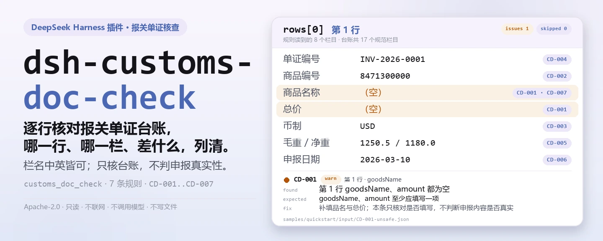
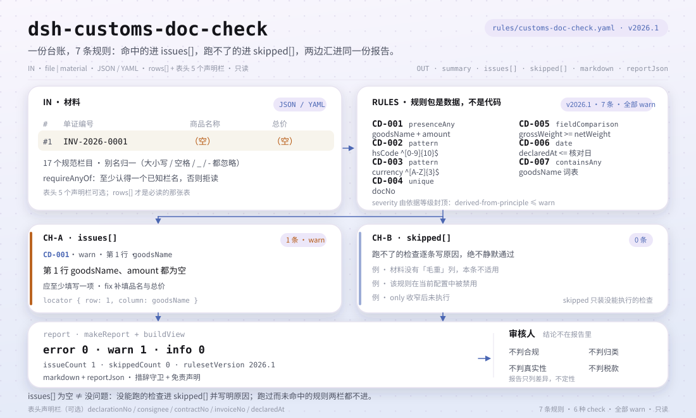

<div align="center">

<picture>
  <source media="(prefers-color-scheme: dark)" srcset="docs/assets/dsh-customs-doc-check-hero-zh-dark.webp">
  
</picture>

# dsh-customs-doc-check

**把报关单证台账逐行核一遍——输出「哪一行、哪一栏、差什么、怎么补」的清单，结论留给审核人。**

面向 DeepSeek Harness 的数据型核查插件：读取一份报关单证台账（栏名可以是中文或英文），按随包的版本化规则包（CD-001..CD-007）逐条核对，只列材料内部能逐条指认的差异，不判合规、不认定责任。

[安装](#三步上手) · [配置](#配置) · [FAQ](#faq) · [简体中文](README.md) · [English](README.en.md) · [Español](README.es.md) · [Português](README.pt.md) · [हिन्दी](README.hi.md)

[](LICENSE)
[](#兼容性)
[](https://www.npmjs.com/package/dsh-customs-doc-check)
[](https://github.com/PerryLink/dsh-customs-doc-check/actions/workflows/ci.yml)
[](#兼容性)

[](https://github.com/PerryLink/dsh-customs-doc-check/stargazers)
[](https://www.npmjs.com/package/dsh-customs-doc-check)
[](https://dshfind.com/plugins/PerryLink/dsh-customs-doc-check?ref=badge)
[](https://securityscorecards.dev/viewer/?uri=github.com/PerryLink/dsh-customs-doc-check)
[](https://dsh.market/)
[](https://gitee.com/perrylink/dsh-customs-doc-check)

```sh
dsh plugin --profile <name> add dsh-customs-doc-check
```

</div>

<sub>社区插件，与 DeepSeek 官方无关。唯一仓库：<https://github.com/PerryLink/dsh-customs-doc-check>（Gitee 为镜像）。</sub>

## 它是什么

`dsh-customs-doc-check` 读取一份报关单证台账——栏名可以是中文或英文——核对这份台账自身，而不是它背后的申报：每行是否至少填写了品名与总价中的一项、商品编号是否为十位数字、币制是否为三位字母代码、单证编号是否重复、毛重是否不小于净重、已填写的申报日期是否可解析且不晚于核对日、品名栏是否残留未替换的模板占位符。

它不判定申报是否真实、是否构成申报不实、是否影响税款，也不判定货物是否应当查验或处罚。

- **给谁用**：报关员、单证员、外贸跟单；不用懂命令行，在对话里把材料交给它即可。
- **你交什么**：这项核对用到的原始材料（表格、清单或文书）；不改原件。Excel 可先转成 JSON/YAML，对话里也能代转。
- **它交什么**：一份「哪一行、哪一栏、差什么、怎么补」的清单；没能执行的检查逐条列入 `skipped` 并写明原因。

<picture>
  <source media="(prefers-color-scheme: dark)" srcset="docs/assets/dsh-customs-doc-check-flow-v5-dark.svg">
  
</picture>

## 三步上手

1. **安装**（三选一）：

   ```sh
   # git 通道（最新 main；等价于 git+https://github.com/PerryLink/dsh-customs-doc-check.git）
   dsh plugin --profile <name> add github:PerryLink/dsh-customs-doc-check
   # npm 通道（已发布版本）
   dsh plugin --profile <name> add dsh-customs-doc-check
   # tarball 通道：本仓库 pnpm pack 后
   dsh plugin --profile <name> add ./dsh-customs-doc-check-<version>.tgz
   ```

2. **最小配置**（默认即可用；bundle 行不带 `config` 时全部走默认值，规则包路径指向随包的 `rules/customs-doc-check.yaml`）：

   ```yaml
   - insert:
       - id: dsh-customs-doc-check
         name: dsh-customs-doc-check
   ```

3. **验证已生效**：

   ```sh
   dsh --profile <name> --dump-config | grep 'dsh-customs-doc-check'
   ```

   然后用仓内自带样例跑一次（需先 `pnpm run build` 产出 `lib/`）：

   ```sh
   node samples/quickstart/run.mjs --check
   ```

   输出（对应 `samples/quickstart/expected/result.json`）：

   ```text
   customs_doc_check: 1 issue(s) — error 0, warn 1, info 0
   skipped: 0
   ```

   截图见 `docs/assets/quickstart.png`。

**卸载**：`dsh plugin --profile <name> remove dsh-customs-doc-check`（或从 profile patch 删掉该行）。

<details>
<summary>在 WorkBuddy / 扣子中使用</summary>

在 WorkBuddy / 扣子搜「关务合规核对包」（本检查是其中一项；上架以商城为准）即可调用同一套核对能力，无需命令行。

</details>

<details>
<summary>从 DSH Desktop 市场安装</summary>

所有 PerryLink 插件均可在 DSH Desktop 内置市场中浏览：**市场 → 来源 → 添加来源 → 粘贴** `https://perrylink-dsh-catalog.perrylink.workers.dev/catalog-source.json` **→ 选中**。安装仍需通过市场的 npm 身份校验与你的确认。

</details>

## 核心能力

`dsh-customs-doc-check` 注册 `customs_doc_check` 工具：读入一份报关单证台账（栏名可以是中文或英文），套用版本化规则包，返回一份报告。

- **七条规则一包带走** —— 规则包是数据不是代码（`rules/customs-doc-check.yaml`）；换掉规则包即换掉整套检查，不动一行 TypeScript。
- **只读材料** —— 接受 JSON 或 YAML，原件永不修改；纯 ESM，无网络请求、不调用模型。
- **引文不造假** —— 每条规则带 `document` / `number` / `clause` / `excerpt` / `kind` / `source`；`excerpt` 必须是逐字引文，本次未取得原文的规则在 `excerpt` 里如实写明并标为 `derived-from-principle`。
- **严重级跟着证据走** —— `derived-from-principle` 最高 `warn`，本机构配置（`institutional-configuration`）最高 `info`，并有测试断言。
- **空清单 ≠ 没问题** —— 每条没能执行的检查都进 `skipped` 并写明原因；必填清单未配置的规则自我报告 `skipped`，绝不静默通过。
- **措辞不作裁决** —— 报告只列差异，不判定合规、责任或正确性；措辞守卫（wording guard）强制执行，报告永远附带免责声明。

| 规则 | 核对内容 | 严重级 | 依据类别 |
|---|---|---|---|
| `CD-001` | 台账记录了品名与总价 | warn | principle |
| `CD-002` | 商品编号为十位数字 | warn | principle |
| `CD-003` | 币制为三位字母代码 | warn | principle |
| `CD-004` | 单证编号在台账内唯一 | warn | principle |
| `CD-005` | 毛重不小于净重 | warn | principle |
| `CD-006` | 申报日期可解析且不在未来 | warn | principle |
| `CD-007` | 品名栏不残留未替换的占位符 | warn | principle |

### 示例

以下为插件真实入口；安装后调用一次即可。第一行是详细走查，其余是简短案例。

**详细示例** — 工具 `customs_doc_check`，输入：

```json
{"rows":[{"单证种类":"发票","商品名称":"","总价":"", ...}]}
```

输出：

```json
{
  "id": "dsh-customs-doc-check.CD-001.de09b5a6",
  "ruleId": "CD-001",
  "severity": "warn",
  "locator": {
    "row": 1,
    "field": "goodsName"
  },
  "found": "第 1 行 goodsName、amount 都为空",
  "expected": "goodsName、amount 至少应填写一项",
  "fix": "补填品名与总价；本条只核对是否填写，不判断申报内容是否真实"
}
```

*Observed from `dsh-customs-doc-check/tests/fixtures/CD-001/CD-001-unsafe.json; dsh-customs-doc-check/tests/fixtures/CD-001/cases.json; dsh-customs-doc-check/rules/customs-doc-check.yaml; dsh-customs-doc-check/tests/index.test.ts`*

本插件对自己 `CD-001` 测试夹具的真实输出，不是示意图。规则库不伪造引文，因此每条发现都会同时写明所引条款，以及该条款原文本次未取得。

| 你会问 | 它怎么答 |
|---|---|
| 某行的品名还写着 `待填`，总价栏是空的——会被报出来吗？ | `CD-001` 不会报：它只要求品名与总价至少填写一项，而 `待填` 不是空白。报出这一行的是 `CD-007`，它在品名栏里查找规则库列出的占位符（`【`、`{{`、`XXX`、`待填`、`TBD` 等）。`CD-001` 不判断申报内容是否真实；`CD-007` 只在这一栏里找这些词，词表可按本机构模板调整。 |
| 商品编号写成了 `84713000`，只有八位——会报出来吗？ | 会。`CD-002` 拿这一栏与十位数字比对，不符合即报出。它只核对位数与字符合法性，绝不判断归类是否正确——同一商品在不同归类决定下可能使用不同编号。位数是本条的 `pattern` 参数，当年税则位数调整时改它即可。 |
| 币制栏一行写 `RMB`，另一行写 `usd`——哪一行会被报出？ | `usd`：`CD-003` 只接受三位大写字母。`RMB` 符合这个形态，因而通过——本条是形态核对，不是条文措辞；条文所指向的代码表本次未取得，本条也不替使用方规定 `CNY` 与 `RMB` 这两种写法该用哪个；若本机构固定一种写法，把 `pattern` 收紧即可。它不判断所选币制是否与实际结算币别相符。 |
| 同一个单证编号出现在两行里——会怎么报？ | `CD-004` 报出重复的单证编号，比较时忽略空白字符。本条只核实「唯一」这一件事：命中通常意味着同一份单证被登记了两次，或编号抄错，究竟哪一条对需人工确认。它不判断哪一条登记才是有效的。 |
| 毛重写 `1,180`、净重写 `1,250`，会被查出来吗？某行没填净重又会怎样？ | 前者会报出：`CD-005` 比较这两个数值，毛重小于净重时逐行报出。本条只做数值比较，可带单位（如 `12.5KGS`），也不判断重量申报是否真实。缺其中一栏的行根本不参与比较；若因此没有任何行可比较，本条进 `skipped` 并给出原因，而不是被当作差异报出。 |
| 台账里根本没有申报日期，还有一行的日期写的是 `2026-13-40`——分别怎么报？ | 不可能的日期会报出：`CD-006` 要求日期可解析，且不晚于核对日。没有申报日期不会被报为缺陷——该栏在申报时免予填报，由海关计算机系统在接受申报数据时记录，所以本条只核对填了的日期。无法解析的日期会单独报出，不会静默跳过；本条也不判断申报是否在法定期限内。 |

## 依据的标准

| 文件 | 文号 | 引用它的规则 |
|---|---|---|
| 《中华人民共和国海关进出口货物报关单填制规范》 | 海关总署公告 2019 年第 18 号（本次未取得条文） | CD-001, CD-002, CD-005, CD-007 |
| 《表示货币的代码》 | GB/T 12406—2022（表示货币的代码；2022-12-30 发布并实施；全部代替 GB/T 12406—2008（该版名称为「表示货币和资金的代码」）——注意旧版名称含"资金"；修改采用 ISO 4217:2015，非等同采用；条号本次未取得） | CD-003 |
| 《中华人民共和国海关进出口货物申报管理规定》 | 海关总署令（现行令号本次未核实） | CD-004, CD-006 |

**边界：** 本插件核对一份**报关单证台账**，范围限于登记表可以机械判定的事项——关键栏目是否填写，商品编码与币制是否符合各自的形式，单证编号是否唯一，毛重是否不低于净重，日期是否可解析，以及是否残留模板占位符。它**不**判定申报是否真实、是否构成申报不实、是否影响税款，也不判定货物是否应当查验或处罚。**这些判断属于海关**；同一批货物在不同的归类决定下可以正当地对应不同的编码。**本插件从不判定归类。**

> ### ⚠️ 在采信报告中的引文之前，请先读这一段
>
> **《中华人民共和国海关进出口货物报关单填制规范》已完整取得并逐条阅读**（49 条正文加结尾定义），
> `rules/evidence/clause-verification.md` 记录了所引内容：第 34 条（商品编码为**10 位数字**）、
> 第 5 条与第 6 条（日期为**8 位数字**，年-月-日；而且——值得知道——申报日期「**在申报时免予填报**」，
> 因此台账缺少该日期是正常的）、第 39 条（币制取自《货币代码表》）、第 24–26 条（件数、毛重与净重）
> 以及第 38 条。**发布事实已对照官方公告确认**：《海关总署公告 2019 年第 18 号》，日期为 2019-01-22，
> **自 2019-02-01 起施行，并废止了海关总署 2018 年第 60 号公告**，因此援引后者完全是错误的。
> 《进（出）境货物备案清单》**比照**本规范填制。
>
> **因此更正了两处主张。** `CD-003` 曾说币制“应为三个字母”——该条只说「按海关规定的《货币代码表》
> 选择相应的货币名称及代码填报」，而该代码表**本次未取得**，所以“三个字母”只是对该表形态的推断，
> 而不是条文措辞。`CD-006` 现在改为写明上述豁免，而不是暗示缺少申报日期就是缺陷。
>
> **每一条 `excerpt` 仍写着“本次未取得”，每条规则也仍为 `warn` 或 `info`**——这是有意为之。
> 该规范规定的是**报关单各栏如何填制**，而本插件核对的是企业的**随附单证台账**。台账不是报关单，
> 因此把规则提升为 `direct` 会把台账缺口包装成海关义务。**《申报管理规定》以及各类代码表（关区、
> 运输方式、监管方式、货币、国别、港口等）均未取得**，这正是没有内置任何代码表的原因。规范正文
> 本身是从**当地贸促会的转载**读取的，因为官方附件是 `.doc` 文件，而本工具无法解码二进制 Office
> 文件。
>
> 有两项检查值得单独说明。商品编码检查只核对**十位数字，别的什么都不核对**——位数来自现行税则，
> 该检查从不判断编码是否为*正确*的编码。币制检查核对**三个大写字母**，并刻意不对 `CNY` 与海关
> 实务同样使用的 `RMB` 拼法采取立场；如果你的机构风格只用其中一种，请收窄该模式。

## 配置

全部可调参数都是 `src/config.ts` 里的 Schemastery `Config` 字段（可从 cordis.yml 覆盖），逐条阈值在 `rules/` 下的规则库文件里。按 id 覆盖会替换整行——请重述所有需要的键。

| 键 | 类型 | 默认值 | 说明 |
|---|---|---|---|
| `rulesFile` | string | `rules/customs-doc-check.yaml` | 规则库文件路径，相对插件包根目录 |
| `disabledRules` | string[] | `[]` | 要停用的规则 id 列表；每条都会出现在 `skipped` 中 |
| `onlyRules` | string[] | `[]` | 只执行这些规则 id；留空表示执行全部规则 |
| `skipNotes` | string | `""` | 附加到每条 `skipped` 说明后的备注 |
| `timeoutMs` | number | `120000` | 工具协作式超时预算（毫秒） |

值得了解的规则级参数：

- `CD-002` `pattern` —— 商品编码的形态；默认要求十位数字。税则位数调整时改这里。
- `CD-003` `pattern` —— 币制的形态；默认要求三个大写字母。若本机构固定一种写法，把它收紧。
- `CD-005` `relation` —— 毛重与净重的比较关系，默认 `gte`。
- `CD-007` `terms` —— 要查找的模板占位符词表。

profile patch 覆盖示例：

```yaml
- insert:
    - id: dsh-customs-doc-check
      name: dsh-customs-doc-check
      config:
        disabledRules: [CD-007]
        timeoutMs: 180000
```

## 材料格式

工具接受 JSON 或 YAML：

```yaml
declarationNo: '530120260310000001'
consignee: 某某进出口有限公司
contractNo: SC-2026-018
rows:
  - { 单证种类: 发票, 单证编号: INV-2026-0001, 商品编号: '8471300000',
      商品名称: 便携式自动数据处理设备, 数量: '100', 总价: '45000.00', 币制: USD,
      毛重: '1250.5', 净重: '1180.0', 申报日期: 2026-03-10 }
```

列名匹配忽略大小写，并忽略空格、下划线与连字符；台账自己的列名会被保留，因此发现里写明的列就是它实际读到的列。数值栏可带单位与千分位（`12.5KGS`、`1,250.5`）。字段在读取层是可选的，由检查引擎校验，因此部分导出的材料会产生「缺项」类差异，而不是让程序崩溃。

## 规则来源

规则数据在 `rules/customs-doc-check.yaml`，与代码分离：每条规则都带文件名、文号、按原文自身编号体系的条款号、逐字摘录与来源地址。规则包头部完整写明本次引文缺口，每条规则的 `note` 复述与该条相关的部分。加载期守卫通常强制「摘录必须是不少于八个字符的真实引文」，但它分不清引文与描述——因此本规则包依靠头部声明、逐条 `note`，以及一条断言所有 `excerpt` 都承认缺口的测试来兜底。夸大依据的规则库会在加载期失败，而不会产出一份看起来很有底气的报告。核验中确认的边界与「刻意没有作出的结论」随包收录在 `rules/evidence/` 目录。

## FAQ

<details>
<summary>它会替我们下「合规 / 不合规」的结论吗？</summary>

不会。它只列出材料内部能逐条指认的差异（哪一行、哪一栏、差什么、怎么补），不下事实判断，也不评价合规性——结论永远留给审核人。报告措辞由 wording guard 强制约束，且每份报告都带免责声明。

</details>

<details>
<summary>我的台账是 Excel，能直接用吗？</summary>

可以，先转成 JSON 或 YAML；平台支持时在对话里就能代为转换。工具只读材料，永不修改原件。

</details>

<details>
<summary>为什么每条规则最高只到 `warn`，没有 `error`？</summary>

因为证据等级决定严重级：本次未取得逐字原文的规则一律标为 `derived-from-principle`，封顶 `warn`；阈值出自本机构配置的检查（`kind: institutional-configuration`）封顶 `info`。规则库加载时会拒绝夸大依据的 `error` 声明，并有测试断言这一封顶。

</details>

<details>
<summary>`issues` 为空能当作「没问题」吗？</summary>

不能。每条没能执行的检查都列在 `skipped` 里并写明原因（例如缺日期、缺净重、规则被停用）。判读报告时请把 `issues` 与 `skipped` 一起看完。

</details>

<details>
<summary>一整个季度的台账一起查，性能吃得消吗？</summary>

工具在 `native` 与 `ptc` 两种模式都能跑；批量校验（例如整季台账或整个目录）建议 `ptc`，schema 成本只付一次。检查本身是纯本地的列匹配与数值、日期算术，无网络请求、不调用模型；`timeoutMs`（默认 120 秒）是协作式超时预算。

</details>

## 排障

- **`CD-002` 对一个我知道有效的编码报错。** 该格不是恰好十位数字——可能带尾随空格、点号或子项后缀。先规范导出，或修改 `pattern`。
- **`CD-003` 对 `RMB` 报错。** 默认模式接受任意三个字母，所以这意味着该格不是三个字母——`RMB￥`、`人民币` 或小写代码都会失败。规范导出，或收紧模式。
- **`CD-006` 对一个未来日期报错。** 这正是检查的本意：申报日期晚于核对日，说明日期或核对基准至少有一个不对。
- **读取器拒绝了一份以前能接受的材料。** 它没有找到任何已知的列名；错误信息会列出它看到的列。
- **插件装上了但工具不出现。** 确认 `main` 解析到 `lib/index.mjs`，且 `pnpm run build` 已产出该文件；`main` 写错会让加载器静默跳过该条目。
- **`dsh plugin add` 以不兼容为由拒绝安装。** peer 范围覆盖 `0.1.x` 与 `0.2.x`；若运行时在其之外，可显式豁免：`dsh plugin --profile <name> allow-version dsh-customs-doc-check@0.1.0 --dsh-version <runtime> --accept-risk`
- **`check` 把 `manifest-peers` 报为失败。** 静态检查器比对的是一份早于 0.2 世代的硬编码 peer 范围；安装期的 peer 校验以运行时为准，声明的范围才是正确的。这是 `dsh-plugin-dev` 的已知上游问题。
- **时间看起来偏移。** 全部计算都是对输入字符串做墙上时钟运算，不做时区换算。

## 兼容性

| 项目 | 状态 |
|---|---|
| Harness | 对等版本范围 `>=0.1.2-rc.1 <0.2.0 \|\| >=0.2.0-0 <0.3.0` —— 已实测同时接受 `0.2.0-rc.2` 与 `0.2.1-rc.2`。已声明 `engines.dsh`：0.2.1 起由宿主单独裁决，范围为 `>=0.2.1-0 <0.3.0` |
| Node | `^22.19.0 \|\| >=24.0.0` |
| 平台 | 全平台（纯 ESM；无原生代码、无联网、不调用模型） |
| 工具模式 | `native` / `ptc` 均可；批量校验整个目录时建议 `ptc`，schema 成本只付一次 |

## 生态与质量

- [Gitee 镜像](https://gitee.com/perrylink/dsh-customs-doc-check)（同步镜像，以 GitHub 为准）
- [dshfind 插件页](https://dshfind.com/plugins/PerryLink/dsh-customs-doc-check)（安装量与排名）
- [OpenSSF Scorecard 报告](https://securityscorecards.dev/viewer/?uri=github.com/PerryLink/dsh-customs-doc-check)（由 [.github/workflows/scorecard.yml](.github/workflows/scorecard.yml) 驱动）
- [DSH Market](https://dsh.market/)（已上架）
- **1024 商店渠道**：先 `npm i -g dsh1024`，再 `dsh1024 plugin --profile <name> add dsh-customs-doc-check`（计入 [deepseek1024.com](https://deepseek1024.com) 安装排行）
- [生态实测知识库](https://perrylink.github.io/dsh-plugin-guide/)：插件开发指南 · 选型实测数据 · 维护取舍判据

## 开发

```sh
pnpm install                                        # node ^22.19 || >=24
pnpm run typecheck                                  # tsc --noEmit
pnpm test                                           # vitest：共享表格插件套件 + 成对夹具
pnpm run build                                      # tsdown -> lib/index.mjs + lib/index.d.mts
pnpm run verify:self-contained                      # 依赖 spec 均来自 registry
pnpm run check:lockfile                             # lockfile 漂移检查
pnpm run check:readmes                              # 五语 README 一致性
pnpm run check:citations                            # 规则包引文基线
node ../scripts/sync-shared.mjs dsh-customs-doc-check   # 从 ../_shared 刷新 src/shared
pnpm pack                                           # 发布 tarball
```

本插件是**数据型**的：`src/model.ts` 声明表格结构，共享套件提供读取器与检查引擎，规则包声明每一条检查；符合既有类型的检查只需改规则包，不必动代码。本地样例试跑（需先 `pnpm run build` 产出 `lib/`）：

```sh
node samples/quickstart/run.mjs --json
# => {"tool":"customs_doc_check","issueCount":1,"summary":{"error":0,"warn":1,"info":0},"skippedCount":0}
```

样例输入在 `samples/quickstart/input/`，期望输出在 `samples/quickstart/expected/result.json`，截图见 `docs/assets/quickstart.png`。README 配图由 [`scripts/gen-readme-assets.py`](scripts/gen-readme-assets.py) 程序化生成：hero 横幅用 Pillow（zh / en × 深浅共四张），结构图是手写 SVG（深浅双版）；可重复执行：`python scripts/gen-readme-assets.py`。旧的单版流程图、hero 与演示图保留在 `docs/assets/` 供外链使用，README 只引用新生成的四张 hero 与 flow-v5 双版。

Topics：`deepseek-harness`, `dsh`, `dsh-plugin`, `cordis`, `customs`, `doc`

## 家族与致谢

本项目是 [PerryLink](https://github.com/PerryLink) 维护的 DeepSeek Harness 插件家族成员（全部 Apache-2.0）。完整家族索引见[按材料选核查器](https://perrylink.github.io/zh/checkers/choose/)。如果这个插件帮到了你，**给个 star**——它不解锁任何功能，但会让下一个人更容易找到它。

- [@PerryLink](https://github.com/PerryLink) —— 创建者与维护者：数据型规则包（CD-001..CD-007）、`customs_doc_check` 工具、引文核验记录与五语文档。

<details>
<summary>展开全部插件</summary>

| 插件 | 状态 |
|---|---|
| **[dsh-aqua-input-check](https://github.com/PerryLink/dsh-aqua-input-check)** |  |
| **[dsh-archive-check](https://github.com/PerryLink/dsh-archive-check)** |  |
| **[dsh-auto-review](https://github.com/PerryLink/dsh-auto-review)** |  |
| **[dsh-autotier](https://github.com/PerryLink/dsh-autotier)** | 🧊 已冻结 — 见仓库 README |
| **[dsh-bid-ca-precheck](https://github.com/PerryLink/dsh-bid-ca-precheck)** |  |
| **[dsh-bid-qual-check](https://github.com/PerryLink/dsh-bid-qual-check)** |  |
| **[dsh-cert-mcp](https://github.com/PerryLink/dsh-cert-mcp)** | 🧊 已冻结 — 见仓库 README |
| **[dsh-checkpoint-rewind](https://github.com/PerryLink/dsh-checkpoint-rewind)** |  |
| **[dsh-click](https://github.com/PerryLink/dsh-click)** |  |
| **[dsh-composer-history](https://github.com/PerryLink/dsh-composer-history)** |  |
| **[dsh-contract-stance](https://github.com/PerryLink/dsh-contract-stance)** |  |
| **[dsh-customs-doc-check](https://github.com/PerryLink/dsh-customs-doc-check)** |  |
| **[dsh-data-quality](https://github.com/PerryLink/dsh-data-quality)** | 🧊 已冻结 — 见仓库 README |
| **[dsh-demurrage-ledger](https://github.com/PerryLink/dsh-demurrage-ledger)** |  |
| **[dsh-doublecheck](https://github.com/PerryLink/dsh-doublecheck)** |  |
| **[dsh-drill-script-check](https://github.com/PerryLink/dsh-drill-script-check)** |  |
| **[dsh-eia-guide-check](https://github.com/PerryLink/dsh-eia-guide-check)** |  |
| **[dsh-emergency-plan](https://github.com/PerryLink/dsh-emergency-plan)** |  |
| **[dsh-essay-rubric-check](https://github.com/PerryLink/dsh-essay-rubric-check)** |  |
| **[dsh-evidence-check](https://github.com/PerryLink/dsh-evidence-check)** |  |
| **[dsh-export-ctl-check](https://github.com/PerryLink/dsh-export-ctl-check)** |  |
| **[dsh-fast](https://github.com/PerryLink/dsh-fast)** |  |
| **[dsh-fmea-table-check](https://github.com/PerryLink/dsh-fmea-table-check)** |  |
| **[dsh-forecast-penalty](https://github.com/PerryLink/dsh-forecast-penalty)** |  |
| **[dsh-fund-research](https://github.com/PerryLink/dsh-fund-research)** |  |
| **[dsh-github](https://github.com/PerryLink/dsh-github)** |  |
| **[dsh-gongwen-flow-check](https://github.com/PerryLink/dsh-gongwen-flow-check)** |  |
| **[dsh-gongwen-word-check](https://github.com/PerryLink/dsh-gongwen-word-check)** |  |
| **[dsh-guard-plan-qc](https://github.com/PerryLink/dsh-guard-plan-qc)** |  |
| **[dsh-hazchem-check](https://github.com/PerryLink/dsh-hazchem-check)** |  |
| **[dsh-hazplan-check](https://github.com/PerryLink/dsh-hazplan-check)** |  |
| **[dsh-hidden-risk-map](https://github.com/PerryLink/dsh-hidden-risk-map)** |  |
| **[dsh-hs-classify](https://github.com/PerryLink/dsh-hs-classify)** |  |
| **[dsh-icd-rule-check](https://github.com/PerryLink/dsh-icd-rule-check)** |  |
| **[dsh-industry-research](https://github.com/PerryLink/dsh-industry-research)** |  |
| **[dsh-lawcite-adapter](https://github.com/PerryLink/dsh-lawcite-adapter)** |  |
| **[dsh-laya](https://github.com/PerryLink/dsh-laya)** |  |
| **[dsh-lc-doc-check](https://github.com/PerryLink/dsh-lc-doc-check)** |  |
| **[dsh-learning-gap-check](https://github.com/PerryLink/dsh-learning-gap-check)** |  |
| **[dsh-library](https://github.com/PerryLink/dsh-library)** |  |
| **[dsh-local-ai](https://github.com/PerryLink/dsh-local-ai)** |  |
| **[dsh-lsp-actions](https://github.com/PerryLink/dsh-lsp-actions)** |  |
| **[dsh-mask](https://github.com/PerryLink/dsh-mask)** |  |
| **[dsh-mcp-panel](https://github.com/PerryLink/dsh-mcp-panel)** |  |
| **[dsh-medrec-qc](https://github.com/PerryLink/dsh-medrec-qc)** |  |
| **[dsh-memento](https://github.com/PerryLink/dsh-memento)** | 🧊 已冻结 — 见仓库 README |
| **[dsh-nsfc-form-check](https://github.com/PerryLink/dsh-nsfc-form-check)** |  |
| **[dsh-nurse-record-check](https://github.com/PerryLink/dsh-nurse-record-check)** |  |
| **[dsh-observe](https://github.com/PerryLink/dsh-observe)** |  |
| **[dsh-origin-rvc-check](https://github.com/PerryLink/dsh-origin-rvc-check)** |  |
| **[dsh-ota-review-check](https://github.com/PerryLink/dsh-ota-review-check)** |  |
| **[dsh-output-styles](https://github.com/PerryLink/dsh-output-styles)** |  |
| **[dsh-paper-doc-adapter](https://github.com/PerryLink/dsh-paper-doc-adapter)** |  |
| **[dsh-permission-rules](https://github.com/PerryLink/dsh-permission-rules)** |  |
| **[dsh-permit-report-check](https://github.com/PerryLink/dsh-permit-report-check)** |  |
| **[dsh-pipeline-check](https://github.com/PerryLink/dsh-pipeline-check)** |  |
| **[dsh-pleading-draft](https://github.com/PerryLink/dsh-pleading-draft)** |  |
| **[dsh-plugin-doctor](https://github.com/PerryLink/dsh-plugin-doctor)** | 🚫 已退役（仓库已归档） |
| **[dsh-plugin-guide](https://github.com/PerryLink/dsh-plugin-guide)** |  |
| **[dsh-plugin-kit](https://github.com/PerryLink/dsh-plugin-kit)** | 🚫 已退役（仓库已归档） |
| **[dsh-plugin-upgrade](https://github.com/PerryLink/dsh-plugin-upgrade)** | 🚫 已退役（仓库已归档） |
| **[dsh-policy-brief-draft](https://github.com/PerryLink/dsh-policy-brief-draft)** |  |
| **[dsh-power-loss-split](https://github.com/PerryLink/dsh-power-loss-split)** |  |
| **[dsh-power-ticket-check](https://github.com/PerryLink/dsh-power-ticket-check)** |  |
| **[dsh-ppap-check](https://github.com/PerryLink/dsh-ppap-check)** |  |
| **[dsh-protest-deadline](https://github.com/PerryLink/dsh-protest-deadline)** |  |
| **[dsh-railway-window](https://github.com/PerryLink/dsh-railway-window)** |  |
| **[dsh-repair-order-qc](https://github.com/PerryLink/dsh-repair-order-qc)** |  |
| **[dsh-research-report](https://github.com/PerryLink/dsh-research-report)** |  |
| **[dsh-review-reply-check](https://github.com/PerryLink/dsh-review-reply-check)** |  |
| **[dsh-rulefile-check](https://github.com/PerryLink/dsh-rulefile-check)** |  |
| **[dsh-safety-brief-check](https://github.com/PerryLink/dsh-safety-brief-check)** |  |
| **[dsh-score](https://github.com/PerryLink/dsh-score)** | 🧊 已冻结 — 见仓库 README |
| **[dsh-session-sync](https://github.com/PerryLink/dsh-session-sync)** |  |
| **[dsh-site-log-check](https://github.com/PerryLink/dsh-site-log-check)** |  |
| **[dsh-skill-pack-security](https://github.com/PerryLink/dsh-skill-pack-security)** |  |
| **[dsh-soe-decision-check](https://github.com/PerryLink/dsh-soe-decision-check)** |  |
| **[dsh-soilwater-check](https://github.com/PerryLink/dsh-soilwater-check)** |  |
| **[dsh-sop-sync-check](https://github.com/PerryLink/dsh-sop-sync-check)** |  |
| **[dsh-spc-gbt-adapter](https://github.com/PerryLink/dsh-spc-gbt-adapter)** |  |
| **[dsh-talk](https://github.com/PerryLink/dsh-talk)** |  |
| **[dsh-tender-extract](https://github.com/PerryLink/dsh-tender-extract)** |  |
| **[dsh-tender-matrix](https://github.com/PerryLink/dsh-tender-matrix)** |  |
| **[dsh-test-drive](https://github.com/PerryLink/dsh-test-drive)** |  |
| **[dsh-ticktick](https://github.com/PerryLink/dsh-ticktick)** | 🚫 已退役（仓库已归档） |
| **[dsh-translate](https://github.com/PerryLink/dsh-translate)** |  |
| **[dsh-warranty-calc](https://github.com/PerryLink/dsh-warranty-calc)** |  |
| **[dsh-budget](https://github.com/PerryLink/dsh-budget)** | 🧊 已冻结 — 见仓库 README |
| **[dsh-claude-move](https://github.com/PerryLink/dsh-claude-move)** | 🧊 已冻结 — 见仓库 README |
| **[dsh-defend](https://github.com/PerryLink/dsh-defend)** | 🧊 已冻结 — 见仓库 README |
| **[dsh-draw](https://github.com/PerryLink/dsh-draw)** | 🧊 已冻结 — 见仓库 README |
| **[dsh-reach](https://github.com/PerryLink/dsh-reach)** | 🧊 已冻结 — 见仓库 README |
| **[dsh-background-agents](https://github.com/PerryLink/dsh-background-agents)** | 🚫 已退役（仓库已归档） |
| **[dsh-session-pin](https://github.com/PerryLink/dsh-session-pin)** | 🚫 已退役（仓库已归档） |
| **[dsh-team-rooms](https://github.com/PerryLink/dsh-team-rooms)** | 🚫 已退役（仓库已归档） |

</details>

## License

[LICENSE](LICENSE)（Apache License 2.0）© 2026 dsh-customs-doc-check contributors

<p align="center"><sub>Apache-2.0 · 社区插件，与 DeepSeek 无关。</sub></p>
