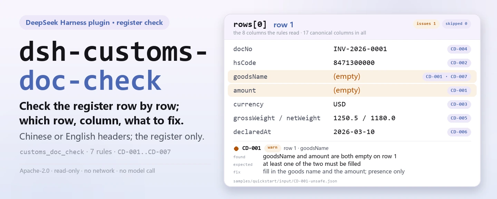

<div align="center">

<picture>
  <source media="(prefers-color-scheme: dark)" srcset="docs/assets/dsh-customs-doc-check-hero-en-dark.webp">
  
</picture>

# dsh-customs-doc-check

**Verifica linha a linha um registo de documentos de declaração aduaneira — obtém uma lista de que linha, que coluna e o que corrigir; o veredito fica com o revisor.**

Um plugin verificador de dados para o DeepSeek Harness: lê um registo de documentos de declaração (os nomes das colunas podem estar em chinês ou em inglês), aplica o pacote de regras versionado que traz (CD-001..CD-007) e lista apenas as diferenças que consegue apontar dentro do material — nunca um veredito de conformidade, nunca uma conclusão de responsabilidade.

[Instalar](#instalação-em-três-passos) · [Configuração](#configuração) · [FAQ](#faq) · [简体中文](README.md) · [English](README.en.md) · [Español](README.es.md) · [Português](README.pt.md) · [हिन्दी](README.hi.md)

[](LICENSE)
[](#compatibilidade)
[](https://www.npmjs.com/package/dsh-customs-doc-check)
[](https://github.com/PerryLink/dsh-customs-doc-check/actions/workflows/ci.yml)
[](#compatibilidade)

[](https://github.com/PerryLink/dsh-customs-doc-check/stargazers)
[](https://www.npmjs.com/package/dsh-customs-doc-check)
[](https://dshfind.com/plugins/PerryLink/dsh-customs-doc-check?ref=badge)
[](https://securityscorecards.dev/viewer/?uri=github.com/PerryLink/dsh-customs-doc-check)
[](https://dsh.market/)
[](https://gitee.com/perrylink/dsh-customs-doc-check)

```sh
dsh plugin --profile <name> add dsh-customs-doc-check
```

</div>

<sub>Plugin da comunidade, sem afiliação com a DeepSeek. Repositório canónico: <https://github.com/PerryLink/dsh-customs-doc-check> (o Gitee é um espelho).</sub>

## O que é

`dsh-customs-doc-check` lê um registo de documentos de declaração (报关单证台账) —cujos nomes de coluna podem estar em chinês ou em inglês— e verifica esse registo em si mesmo, não a declaração por trás dele: que cada linha traga pelo menos um dos dois, o nome da mercadoria ou o montante total; que o código da mercadoria tenha dez dígitos e a moeda seja um código de três letras; que não se repita nenhum número de documento; que o peso bruto não seja inferior ao peso líquido; que a data de declaração, quando registada, seja analisável e não seja posterior à data de verificação; e que não reste nenhum marcador de modelo por substituir na coluna do nome da mercadoria.

Não decide se a declaração é verdadeira, se constitui uma declaração inexata, se afeta os direitos aduaneiros ou se a mercadoria deve ser inspecionada ou sancionada.

- **Para quem é**: declarantes aduaneiros, responsáveis de documentação comercial e agentes de comércio externo; não é preciso linha de comandos, basta entregar o material no chat.
- **O que entrega**: o material de origem sobre o qual a verificação trabalha (uma tabela, um registo ou um documento); o original nunca é modificado. O Excel pode ser convertido antes para JSON/YAML, no próprio chat se a plataforma o permitir.
- **O que recebe**: uma lista de «que linha, que coluna, o que falta, como corrigir»; cada verificação que não pôde ser executada aparece em `skipped` com o seu motivo.

<picture>
  <source media="(prefers-color-scheme: dark)" srcset="docs/assets/dsh-customs-doc-check-flow-v5-dark.svg">
  
</picture>

## Instalação em três passos

1. **Instale** (escolha um canal):

   ```sh
   # canal git (main mais recente; equivalente a git+https://github.com/PerryLink/dsh-customs-doc-check.git)
   dsh plugin --profile <name> add github:PerryLink/dsh-customs-doc-check
   # canal npm (versões publicadas)
   dsh plugin --profile <name> add dsh-customs-doc-check
   # canal tarball: pnpm pack neste repositório e depois
   dsh plugin --profile <name> add ./dsh-customs-doc-check-<version>.tgz
   ```

2. **Configuração mínima** (valores por omissão prontos a usar; uma linha bundle sem `config` aplica todos os valores por omissão e o caminho do pacote de regras aponta para o `rules/customs-doc-check.yaml` incluído):

   ```yaml
   - insert:
       - id: dsh-customs-doc-check
         name: dsh-customs-doc-check
   ```

3. **Verifique que monta**:

   ```sh
   dsh --profile <name> --dump-config | grep 'dsh-customs-doc-check'
   ```

   Depois execute a amostra incluída no repositório (requer `pnpm run build` antes para produzir `lib/`):

   ```sh
   node samples/quickstart/run.mjs --check
   ```

   Saída (esperada em `samples/quickstart/expected/result.json`):

   ```text
   customs_doc_check: 1 issue(s) — error 0, warn 1, info 0
   skipped: 0
   ```

   Captura em `docs/assets/quickstart.png`.

**Desinstalar**: `dsh plugin --profile <name> remove dsh-customs-doc-check` (ou remova a linha do patch do perfil).

<details>
<summary>Usá-lo no WorkBuddy / Coze</summary>

Procure «Customs Compliance Suite» no WorkBuddy / Coze (esta verificação é uma parte; disponibilidade conforme a loja) para invocar a mesma capacidade de verificação sem linha de comandos.

</details>

<details>
<summary>Instalar a partir do mercado do DSH Desktop</summary>

Todos os plugins PerryLink podem ser explorados no mercado integrado do DSH Desktop: **Mercado → Fontes → Adicionar fonte → cole** `https://perrylink-dsh-catalog.perrylink.workers.dev/catalog-source.json` **→ selecione**. A instalação continua a exigir a verificação de identidade npm do mercado e a sua confirmação.

</details>

## Capacidades principais

`dsh-customs-doc-check` regista a ferramenta `customs_doc_check`: lê um registo de documentos de declaração —com os nomes de coluna do próprio registo, em chinês ou em inglês—, aplica um pacote de regras versionado e devolve um relatório.

- **Sete regras num pacote de dados** — o pacote de regras é dados, não código (`rules/customs-doc-check.yaml`); substituí-lo troca todo o conjunto de regras sem tocar numa linha de TypeScript.
- **Apenas leitura sobre o material** — aceita JSON ou YAML e nunca modifica o original; ESM puro, sem pedidos de rede e sem chamadas ao modelo.
- **Sem citações inventadas** — cada regra leva `document` / `number` / `clause` / `excerpt` / `kind` / `source`; `excerpt` tem de ser uma citação literal, e as regras cujo texto da cláusula não foi obtido nesta passagem dizem-no no próprio `excerpt` e permanecem marcadas como `derived-from-principle`.
- **A severidade segue a evidência** — `derived-from-principle` tem como teto `warn`, a configuração institucional (`institutional-configuration`) tem como teto `info`, e um teste garante-o.
- **Uma lista vazia nunca é «está tudo bem»** — cada verificação que não pôde ser executada é reportada em `skipped` com o seu motivo; uma regra cuja lista obrigatória não está configurada auto-reporta-se em `skipped` em vez de passar em silêncio.
- **Sem redação adjudicadora** — o relatório enumera diferenças e nunca se pronuncia sobre conformidade, responsabilidade ou correção; um guardião de redação (wording guard) impõe-no e cada relatório leva o aviso legal.

| Regra | Verificação | Severidade | Tipo de base |
|---|---|---|---|
| `CD-001` | o registo anota nome da mercadoria e montante | warn | principle |
| `CD-002` | o código da mercadoria tem dez dígitos | warn | principle |
| `CD-003` | a moeda é um código de três letras | warn | principle |
| `CD-004` | os números de documento são únicos no registo | warn | principle |
| `CD-005` | o peso bruto não é inferior ao peso líquido | warn | principle |
| `CD-006` | a data de declaração é analisável e não é futura | warn | principle |
| `CD-007` | o nome da mercadoria não conserva marcadores por substituir | warn | principle |

### Exemplos

Estes são os pontos de entrada reais do plugin; instale uma vez e invoque um. A primeira linha da tabela seguinte é o percurso detalhado e as restantes são casos breves.

**Exemplo detalhado** — ferramenta `customs_doc_check`, entrada:

```json
{"rows":[{"单证种类":"发票","商品名称":"","总价":"", ...}]}
```

Saída:

```json
{
  "id": "dsh-customs-doc-check.CD-001.de09b5a6",
  "ruleId": "CD-001",
  "severity": "warn",
  "locator": {
    "row": 1,
    "field": "goodsName"
  },
  "found": "第 1 行 goodsName、amount 都为空",
  "expected": "goodsName、amount 至少应填写一项",
  "fix": "补填品名与总价；本条只核对是否填写，不判断申报内容是否真实"
}
```

*Observado em `dsh-customs-doc-check/tests/fixtures/CD-001/CD-001-unsafe.json; dsh-customs-doc-check/tests/fixtures/CD-001/cases.json; dsh-customs-doc-check/rules/customs-doc-check.yaml; dsh-customs-doc-check/tests/index.test.ts`*

Saída real deste plugin sobre o seu próprio fixture de teste `CD-001` — não é uma simulação. O pacote de regras não inventa citações, por isso cada achado nomeia a cláusula aplicada e avisa que o seu texto não foi obtido nesta passagem.

| Você pergunta | O que ele responde |
|---|---|
| Numa linha o nome da mercadoria ainda diz `待填` e a célula do montante está vazia — isso é reportado? | `CD-001` não: exige apenas que pelo menos um dos dois, o nome da mercadoria ou o montante total, esteja preenchido, e `待填` não está em branco. Quem reporta essa linha é `CD-007`, que procura na coluna do nome da mercadoria os marcadores de modelo que o pacote lista (`【`, `{{`, `XXX`, `待填`, `TBD` e afins). `CD-001` não julga se o conteúdo declarado é verdadeiro; `CD-007` procura apenas esses termos nessa coluna, e a sua lista de termos pode ser ajustada ao modelo da sua instituição. |
| O código da mercadoria está escrito `84713000`, com oito dígitos — isso é reportado? | Sim. `CD-002` compara a célula com dez dígitos e reporta qualquer outro caso. Verifica apenas o número de dígitos e a legalidade dos caracteres, nunca se o código é o correto: a mesma mercadoria pode legitimamente ter códigos diferentes sob decisões de classificação diferentes. O número de dígitos é o parâmetro `pattern` da regra, alterável quando a pauta aduaneira mudar o seu número de dígitos. |
| A coluna da moeda diz `RMB` numa linha e `usd` noutra — qual das linhas é reportada? | `usd`: `CD-003` aceita apenas três letras maiúsculas. `RMB` encaixa nessa forma e passa, porque a regra é uma verificação de forma e não a redação do artigo — a tabela de códigos para a qual o artigo remete não foi obtida, e a regra não toma posição entre as grafias `CNY` e `RMB` que a prática aduaneira também usa; restrinja o `pattern` se a sua instituição fixar uma só. Não julga se a moeda escolhida é a correta para a liquidação. |
| O mesmo número de documento aparece em duas linhas — o que diz a verificação? | `CD-004` reporta o número repetido; na comparação os espaços são ignorados. A unicidade é tudo o que a regra estabelece: um resultado costuma significar que o mesmo documento foi registado duas vezes ou que um número foi copiado de outro documento, e qual dos dois está errado cabe a uma pessoa confirmar. Não decide qual registo é o válido. |
| O peso bruto está `1,180` e o líquido `1,250` — isso é detetado? E se uma linha não tiver peso líquido? | O primeiro é reportado: `CD-005` compara os dois valores e reporta a linha em que o peso bruto é inferior ao líquido. Só os números são comparados e aceitam-se unidades (`12.5KGS`), e a regra nunca julga se o peso declarado é verdadeiro. Uma linha à qual falte um dos dois campos não é comparada de todo; se isso não deixar nada a comparar, a regra entra em `skipped` com o seu motivo em vez de ser reportada como diferença. |
| O registo não traz data de declaração nenhuma e uma linha tem `2026-13-40` — o que é reportado? | A data impossível é reportada: `CD-006` exige que a data seja analisável e não posterior à data de verificação. A falta da data de declaração não é reportada como defeito — no momento da declaração essa coluna é 免予填报, sendo registada pelo sistema informático aduaneiro e não pelo declarante, pelo que a regra só verifica a data quando ela consta. Uma data que não se consegue analisar é reportada à parte e nunca é omitida em silêncio, e a regra não julga se a declaração foi feita dentro de um prazo legal. |

## Normas que segue

| Documento | Número | Regras que o citam |
|---|---|---|
| 《中华人民共和国海关进出口货物报关单填制规范》 | 海关总署公告 2019 年第 18 号（本次未取得条文） | CD-001, CD-002, CD-005, CD-007 |
| 《表示货币的代码》 | GB/T 12406—2022（表示货币的代码；2022-12-30 发布并实施；全部代替 GB/T 12406—2008（该版名称为「表示货币和资金的代码」）——注意旧版名称含"资金"；修改采用 ISO 4217:2015，非等同采用；条号本次未取得） | CD-003 |
| 《中华人民共和国海关进出口货物申报管理规定》 | 海关总署令（现行令号本次未核实） | CD-004, CD-006 |

**Limite:** este plugin verifica um **registo de documentos de declaração aduaneira** no que um registo pode ser exigido mecanicamente: que as colunas-chave estejam preenchidas, que o código da mercadoria e a moeda sigam os seus formatos, que os números de documento sejam únicos, que o peso bruto não seja inferior ao líquido, que as datas sejam analisáveis e que não sobreviva nenhum marcador de modelo. **Não** decide se uma declaração é verdadeira, se constitui uma declaração inexata, se afeta os direitos aduaneiros ou se a mercadoria deve ser inspecionada ou sancionada. **Essas decisões pertencem à Alfândega**, e a mesma mercadoria pode legitimamente ter códigos diferentes sob decisões de classificação diferentes. **Este plugin nunca julga a classificação.**

> ### ⚠️ Leia isto antes de confiar numa citação do relatório
>
> **A 《中华人民共和国海关进出口货物报关单填制规范》 foi obtida na íntegra e lida artigo a artigo** (49 artigos mais as definições finais), e `rules/evidence/clause-verification.md` regista o que foi citado: o artigo 34 (o código da mercadoria são **10 dígitos**), os artigos 5 e 6 (as datas são de **8 dígitos**, ano-mês-dia, e — vale a pena saber — a data de declaração fica «**免予填报**», isenta de preenchimento no momento da declaração, pelo que um registo sem ela é normal), o artigo 39 (a moeda é retirada da 《货币代码表》), os artigos 24–26 (volumes, peso bruto e líquido) e o artigo 38. **Os factos de publicação foram confirmados contra o anúncio oficial**: 《海关总署公告 2019 年第 18 号》, de 2019-01-22, **em vigor desde 2019-02-01, e revogou o 《海关总署 2018 年第 60 号公告》**, pelo que citar este último é simplesmente um erro. A 《进（出）境货物备案清单》 é preenchida **por referência** a esta especificação.
>
> **Como consequência, corrigiram-se duas afirmações.** `CD-003` dizia que a moeda «deve ter três letras» — o artigo diz apenas «selecionar o nome e o código da moeda conforme a 《货币代码表》 fixada pela Alfândega», e essa tabela de códigos **não foi obtida**, pelo que «três letras» é uma inferência sobre a forma da tabela, não a redação do artigo. E `CD-006` passa a declarar a isenção acima em vez de insinuar que falta a data é um defeito.
>
> **Cada `excerpt` continua a admitir a lacuna e cada regra continua em `warn` ou `info`** — de propósito. A especificação regula **como se preenchem as colunas do formulário de declaração**, enquanto este plugin verifica o **registo de documentos de suporte** de uma empresa. Um registo não é um formulário de declaração, pelo que elevar uma regra a `direct` vestiria uma lacuna do registo como uma obrigação aduaneira. **A 《申报管理规定》 e as várias tabelas de códigos (distritos aduaneiros, modos de transporte, regimes de supervisão, moedas, países, portos, etc.) não foram obtidas**, e é exatamente por isso que não se incorpora nenhuma tabela de códigos. O texto da especificação foi lido de uma **reprodução do conselho local de promoção do comércio**, porque o anexo oficial é um `.doc` e esta ferramenta não consegue descodificar ficheiros Office binários.
>
> Duas verificações merecem uma nota própria. A do código da mercadoria verifica **dez dígitos e nada mais** — o número de dígitos vem da pauta em vigor, e a verificação nunca diz se um código é o código *correto*. A da moeda verifica **três letras maiúsculas** e deliberadamente não toma posição entre `CNY` e a grafia `RMB` que a prática aduaneira também usa; restrinja o padrão se a sua instituição se fixar numa.

## Configuração

Todos os parâmetros ajustáveis são campos `Config` de Schemastery em `src/config.ts` (alteráveis a partir de cordis.yml); os limites por regra vivem no pacote de regras em `rules/`. Uma substituição por id substitui a linha inteira: repita todas as chaves de que precisa.

| Chave | Tipo | Padrão | Descrição |
|---|---|---|---|
| `rulesFile` | string | `rules/customs-doc-check.yaml` | Caminho do pacote de regras, relativo à raiz do pacote |
| `disabledRules` | string[] | `[]` | Ids de regras a desativar; cada uma aparece em `skipped` |
| `onlyRules` | string[] | `[]` | Executar apenas estas regras; vazio executa todas |
| `skipNotes` | string | `""` | Nota acrescentada a cada motivo de `skipped` |
| `timeoutMs` | number | `120000` | Orçamento de tempo limite cooperativo da ferramenta |

Parâmetros por regra que vale a pena conhecer:

- `CD-002` `pattern` — a forma do código da mercadoria; por omissão exige dez dígitos. Altere quando a pauta mudar o número de dígitos.
- `CD-003` `pattern` — a forma da moeda; por omissão exige três letras maiúsculas. Restrinja a uma só grafia da moeda local se a sua instituição a fixar.
- `CD-005` `relation` — a comparação entre peso bruto e líquido, `gte` por omissão.
- `CD-007` `terms` — os marcadores a procurar.

Exemplo de substituição no patch do seu perfil:

```yaml
- insert:
    - id: dsh-customs-doc-check
      name: dsh-customs-doc-check
      config:
        disabledRules: [CD-007]
        timeoutMs: 180000
```

## Formato do material

A ferramenta aceita JSON ou YAML:

```yaml
declarationNo: '530120260310000001'
consignee: 某某进出口有限公司
contractNo: SC-2026-018
rows:
  - { 单证种类: 发票, 单证编号: INV-2026-0001, 商品编号: '8471300000',
      商品名称: 便携式自动数据处理设备, 数量: '100', 总价: '45000.00', 币制: USD,
      毛重: '1250.5', 净重: '1180.0', 申报日期: 2026-03-10 }
```

Os nomes de coluna são comparados sem distinguir maiúsculas e ignorando espaços, sublinhados e hífenes; os nomes próprios do registo são preservados, pelo que um achado nomeia a coluna que leu. As células numéricas podem levar unidades e separadores de milhares (`12.5KGS`, `1,250.5`). Os campos são opcionais na camada de leitura e validados pelo motor de verificação, pelo que uma exportação parcial produz achados de «elemento em falta» em vez de uma falha.

## Fontes das regras

Os dados das regras vivem em `rules/customs-doc-check.yaml`, separados do código: cada regra leva documento, número, cláusula na numeração própria da fonte, extrato literal e URL de origem. O cabeçalho do pacote declara por completo a lacuna de citações desta passagem, e o `note` de cada regra repete a parte que lhe diz respeito. O guardião de carga que normalmente impõe «um extrato tem de ser uma citação real de pelo menos oito caracteres» não distingue uma citação de uma descrição, pelo que este pacote se apoia no cabeçalho, nas notas por regra e num teste que garante que todo `excerpt` admite a lacuna. Um pacote que exagere a sua base falha ao carregar em vez de produzir um relatório com aspeto seguro. Os limites confirmados durante a verificação e as conclusões deliberadamente **não** afirmadas acompanham o pacote no diretório `rules/evidence/`.

## FAQ

<details>
<summary>Decide a conformidade por nós?</summary>

Não. Apenas enumera as diferenças que consegue apontar dentro do material (que linha, que coluna, o que falta, como corrigir) e não decide factos nem conformidade: a conclusão fica sempre com o revisor. Um guardião de redação impõe a redação do relatório e cada relatório leva o aviso legal.

</details>

<details>
<summary>O meu registo é um Excel. Posso usá-lo diretamente?</summary>

Sim: converta-o antes para JSON ou YAML; no chat a plataforma pode fazer a conversão por si, se o permitir. A ferramenta só lê o material e nunca modifica o original.

</details>

<details>
<summary>Porque é que nenhuma regra passa de `warn`? Onde está o `error`?</summary>

Porque o nível de evidência decide a severidade: uma regra cujo texto literal não foi obtido nesta passagem é marcada `derived-from-principle` e tem teto `warn`, enquanto uma verificação cujo limite vem da sua instituição (`institutional-configuration`) tem teto `info`. O pacote recusa ao carregar um `error` exagerado, e um teste garante o teto.

</details>

<details>
<summary>Uma lista `issues` vazia pode ser lida como «nada está errado»?</summary>

Não. Cada verificação que não pôde ser executada aparece em `skipped` com o seu motivo (uma data em falta, um peso líquido em falta, uma regra desativada). Leia `issues` e `skipped` em conjunto antes de tirar qualquer conclusão de um relatório.

</details>

<details>
<summary>Aguenta um trimestre inteiro de declarações de uma vez?</summary>

A ferramenta funciona nos modos `native` e `ptc`; para trabalho em lote (um trimestre de registos ou um diretório completo) use `ptc`, onde o custo do esquema é pago uma só vez. As verificações em si são comparação de colunas e aritmética numérica e de datas local: sem pedidos de rede e sem chamadas ao modelo; `timeoutMs` (120 s por omissão) é o orçamento de tempo limite cooperativo.

</details>

## Resolução de problemas

- **`CD-002` dispara num código que sei ser válido.** A célula não tem exatamente dez dígitos: pode levar um espaço final, um ponto ou um sufixo de subposição. Normalize a exportação ou altere `pattern`.
- **`CD-003` dispara em `RMB`.** O padrão por omissão aceita três letras quaisquer, pelo que isto significa que a célula não tem três letras: um sufixo de símbolo, o nome no idioma local ou um código em minúsculas falhariam. Normalize ou restrinja o padrão.
- **`CD-006` dispara numa data futura.** É essa a verificação: uma declaração datada depois da data de revisão significa que a data ou a base de revisão estão erradas.
- **O leitor recusa um registo que antes aceitava.** Não encontrou nenhum dos nomes de coluna conhecidos; o erro enumera as colunas que viu.
- **O plugin instala mas a ferramenta não aparece.** Confirme que `main` resolve para `lib/index.mjs` e que `pnpm run build` o produziu; um `main` errado faz o carregador saltar a entrada em silêncio.
- **`dsh plugin add` recusa o pacote por incompatível.** O intervalo de peers cobre `0.1.x` e `0.2.x`; se o seu runtime ficar fora, conceda uma isenção explícita: `dsh plugin --profile <name> allow-version dsh-customs-doc-check@0.1.0 --dsh-version <runtime> --accept-risk`
- **`check` reporta `manifest-peers` como falha.** O verificador estático compara com um intervalo de peers fixo no código, anterior à linha 0.2. O runtime impõe a compatibilidade na instalação, pelo que o intervalo declarado é o correto; é um problema conhecido a montante em `dsh-plugin-dev`.
- **Os horários parecem deslocados.** Toda a aritmética é de hora local sobre as cadeias fornecidas, sem conversão de fuso horário.

## Compatibilidade

| Superfície | Estado |
|---|---|
| Harness | Intervalo de peers `>=0.1.2-rc.1 <0.2.0 \|\| >=0.2.0-0 <0.3.0` — verificado para aceitar tanto `0.2.0-rc.2` como `0.2.1-rc.2`. **`engines.dsh` é declarado como `>=0.2.1-0 <0.3.0`** e o host aplica-o desde 0.2.1 |
| Node | `^22.19.0 \|\| >=24.0.0` |
| Plataformas | Todas (ESM puro; sem código nativo, sem rede, sem chamada ao modelo) |
| Modo de ferramenta | Funciona em `native` e `ptc`; para um lote de declarações use `ptc` |

## Ecossistema e qualidade

- [Espelho Gitee](https://gitee.com/perrylink/dsh-customs-doc-check) (espelho sincronizado; o GitHub é o canónico)
- [Página do plugin no dshfind](https://dshfind.com/plugins/PerryLink/dsh-customs-doc-check) (instalações e ranking)
- [Relatório OpenSSF Scorecard](https://securityscorecards.dev/viewer/?uri=github.com/PerryLink/dsh-customs-doc-check) (impulsionado por [.github/workflows/scorecard.yml](.github/workflows/scorecard.yml))
- [DSH Market](https://dsh.market/) (listado)
- **Canal da loja 1024**: `npm i -g dsh1024` uma vez e depois `dsh1024 plugin --profile <name> add dsh-customs-doc-check` (conta para o ranking de instalações de [deepseek1024.com](https://deepseek1024.com))
- [Base de conhecimento do ecossistema](https://perrylink.github.io/dsh-plugin-guide/): guia de desenvolvimento de plugins · dados medidos de seleção · critérios de manutenção

## Desenvolvimento

```sh
pnpm install                                        # node ^22.19 || >=24
pnpm run typecheck                                  # tsc --noEmit
pnpm test                                           # vitest: suite partilhada de plugins de tabela + fixtures emparelhados
pnpm run build                                      # tsdown -> lib/index.mjs + lib/index.d.mts
pnpm run verify:self-contained                      # as dependências resolvem a partir do registry
pnpm run check:lockfile                             # verificação de deriva do lockfile
pnpm run check:readmes                              # consistência dos README em cinco idiomas
pnpm run check:citations                            # linha de base de citações do pacote de regras
node ../scripts/sync-shared.mjs dsh-customs-doc-check   # atualiza src/shared a partir de ../_shared
pnpm pack                                           # tarball de publicação
```

O plugin é **só dados**: `src/model.ts` declara a forma da tabela, o kit partilhado fornece o leitor e o motor de verificação, e o pacote de regras declara cada verificação; uma verificação que caiba num tipo existente precisa apenas de uma alteração no pacote de regras e de mais nada. Execução local da amostra (requer `pnpm run build` antes para produzir `lib/`):

```sh
node samples/quickstart/run.mjs --json
# => {"tool":"customs_doc_check","issueCount":1,"summary":{"error":0,"warn":1,"info":0},"skippedCount":0}
```

A entrada da amostra está em `samples/quickstart/input/`, a saída esperada em `samples/quickstart/expected/result.json` e uma captura em `docs/assets/quickstart.png`. As imagens do README são geradas programaticamente por [`scripts/gen-readme-assets.py`](scripts/gen-readme-assets.py): as faixas hero com Pillow (zh / en × claro / escuro, quatro ficheiros) e o diagrama de estrutura como SVG escrito à mão (claro e escuro); podem ser executadas novamente: `python scripts/gen-readme-assets.py`. O diagrama de fluxo de pele única, o hero antigo e as imagens de demonstração permanecem em `docs/assets/` para ligações externas, enquanto os README apenas referenciam o novo conjunto de hero e o par flow-v5.

Topics: `deepseek-harness`, `dsh`, `dsh-plugin`, `cordis`, `customs`, `doc`

## Família e agradecimentos

Este projeto faz parte da família de plugins DeepSeek Harness da [PerryLink](https://github.com/PerryLink) (todos Apache-2.0). Índice completo: [escolher um verificador por material](https://perrylink.github.io/zh/checkers/choose/) e [todos os plugins](https://github.com/PerryLink). Se lhe for útil, **uma estrela ajuda a que a próxima pessoa o encontre** — nada fica bloqueado por isso.

- [@PerryLink](https://github.com/PerryLink) — criador e mantenedor: o pacote de regras de dados (CD-001..CD-007), a ferramenta `customs_doc_check`, o registo de verificação de citações e a documentação em cinco idiomas.

<details>
<summary>Expandir todos os plugins</summary>

| Plugin | Estado |
|---|---|
| **[dsh-aqua-input-check](https://github.com/PerryLink/dsh-aqua-input-check)** |  |
| **[dsh-archive-check](https://github.com/PerryLink/dsh-archive-check)** |  |
| **[dsh-auto-review](https://github.com/PerryLink/dsh-auto-review)** |  |
| **[dsh-autotier](https://github.com/PerryLink/dsh-autotier)** | 🧊 CONGELADO — ver o README do repo |
| **[dsh-bid-ca-precheck](https://github.com/PerryLink/dsh-bid-ca-precheck)** |  |
| **[dsh-bid-qual-check](https://github.com/PerryLink/dsh-bid-qual-check)** |  |
| **[dsh-cert-mcp](https://github.com/PerryLink/dsh-cert-mcp)** | 🧊 CONGELADO — ver o README do repo |
| **[dsh-checkpoint-rewind](https://github.com/PerryLink/dsh-checkpoint-rewind)** |  |
| **[dsh-click](https://github.com/PerryLink/dsh-click)** |  |
| **[dsh-composer-history](https://github.com/PerryLink/dsh-composer-history)** |  |
| **[dsh-contract-stance](https://github.com/PerryLink/dsh-contract-stance)** |  |
| **[dsh-customs-doc-check](https://github.com/PerryLink/dsh-customs-doc-check)** |  |
| **[dsh-data-quality](https://github.com/PerryLink/dsh-data-quality)** | 🧊 CONGELADO — ver o README do repo |
| **[dsh-demurrage-ledger](https://github.com/PerryLink/dsh-demurrage-ledger)** |  |
| **[dsh-doublecheck](https://github.com/PerryLink/dsh-doublecheck)** |  |
| **[dsh-drill-script-check](https://github.com/PerryLink/dsh-drill-script-check)** |  |
| **[dsh-eia-guide-check](https://github.com/PerryLink/dsh-eia-guide-check)** |  |
| **[dsh-emergency-plan](https://github.com/PerryLink/dsh-emergency-plan)** |  |
| **[dsh-essay-rubric-check](https://github.com/PerryLink/dsh-essay-rubric-check)** |  |
| **[dsh-evidence-check](https://github.com/PerryLink/dsh-evidence-check)** |  |
| **[dsh-export-ctl-check](https://github.com/PerryLink/dsh-export-ctl-check)** |  |
| **[dsh-fast](https://github.com/PerryLink/dsh-fast)** |  |
| **[dsh-fmea-table-check](https://github.com/PerryLink/dsh-fmea-table-check)** |  |
| **[dsh-forecast-penalty](https://github.com/PerryLink/dsh-forecast-penalty)** |  |
| **[dsh-fund-research](https://github.com/PerryLink/dsh-fund-research)** |  |
| **[dsh-github](https://github.com/PerryLink/dsh-github)** |  |
| **[dsh-gongwen-flow-check](https://github.com/PerryLink/dsh-gongwen-flow-check)** |  |
| **[dsh-gongwen-word-check](https://github.com/PerryLink/dsh-gongwen-word-check)** |  |
| **[dsh-guard-plan-qc](https://github.com/PerryLink/dsh-guard-plan-qc)** |  |
| **[dsh-hazchem-check](https://github.com/PerryLink/dsh-hazchem-check)** |  |
| **[dsh-hazplan-check](https://github.com/PerryLink/dsh-hazplan-check)** |  |
| **[dsh-hidden-risk-map](https://github.com/PerryLink/dsh-hidden-risk-map)** |  |
| **[dsh-hs-classify](https://github.com/PerryLink/dsh-hs-classify)** |  |
| **[dsh-icd-rule-check](https://github.com/PerryLink/dsh-icd-rule-check)** |  |
| **[dsh-industry-research](https://github.com/PerryLink/dsh-industry-research)** |  |
| **[dsh-lawcite-adapter](https://github.com/PerryLink/dsh-lawcite-adapter)** |  |
| **[dsh-laya](https://github.com/PerryLink/dsh-laya)** |  |
| **[dsh-lc-doc-check](https://github.com/PerryLink/dsh-lc-doc-check)** |  |
| **[dsh-learning-gap-check](https://github.com/PerryLink/dsh-learning-gap-check)** |  |
| **[dsh-library](https://github.com/PerryLink/dsh-library)** |  |
| **[dsh-local-ai](https://github.com/PerryLink/dsh-local-ai)** |  |
| **[dsh-lsp-actions](https://github.com/PerryLink/dsh-lsp-actions)** |  |
| **[dsh-mask](https://github.com/PerryLink/dsh-mask)** |  |
| **[dsh-mcp-panel](https://github.com/PerryLink/dsh-mcp-panel)** |  |
| **[dsh-medrec-qc](https://github.com/PerryLink/dsh-medrec-qc)** |  |
| **[dsh-memento](https://github.com/PerryLink/dsh-memento)** | 🧊 CONGELADO — ver o README do repo |
| **[dsh-nsfc-form-check](https://github.com/PerryLink/dsh-nsfc-form-check)** |  |
| **[dsh-nurse-record-check](https://github.com/PerryLink/dsh-nurse-record-check)** |  |
| **[dsh-observe](https://github.com/PerryLink/dsh-observe)** |  |
| **[dsh-origin-rvc-check](https://github.com/PerryLink/dsh-origin-rvc-check)** |  |
| **[dsh-ota-review-check](https://github.com/PerryLink/dsh-ota-review-check)** |  |
| **[dsh-output-styles](https://github.com/PerryLink/dsh-output-styles)** |  |
| **[dsh-paper-doc-adapter](https://github.com/PerryLink/dsh-paper-doc-adapter)** |  |
| **[dsh-permission-rules](https://github.com/PerryLink/dsh-permission-rules)** |  |
| **[dsh-permit-report-check](https://github.com/PerryLink/dsh-permit-report-check)** |  |
| **[dsh-pipeline-check](https://github.com/PerryLink/dsh-pipeline-check)** |  |
| **[dsh-pleading-draft](https://github.com/PerryLink/dsh-pleading-draft)** |  |
| **[dsh-plugin-doctor](https://github.com/PerryLink/dsh-plugin-doctor)** | 🚫 APOSENTADO (repo arquivado) |
| **[dsh-plugin-guide](https://github.com/PerryLink/dsh-plugin-guide)** |  |
| **[dsh-plugin-kit](https://github.com/PerryLink/dsh-plugin-kit)** | 🚫 APOSENTADO (repo arquivado) |
| **[dsh-plugin-upgrade](https://github.com/PerryLink/dsh-plugin-upgrade)** | 🚫 APOSENTADO (repo arquivado) |
| **[dsh-policy-brief-draft](https://github.com/PerryLink/dsh-policy-brief-draft)** |  |
| **[dsh-power-loss-split](https://github.com/PerryLink/dsh-power-loss-split)** |  |
| **[dsh-power-ticket-check](https://github.com/PerryLink/dsh-power-ticket-check)** |  |
| **[dsh-ppap-check](https://github.com/PerryLink/dsh-ppap-check)** |  |
| **[dsh-protest-deadline](https://github.com/PerryLink/dsh-protest-deadline)** |  |
| **[dsh-railway-window](https://github.com/PerryLink/dsh-railway-window)** |  |
| **[dsh-repair-order-qc](https://github.com/PerryLink/dsh-repair-order-qc)** |  |
| **[dsh-research-report](https://github.com/PerryLink/dsh-research-report)** |  |
| **[dsh-review-reply-check](https://github.com/PerryLink/dsh-review-reply-check)** |  |
| **[dsh-rulefile-check](https://github.com/PerryLink/dsh-rulefile-check)** |  |
| **[dsh-safety-brief-check](https://github.com/PerryLink/dsh-safety-brief-check)** |  |
| **[dsh-score](https://github.com/PerryLink/dsh-score)** | 🧊 CONGELADO — ver o README do repo |
| **[dsh-session-sync](https://github.com/PerryLink/dsh-session-sync)** |  |
| **[dsh-site-log-check](https://github.com/PerryLink/dsh-site-log-check)** |  |
| **[dsh-skill-pack-security](https://github.com/PerryLink/dsh-skill-pack-security)** |  |
| **[dsh-soe-decision-check](https://github.com/PerryLink/dsh-soe-decision-check)** |  |
| **[dsh-soilwater-check](https://github.com/PerryLink/dsh-soilwater-check)** |  |
| **[dsh-sop-sync-check](https://github.com/PerryLink/dsh-sop-sync-check)** |  |
| **[dsh-spc-gbt-adapter](https://github.com/PerryLink/dsh-spc-gbt-adapter)** |  |
| **[dsh-talk](https://github.com/PerryLink/dsh-talk)** |  |
| **[dsh-tender-extract](https://github.com/PerryLink/dsh-tender-extract)** |  |
| **[dsh-tender-matrix](https://github.com/PerryLink/dsh-tender-matrix)** |  |
| **[dsh-test-drive](https://github.com/PerryLink/dsh-test-drive)** |  |
| **[dsh-ticktick](https://github.com/PerryLink/dsh-ticktick)** | 🚫 APOSENTADO (repo arquivado) |
| **[dsh-translate](https://github.com/PerryLink/dsh-translate)** |  |
| **[dsh-warranty-calc](https://github.com/PerryLink/dsh-warranty-calc)** |  |
| **[dsh-budget](https://github.com/PerryLink/dsh-budget)** | 🧊 CONGELADO — ver o README do repo |
| **[dsh-claude-move](https://github.com/PerryLink/dsh-claude-move)** | 🧊 CONGELADO — ver o README do repo |
| **[dsh-defend](https://github.com/PerryLink/dsh-defend)** | 🧊 CONGELADO — ver o README do repo |
| **[dsh-draw](https://github.com/PerryLink/dsh-draw)** | 🧊 CONGELADO — ver o README do repo |
| **[dsh-reach](https://github.com/PerryLink/dsh-reach)** | 🧊 CONGELADO — ver o README do repo |
| **[dsh-background-agents](https://github.com/PerryLink/dsh-background-agents)** | 🚫 APOSENTADO (repo arquivado) |
| **[dsh-session-pin](https://github.com/PerryLink/dsh-session-pin)** | 🚫 APOSENTADO (repo arquivado) |
| **[dsh-team-rooms](https://github.com/PerryLink/dsh-team-rooms)** | 🚫 APOSENTADO (repo arquivado) |

</details>

## Licença

[LICENSE](LICENSE) (Apache License 2.0) © 2026 dsh-customs-doc-check contributors

<p align="center"><sub>Apache-2.0 · Plugin da comunidade, sem afiliação com a DeepSeek.</sub></p>
